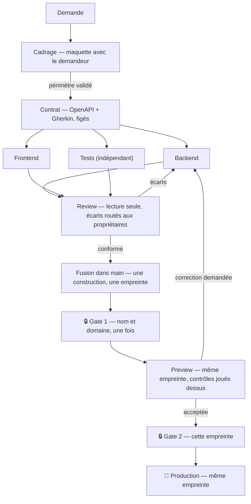
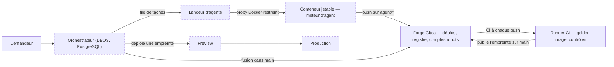

🇬🇧 [Read in English](README.md)

# EupaDev

**Une usine à outils logiciels en libre-service.** Quelqu'un explique, avec
ses mots, l'outil dont son équipe a besoin ; des agents IA le cadrent,
l'écrivent, le testent et le durcissent ; des humains approuvent à deux gates
avant que quoi que ce soit n'atteigne la production. Open core, Apache 2.0 : le moteur est
ici, les extensions propres à une organisation n'y sont pas.

> **Statut : pré-publication.** Sur les VM du labo, un cycle complet tourne
> de bout en bout avec un agent scripté (sans coût d'IA) : la forge Git et sa
> vraie CI, le moteur (DBOS) et ses gates, une image signée, une Preview avec
> ses tests, puis la Prod. Construit et prouvé par des tests réels : la forge
> avec ses comptes robots et ses protections de branche, le runner CI, la
> golden image, le moteur, le lanceur qui fait tourner Claude Code dans des
> conteneurs isolés, l'identité Keycloak avec validation à quatre yeux, le
> socle durci commun des outils générés, le pipeline du template et le
> déployeur. Pas encore construit : le tableau de bord et les pages de gate. Détails :
> [`docs/fr/architecture.md`](docs/fr/architecture.md), plan :
> [`ROADMAP.md`](ROADMAP.md) §8.

## Pourquoi

Donner de l'autonomie à un agent de codage rate de deux façons opposées :
verrouillé jusqu'à l'inutile, ou lâché jusqu'à devenir un risque. EupaDev
répond par un cycle où le travail exploratoire bon marché et le travail
rigoureux sont des étapes séparées, et par une usine où chaque pièce qu'un
agent pourrait détourner est mise hors de sa portée par construction, pas par
consigne.

## Pour qui — et pour qui ce n'est pas

**Pour** les ETI et les organisations industrielles qui doivent garder leurs
outils sur leurs propres serveurs, ont besoin d'outils à vraie logique métier
(workflows à plusieurs rôles, règles de validation, appels aux systèmes
internes), veulent posséder le code et la trace d'audit, et n'ont pas de
développeur disponible pour les écrire.

**Pas pour** :
- les formulaires, tableaux de bord ou écrans de saisie simples dans une
  organisation déjà sous Microsoft 365 : Power Apps, déjà payé, le fait plus vite ;
- les petites structures sans DSI pour héberger et exploiter la plateforme ;
- les équipes qui ont déjà des développeurs à l'aise avec les agents de code.

**Souverain sur l'exécution des outils, pas sur leur fabrication.** Les outils
générés tournent entièrement sur les serveurs de l'organisation. Leur
fabrication envoie la demande, la spécification et le code au fournisseur du
modèle, sous le compte de l'organisation ; un traitement dans l'UE est possible
via Amazon Bedrock ou Google Vertex AI. Voir
[`docs/fr/governance.md`](docs/fr/governance.md).

## Le cycle

1. **Cadrage** — un agent construit une maquette fonctionnelle avec le
   demandeur. Rien n'est encore audité ; le périmètre bouge.
2. **Contrat** — le périmètre validé devient une description OpenAPI et des
   scénarios Gherkin, puis est figé.
3. **Durcissement** — l'agent de tests écrit la suite d'acceptation à partir
   du contrat, puis l'agent builder écrit le code contre le contrat et cette
   suite, chacun sur sa branche et son dossier. L'agent de tests ne lit jamais
   le code : il ne partage aucun angle mort avec celui qui l'a écrit.
4. **Review** — deux relecteurs en lecture seule (sécurité, qualité) signalent
   les écarts ; seuls les rôles propriétaires sont relancés.
5. **Fusion, construction unique** — l'orchestrateur fusionne dans `main` ; la
   CI construit une seule image et enregistre son empreinte.
6. **Gate 1, Preview, Gate 2, Production** — un humain approuve le nom et le
   domaine une fois ; l'empreinte est déployée en Preview et contrôlée là ; un
   humain approuve cette empreinte précise ; la Production reçoit la même
   empreinte. Rien n'est reconstruit entre la Preview et la Production.

Qui tient chaque gate, budgets, décommissionnement :
[`docs/fr/governance.md`](docs/fr/governance.md).

### Ce que ce projet ne fait volontairement jamais

- **Déployer en production tout seul.** Deux gates humaines, la seconde sur
  une empreinte d'image précise.
- **Reconstruire entre deux environnements.** Ce qui tourne en Production est
  l'empreinte contrôlée en Preview.
- **Laisser un agent toucher à ses règles.** Sur les branches d'agent, la forge
  refuse au moment du push toute modification de la charte, des prompts de
  rôle, des règles d'analyse ou de la CI.
- **Faire confiance à l'agent.** Il tourne dans un conteneur jetable, derrière
  un proxy Docker restreint, avec des sorties réseau limitées aux adresses
  autorisées et un jeton qui peut pousser sur sa branche et rien d'autre.

## Comment ça s'articule

En pointillé : conçu, pas encore construit. Le moteur d'agent est
interchangeable derrière un contrat fixe (en entrée : dépôt, consigne, règles,
plafond de budget ; en sortie : code, rapport JSON, coût). Claude Code est le
moteur n°1 ; un moteur factice qui rejoue du code préparé permet de tester
toute la chaîne sans appel d'IA.

## Contenu de ce dépôt

| Chemin | Ce que c'est |
|---|---|
| [`infra/`](infra/) | Le labo, entièrement décrit en code : VM (Terraform), forge, runner et comptes robots (Ansible), services (Compose), tests réels (`verify-*.yml`). |
| [`images/base-node/`](images/base-node/) | La golden image dont part chaque image d'outil : durcie, non-root, reconstruite et scannée chaque semaine par la CI de la forge. |
| [`tool-template/`](tool-template/) | Le dépôt copié pour chaque nouvel outil : charte des agents (`AGENTS.md`), prompts de rôle, règles par domaine, briques livrées, règles d'analyse, pipelines CI, design system. |
| [`docs/`](docs/) | Documentation de la plateforme : [`architecture.md`](docs/architecture.md), [`governance.md`](docs/governance.md), traductions françaises sous `docs/fr/`. |
| [`ROADMAP.md`](ROADMAP.md) | La conception avec ses raisons : §1-7 les leçons de la v1, §8 la référence v2 (décisions, alternatives écartées, ordre de construction). |

## Démarrer

Tout ce qui existe sur une machine est décrit dans `infra/` ; rien n'est
configuré à la main. Reconstruire le labo de zéro, lancer les tests réels,
passer du labo à un hébergeur : [`infra/README.md`](infra/README.md).

## Principes

- **Le prompt guide, le code vérifie.** Toute règle vérifiable mécaniquement
  devient un contrôle : étape de CI, règle d'analyse, protection de branche.
  La charte reste courte.
- **La responsabilité vit côté relecteur.** L'agent qui écrit le code ne le
  déclare jamais conforme ; les tests d'acceptation sont écrits par un agent
  qui n'a pas vu le code.
- **Construire une fois, promouvoir par empreinte.** Approbations, résultats
  de contrôle et déploiements désignent tous une empreinte ; le retour arrière
  consiste à redéployer la précédente.
- **Fonctionne à N = 1 sur une petite VM.** Le parallèle accélère, il n'est
  jamais requis ; PostgreSQL est le seul composant d'infrastructure en plus.
- **Tester en vrai.** Sur les VM du labo, avec des tests qui nettoient derrière
  eux ; une simulation seulement quand le vrai test est risqué, en le disant.
- **Chaque installation garde ses données.** Ses décisions, ses leçons et les
  données de ses outils ne la quittent jamais.

## Contribuer

Voir [`CONTRIBUTING.fr.md`](CONTRIBUTING.fr.md).

## Licence

[Apache 2.0](LICENSE).
