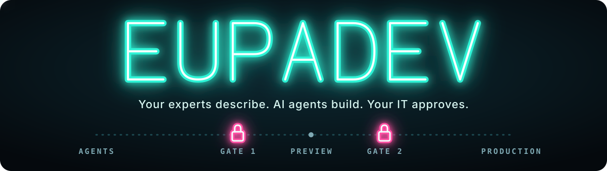
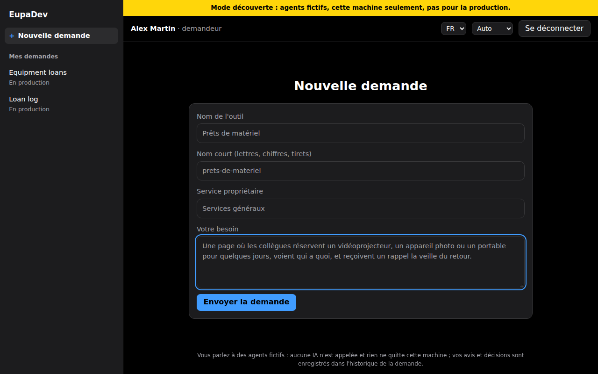
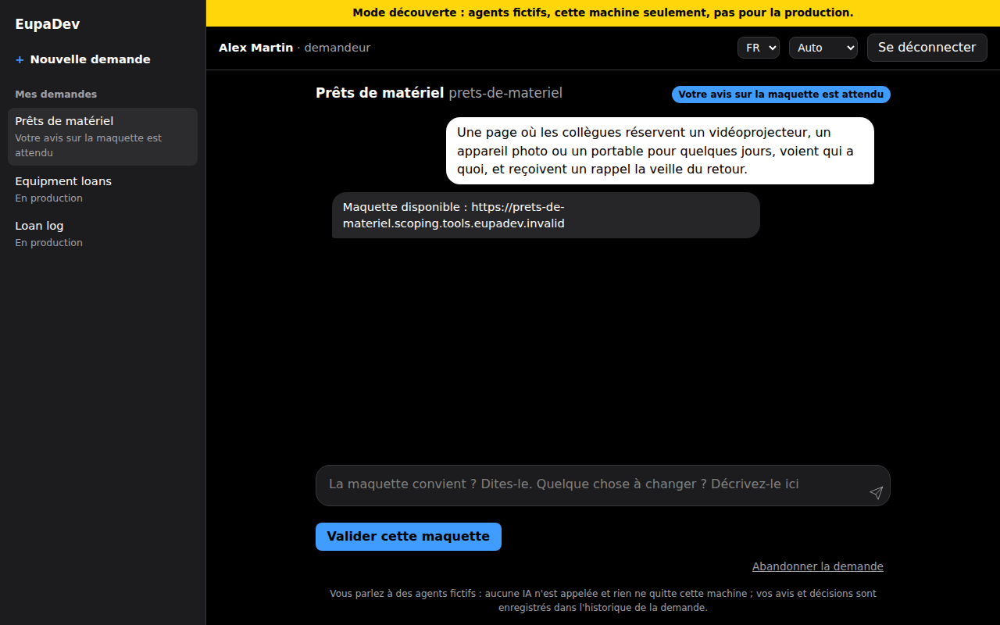
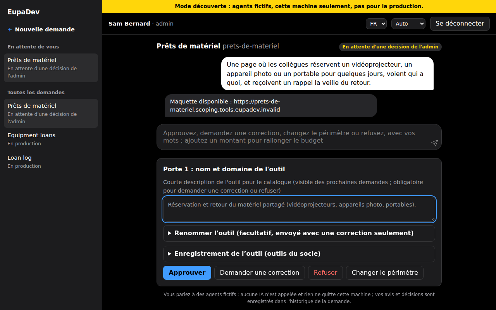
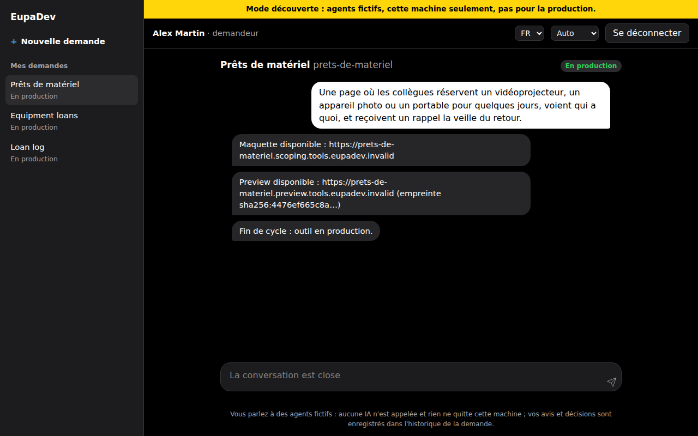
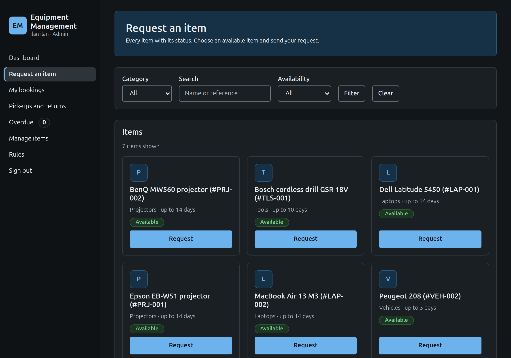
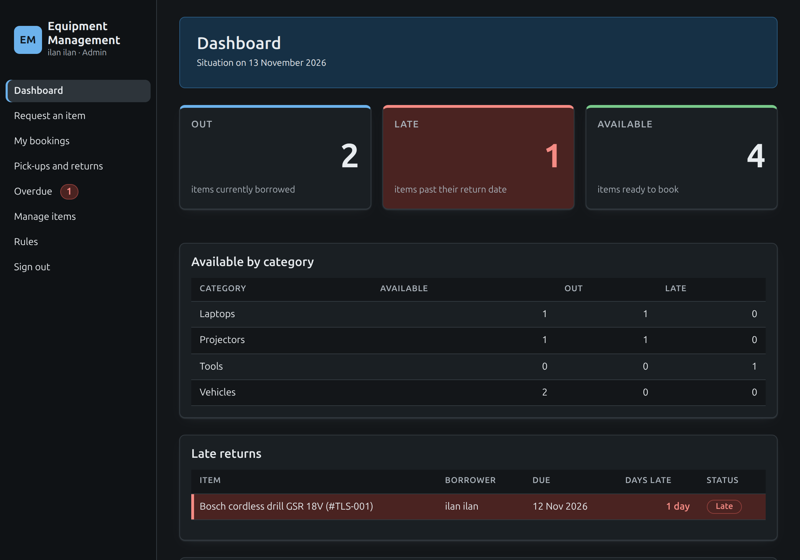
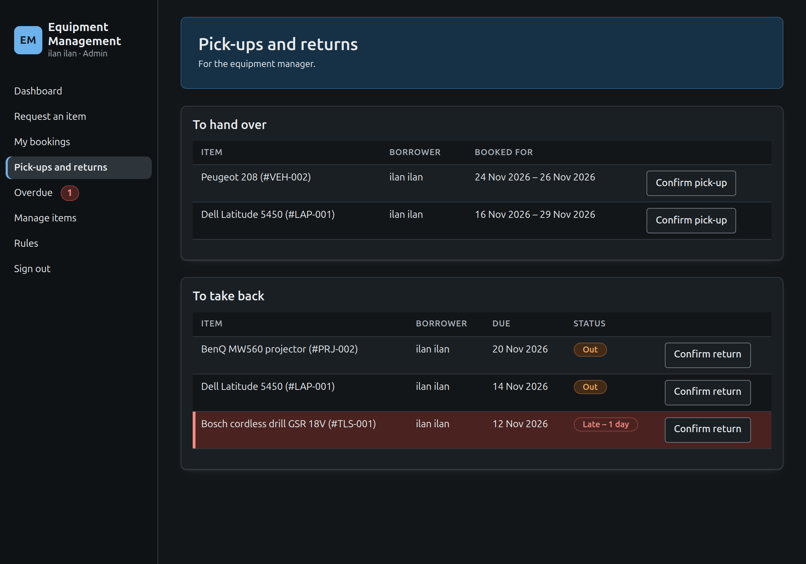
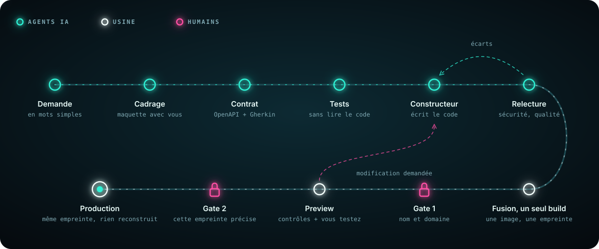
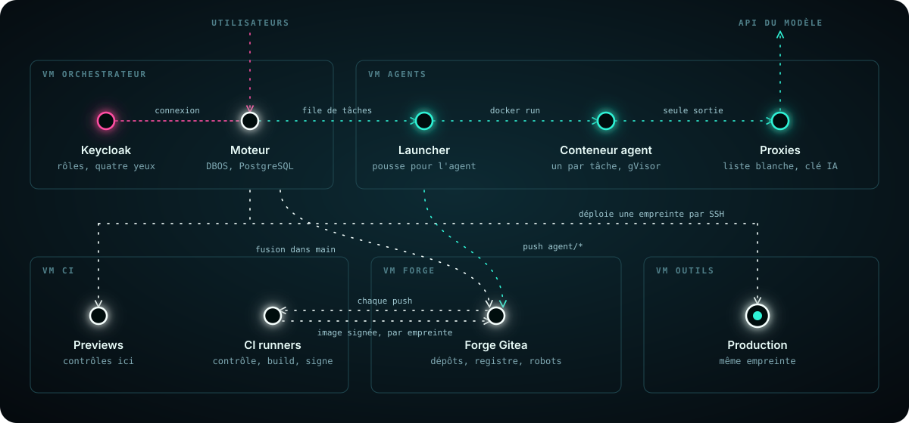

<div align="center">



**Vos experts métier décrivent l'outil dont ils ont besoin. Des agents IA le construisent dans les règles de l'art. Votre DSI approuve chaque mise en production. Tout tourne sur vos propres serveurs.**

[](LICENSE)
[](#statut)
[](CONTRIBUTING.fr.md)

[Architecture](docs/fr/architecture.md) · [Gouvernance](docs/fr/governance.md) · [Feuille de route](ROADMAP.md) · [Monter le labo](infra/README.md) · [Read in English](README.md)

</div>

<!-- screenshots: taken from the discovery mode by `node tests/install/screenshots.mjs`, 1280x800, dark theme -->
|  |  |
|:--:|:--:|
| Un salarié décrit l'outil dont il a besoin | L'agent de cadrage répond par une maquette à valider ou corriger |
|  |  |
| Gate 1 : la DSI nomme l'outil et le laisse continuer | Preview acceptée, Gate 2 approuvée : l'outil est en production |

<sub>Écrans du [mode découverte](docs/install.md) : des agents fictifs sur une seule machine, comme le bandeau le dit ; [les mails de ce cycle](docs/assets/screenshots/mails.fr.png) tombent dans un piège à mails local.</sub>

|  |  |  |
|:--:|:--:|:--:|
| Un outil vraiment construit par les agents, en production au labo | Son tableau de bord, pour le gestionnaire et l'admin | Son guichet : remettre, reprendre avec l'état de l'objet |

<sub>« Equipment Management » : construit par de vrais agents Claude Code sur le labo, de bout en bout (cadrage, maquette, contrat, tests, code, Preview, les deux gates), puis utilisé à la main.</sub>

## Essayer en dix minutes (mode découverte)

Une machine Linux avec Docker
Engine et son greffon Compose, environ 2 Gio de RAM libre, les ports 8080,
8081 et 8025 libres, Chrome ou Firefox. Agents factices, pas de clé d'IA,
rien ne quitte la machine :

```sh
git clone https://github.com/EupaDev-hq/eupadev.git
cd eupadev
sh install.sh check
sh install.sh discovery
```

`check` ne change rien ; `discovery` construit l'image du moteur la première
fois (plusieurs minutes), la démarre sur `127.0.0.1` et affiche **une seule
fois** les mots de passe des deux comptes, `requester` et `admin` : notez-les.
Ouvrez ensuite `http://localhost:8080/`, connectez-vous en `requester` pour
demander un outil, puis en `admin` pour décider aux portes ; les mails des
portes arrivent dans `http://localhost:8025/`. Tout retirer :
`sh install.sh uninstall`.

Jusqu'à la première release signée, cela tourne depuis une copie du dépôt et
affiche « signature not checked ». À partir de la première release,
téléchargez le script et vérifiez d'abord sa signature :
[`docs/fr/install.md`](docs/fr/install.md), qui couvre aussi la recette
entreprise.

## Pourquoi EupaDev existe

Imaginez une responsable d'équipe qui a besoin d'un petit outil : suivre les
prêts de matériel, consigner les incidents, relancer les fournisseurs, gérer
les demandes de congés. Aucun développeur n'est disponible, alors elle ouvre
un générateur d'applications par IA et, en un après-midi, obtient un premier
écran qui fonctionne sur son portable. Ça a l'air terminé. Ça ne l'est pas :
pas de serveur, pas de vraie base de données, pas de connexion, pas de
sauvegarde, et personne pour maintenir l'outil. Utilisé tous les jours par une
équipe, il perdrait des données, les ferait fuiter, ou les deux.

Cela se produit en ce moment, dans toutes les organisations à la fois. L'IA a
rendu la construction assez facile pour que les gens qui connaissent le métier
fabriquent leurs propres outils, sans la moindre notion de ce qu'est une base
de données ou un déploiement. Le résultat est une nouvelle vague de shadow IT :
des outils que personne n'a audités, hébergés nulle part en particulier, dont
personne n'est responsable.

EupaDev garde la bonne part de ce mouvement et en retire la part dangereuse.
La personne qui connaît le besoin le décrit ; l'ingénierie est faite comme une
équipe professionnelle la ferait ; et la DSI décide de ce qui passe en
production.

## Ce que c'est

EupaDev est une usine à outils auto-hébergée. Un salarié décrit un outil
métier avec ses mots. Un agent de cadrage construit avec lui une maquette
cliquable jusqu'à ce que le besoin soit juste. Puis une chaîne d'agents
transforme le périmètre validé en contrat figé, écrit les tests d'acceptation,
écrit le code, le relit et confie le résultat à une vraie CI. Deux humains
approuvent avant que quoi que ce soit n'atteigne la Production.

- **Du prompt à l'application, pour l'expert métier.** Le demandeur ne voit
  jamais de code : un chat, une maquette, puis une Preview qui fonctionne et
  qu'il essaie.
- **L'ingénierie est faite derrière.** Chaque outil est généré sur un socle
  durci commun (`@eupadev/core`) : connexion OIDC, PostgreSQL avec des rôles
  séparés, validation de chaque requête, journal d'audit en ajout seul,
  protections web, tests d'acceptation écrits à partir du contrat par un agent
  indépendant.
- **La DSI garde la main.** Un humain approuve une fois le nom et le domaine
  de l'outil (Gate 1), puis chaque version par l'empreinte exacte de son image
  (Gate 2), avec une règle des quatre yeux : le demandeur ne peut pas approuver
  son propre outil.
- **Les agents n'atteignent pas ce qu'ils pourraient détourner.** Conteneurs
  jetables sous gVisor, aucun jeton de la forge, sorties réseau limitées à une
  liste d'adresses, fichiers protégés refusés au moment du push. Par
  construction, pas par consigne.
- **Un registre unique des outils.** L'orchestrateur tient son propre registre
  et l'interroge avant le cadrage : une demande qui recoupe un outil existant
  remonte au product owner au lieu de produire un doublon.
- **Vos données restent chez vous.** Les outils générés, leurs bases de
  données et l'usine elle-même tournent sur vos serveurs. La seule chose qui
  sort est le travail des agents pendant la construction d'un outil, envoyé au
  fournisseur du modèle sous votre propre compte.

Open core, Apache 2.0 : le moteur est ici ; les extensions propres à une
organisation (modèles d'outils prêts à l'emploi, intégrations annuaire,
connecteurs ITSM) n'y sont pas.

## Statut

**Pré-publication.** Sur les VM du labo, un cycle complet tourne de bout en
bout avec un agent scripté, sans coût d'IA : la forge Git et sa vraie CI, le
moteur DBOS et ses gates, une image signée, une Preview avec ses contrôles,
puis la Production. Un vrai outil (un suivi de prêts de matériel) a été mené
par le modèle de la demande jusqu'à la Production au labo, en novembre 2026,
avec des corrections humaines en cours de route ; ce qui a raté et ce que cela
a coûté est écrit dans l'ADR-027 et [`docs/ai-error-log.md`](docs/ai-error-log.md).
Rien n'a encore tourné chez un client. Le tableau de bord et les pages de gate
ne sont pas construits : pour l'instant, les gates se décident par l'API locale
du moteur.
L'installation en une commande n'existe que pour le mode découverte, depuis un
clone de ce dépôt jusqu'à la première release signée
([`docs/fr/install.md`](docs/fr/install.md)) ; la plateforme elle-même, ce sont
cinq VM décrites en code dans [`infra/`](infra/README.md). Le statut pièce par
pièce, avec les
tests qui le prouvent : [`docs/fr/architecture.md`](docs/fr/architecture.md).

## Comment un outil se construit

<p align="center"></p>

1. **Cadrage.** Un agent construit une maquette fonctionnelle avec le
   demandeur. Rien n'est encore audité ; le périmètre bouge encore.
2. **Contrat.** Le périmètre validé devient une description OpenAPI et des
   scénarios Gherkin, puis est figé pour le cycle.
3. **Durcissement.** L'agent de tests écrit la suite d'acceptation à partir du
   contrat. Puis l'agent builder écrit le code contre le contrat et cette
   suite, qu'il peut lire mais pas modifier. Ils ne partagent aucun angle mort.
4. **Review.** Deux relecteurs en lecture seule signalent les écarts avec le
   fichier et la ligne ; seul le rôle propriétaire est relancé.
5. **Fusion et construction unique.** L'orchestrateur fusionne dans `main` ;
   la CI construit une seule image et enregistre son empreinte.
6. **Gate 1, Preview, Gate 2, Production.** L'empreinte est déployée en
   Preview, où tournent les contrôles de performance, d'accessibilité, de
   sécurité dynamique et la suite d'acceptation de l'outil ; le demandeur
   l'essaie ; une seconde personne approuve cette empreinte précise ; la
   Production reçoit les mêmes octets.

Qui tient chaque gate, les budgets par cycle, le décommissionnement :
[`docs/fr/governance.md`](docs/fr/governance.md).

## Ce que ce projet ne fait jamais

- **Déployer en production tout seul.** Deux gates humaines, la seconde sur
  une empreinte d'image précise.
- **Reconstruire entre deux environnements.** Ce qui tourne en Production est
  l'empreinte contrôlée en Preview.
- **Laisser un agent toucher à ses règles.** Sur les branches d'agent, la forge
  refuse au moment du push toute modification de la charte, des prompts de
  rôle, des règles d'analyse ou de la CI.
- **Faire confiance à l'agent.** Il tourne dans un conteneur jetable sous
  gVisor, sans socket Docker, avec des sorties réseau limitées aux adresses
  autorisées et sans aucun jeton de la forge : le lanceur pousse son travail
  sur sa propre branche et nulle part ailleurs.
- **Lire un e-mail pour prendre une décision.** Les gates se décident par une
  API authentifiée, avec enregistrement de qui, sous quelle casquette, et pour
  quelle empreinte.

Modèle de confiance complet, comptes robots et leurs droits :
[`docs/fr/architecture.md`](docs/fr/architecture.md#modèle-de-confiance).

## Pour qui

Les ETI et les organisations industrielles qui doivent garder leurs outils sur
leurs propres serveurs, ont besoin d'outils à vraie logique métier (workflows à
plusieurs rôles, règles de validation, appels aux systèmes internes), veulent
posséder le code et la trace d'audit, et n'ont pas de développeur à y
consacrer.

Probablement pas pour vous s'il vous faut des formulaires ou des tableaux de
bord simples et que vous payez déjà Microsoft 365 (Power Apps le fait plus
vite), si vous n'avez pas de DSI pour héberger et exploiter la plateforme, ou
si vos développeurs sont déjà à l'aise avec les agents de code.

**Souverain sur l'exécution des outils, pas sur leur fabrication.** Fabriquer
un outil envoie la demande, la spécification et le code au fournisseur du
modèle, sous le compte de votre organisation. La plateforme appelle
aujourd'hui l'API d'Anthropic ; Claude Code permet aussi un traitement dans
l'UE via Amazon Bedrock ou Google Vertex AI. Détails :
[`docs/fr/governance.md`](docs/fr/governance.md).

## Démarrer

Jusqu'à la première release, la vraie plateforme tourne sur le labo :
cinq VM (forge, CI, orchestrateur, agents, outils) créées par Terraform,
configurées par Ansible, lancées avec Docker Compose, et prouvées par de vrais
tests qui nettoient derrière eux. Rien n'est configuré à la main ; si ce n'est
pas dans `infra/`, ça n'existe pas.

Reconstruire le labo de zéro, lancer les tests, passer du labo à un
hébergeur : [`infra/README.md`](infra/README.md). Ce qu'une installation
demande chez un client : [`docs/client-prerequisites.md`](docs/client-prerequisites.md)
et [`docs/deployment.md`](docs/deployment.md).

## Contenu de ce dépôt

| Chemin | Ce que c'est |
|---|---|
| [`orchestrator/`](orchestrator/) | Le moteur : workflows DBOS du cycle et de ses gates, le lanceur d'agents, les adaptateurs de la forge, du déployeur, du mail et de Claude Code, la page web du demandeur. |
| [`core/`](core/) | `@eupadev/core`, le socle durci commun sur lequel tourne chaque outil généré : serveur, accès à la base, connexion, protections web, modules front, kit de tests de sécurité. |
| [`tool-template/`](tool-template/) | Le dépôt copié pour chaque nouvel outil : charte des agents (`AGENTS.md`), prompts de rôle, règles par domaine, règles d'analyse, pipelines CI, design system. |
| [`examples/requests/`](examples/requests/) | Un outil complet écrit à la main sur le socle : la référence qu'imitent les agents. |
| [`images/base-node/`](images/base-node/) | La golden image dont part chaque image d'outil : durcie, non-root, reconstruite et scannée chaque semaine par la CI de la forge. |
| [`infra/`](infra/) | Le labo en code : VM (Terraform), forge, runners et comptes robots (Ansible), services (Compose), tests réels (`verify-*.yml`). |
| [`docs/`](docs/) | [`install.md`](docs/install.md), [`architecture.md`](docs/architecture.md), [`governance.md`](docs/governance.md), [`deployment.md`](docs/deployment.md), les ADR dans [`adr/`](docs/adr/), les traductions françaises dans [`fr/`](docs/fr/). |
| [`ROADMAP.md`](ROADMAP.md) | La conception avec ses raisons : §1-6 les leçons de la v1, §8 la référence v2 (décisions, alternatives écartées, ordre de construction). |

<details>
<summary><strong>Comment les pièces s'articulent</strong></summary>

<p align="center"></p>

Le moteur d'agent est derrière un contrat fixe (en entrée : dépôt, consigne,
règles, plafond de budget ; en sortie : code, rapport JSON, coût). Claude Code
est le moteur n° 1. Un moteur factice qui rejoue des réponses préparées et un
faux qui pousse des fichiers préparés permettent de tester toute la chaîne sans
appel d'IA.

</details>

<details>
<summary><strong>Principes</strong></summary>

- **Le prompt guide, le code vérifie.** Toute règle vérifiable mécaniquement
  devient un contrôle : étape de CI, règle d'analyse, protection de branche.
  La charte reste courte.
- **La responsabilité vit côté relecteur.** L'agent qui écrit le code ne le
  déclare jamais conforme ; les tests d'acceptation sont écrits par un agent
  qui n'a pas vu le code.
- **Construire une fois, promouvoir par empreinte.** Approbations, résultats
  de contrôle et déploiements désignent tous une empreinte ; le retour arrière
  consiste à redéployer la précédente.
- **Fonctionne à N = 1 sur une petite VM.** Le parallèle accélère, il n'est
  jamais requis ; PostgreSQL est le seul composant d'infrastructure en plus.
- **Tester en vrai.** Sur les VM du labo, avec des tests qui nettoient derrière
  eux ; une simulation seulement quand le vrai test est risqué, en le disant.
- **Chaque installation garde ses données.** Ses décisions, ses leçons et les
  données de ses outils ne la quittent jamais.

</details>

## Contribuer et sécurité

Les contributions sont bienvenues et demandent un sign-off DCO :
[`CONTRIBUTING.fr.md`](CONTRIBUTING.fr.md). Signalez une vulnérabilité en
privé comme décrit dans [`SECURITY.md`](SECURITY.md). Questions :
[`SUPPORT.md`](SUPPORT.md).

## Licence

[Apache 2.0](LICENSE).
