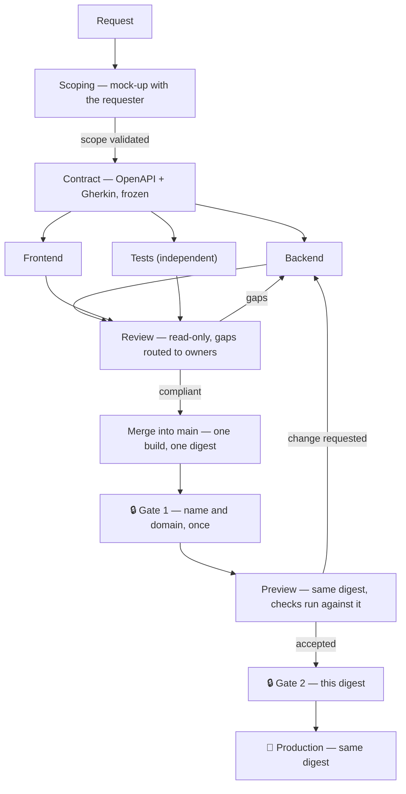
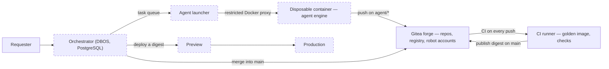

🇫🇷 [Lire en français](README.fr.md)

# EupaDev

**A self-service factory for software tools.** A colleague explains, in
everyday words, the tool their team needs; AI agents scope it, write it, test
it and harden it; humans approve at two gates before anything reaches production.
Open core, Apache 2.0: the engine is here, organisation-specific extras are not.

> **Status: pre-release.** On the lab VMs, a full cycle runs end to end with
> a scripted agent (no AI cost): the Git forge and its real CI, the engine
> (DBOS) and its gates, a signed image, a Preview with its tests, then Prod.
> Built and proven by real tests: the forge with its robot accounts and branch
> protections, the CI runner, the golden image, the engine, the agent launcher
> running Claude Code in isolated containers, Keycloak identity with
> four-eyes approval, the shared hardened core of the generated tools, the
> template pipeline and the deployer. Not built yet: the dashboard and gate
> pages. Details: [`docs/architecture.md`](docs/architecture.md),
> plan: [`ROADMAP.md`](ROADMAP.md) §8.

## Why

Giving a coding agent autonomy goes wrong in two opposite ways: locked down
until it is useless, or let loose until it becomes a liability. EupaDev
answers with a cycle in which the cheap, exploratory work and the rigorous
work are separate steps, and with a factory where every piece an agent could
abuse is placed out of its reach by construction, not by instruction.

## Who it is for — and who it is not for

**For** mid-sized companies and industrial organisations that must keep their
tools on their own servers, need tools with real business logic (multi-role
workflows, validation rules, calls to internal systems), want to own the code
and the audit trail, and have no developer available to write them.

**Not for**:
- simple forms, dashboards or CRUD screens in an organisation already on
  Microsoft 365: Power Apps, already paid for, does that faster;
- small companies without an IT department to host and run the platform;
- teams that already have developers comfortable with coding agents.

**Sovereign on running the tools, not on building them.** Generated tools run
entirely on the organisation's servers. Building them sends the request, the
specification and the code to the model provider, under the organisation's own
account; EU processing is available through Amazon Bedrock or Google Vertex AI.
See [`docs/governance.md`](docs/governance.md).

## The cycle

1. **Scoping** — one agent builds a working mock-up with the requester. Nothing
   is audited yet; the scope is still moving.
2. **Contract** — the validated scope becomes an OpenAPI description and
   Gherkin scenarios, then is frozen.
3. **Hardening** — the tests agent writes the acceptance suite from the
   contract, then the builder agent writes the code against the contract and
   that suite, each on its own branch and folder. The tests agent never reads
   the code, so it shares no blind spot with the agent that wrote it.
4. **Review** — two read-only reviewers (security, quality) report gaps; only
   the owning roles are relaunched.
5. **Merge, build once** — the orchestrator merges into `main`; CI builds one
   image and records its digest.
6. **Gate 1, Preview, Gate 2, Production** — a human approves the name and
   domain once; the digest is deployed to Preview and checked there; a human
   approves that exact digest; Production receives the same digest. Nothing is
   rebuilt between Preview and Production.

Who holds each gate, budgets, decommissioning:
[`docs/governance.md`](docs/governance.md).

### What this deliberately never does

- **Deploy to production on its own.** Two human gates, the second one on a
  specific image digest.
- **Rebuild between environments.** What runs in Production is the digest that
  was checked in Preview.
- **Let an agent touch its own rules.** On agent branches the forge refuses,
  at push time, any change to the charter, the role prompts, the analysis rules
  or the CI.
- **Trust the agent.** It runs in a disposable container, behind a restricted
  Docker proxy and an egress allow-list, with a token that can push on its own
  branch and nothing else.

## How it fits together

Dashed: designed, not built yet. The agent engine is interchangeable behind a
fixed contract (repository, instruction, rules and budget cap in; code, JSON
report and cost out). Claude Code is engine n°1; a dummy engine that replays
prepared code lets the whole chain be tested without an AI call.

## What's in this repo

| Path | What it is |
|---|---|
| [`infra/`](infra/) | The lab, fully described as code: VMs (Terraform), forge, runner and robot accounts (Ansible), services (Compose), real tests (`verify-*.yml`). |
| [`images/base-node/`](images/base-node/) | The golden image every tool image starts from: hardened, non-root, rebuilt and scanned weekly by the forge's CI. |
| [`tool-template/`](tool-template/) | The repository copied for every new tool: agent charter (`AGENTS.md`), role prompts, domain rules, delivered building blocks, analysis rules, CI pipelines, design system. |
| [`docs/`](docs/) | Platform documentation: [`architecture.md`](docs/architecture.md), [`governance.md`](docs/governance.md), French translations under `docs/fr/`. |
| [`ROADMAP.md`](ROADMAP.md) | Design with reasons: §1-7 the v1 lessons, §8 the v2 reference (decisions, rejected alternatives, build order). |

## Getting started

Everything that exists on a machine is described in `infra/`; nothing is
configured by hand. Rebuilding the lab from scratch, running the real tests,
moving from the lab to a hosting provider: [`infra/README.md`](infra/README.md).

## Principles

- **The prompt guides, the code checks.** Every rule that can be verified
  mechanically becomes a check: CI step, analysis rule, branch protection.
  The charter stays short.
- **Responsibility lives with the reviewer.** The agent that writes code never
  declares it compliant; acceptance tests are written by an agent that has not
  seen the code.
- **Build once, promote by digest.** Approvals, check results and deployments
  all name a digest; rollback is redeploying the previous one.
- **Works at N = 1 on a small VM.** Parallelism accelerates, it is never
  required; PostgreSQL is the only extra infrastructure component.
- **Test for real.** On the lab VMs, with tests that clean up after
  themselves; a simulation only when the real test is risky, and said so.
- **Each installation keeps its own data.** Its decisions, lessons and tool
  data never leave it.

## Contributing

See [`CONTRIBUTING.md`](CONTRIBUTING.md).

## License

[Apache 2.0](LICENSE).
