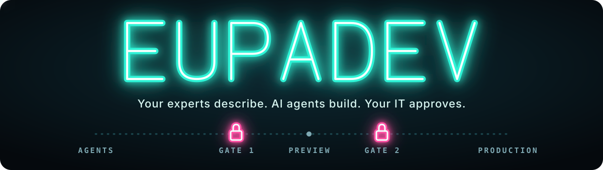
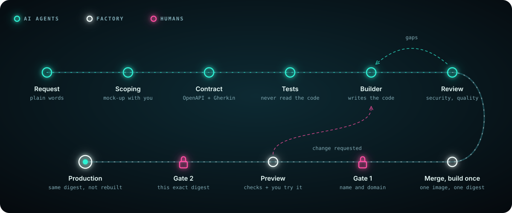
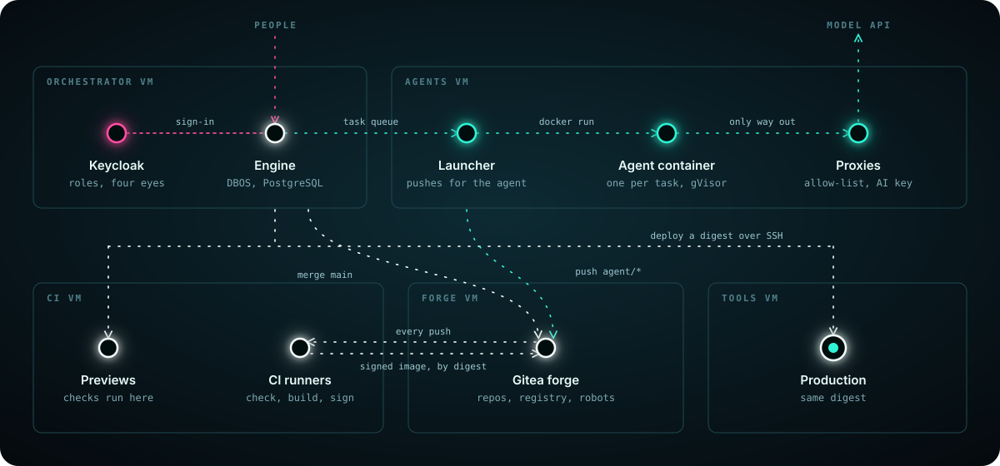

**Your experts describe the tool they need. AI agents build it properly. Your IT department approves every release. Everything runs on your own servers.**

[Architecture](docs/architecture.md) · [Governance](docs/governance.md) · [Roadmap](ROADMAP.md) · [Build the lab](infra/README.md) · [Lire en français](README.fr.md)

<!-- screenshots: requester page, mock-up, Preview -->

## Why EupaDev exists

Picture a team lead who needs a small tool: tracking equipment loans, logging
incidents, following up suppliers, handling leave requests. No developer is
available, so she opens an AI app builder and, in an afternoon, gets a first
screen working on her laptop. It looks finished. It is not: there is no server,
no real database, no sign-in, no backup, and nobody who will maintain it.
Used every day by a team, it would lose data, leak it, or both.

This is happening in every organisation, at once. AI has made building easy
enough that people who know the job build their own tools, with no notion of
what a database or a deployment is. The result is a new wave of shadow IT: tools
nobody audited, hosted nowhere in particular, owned by no one.

EupaDev takes the good part of that movement and removes the dangerous part.
The person who knows the need describes it; the engineering is done the way a
professional team would do it; and the IT department decides what goes live.

## What it is

EupaDev is a self-hosted tool factory. An employee describes a business tool
in plain words. A scoping agent builds a clickable mock-up with them until the
need is right. Then a chain of agents turns the validated scope into a frozen
contract, writes the acceptance tests, writes the code, reviews it, and hands
the result to a real CI. Two humans approve before anything reaches Production.

- **Prompt-to-app for the domain expert.** The requester never sees code: a
  chat, a mock-up, then a working Preview to try.
- **Engineering done behind it.** Every tool is generated on a shared hardened
  base (`@eupadev/core`): OIDC sign-in, PostgreSQL with separate roles,
  validation of every request, append-only audit, web protections, acceptance
  tests that an independent agent wrote from the contract.
- **The IT department keeps control.** A human approves the tool's name and
  domain once (Gate 1), then each release by its exact image digest (Gate 2),
  with a four-eyes rule: the requester cannot approve their own tool.
- **Agents cannot reach what they could abuse.** Disposable containers under
  gVisor, no forge token, an egress allow-list, protected files refused at push
  time. By construction, not by instruction.
- **One registry of tools.** The orchestrator keeps its own registry and
  searches it before scoping: a request that overlaps an existing tool is
  raised to the product owner instead of producing a duplicate.
- **Your data stays home.** Generated tools, their databases and the factory
  itself run on your servers. The only thing that leaves is the agents' work
  while a tool is being built, sent to the model provider under your own
  account.

Open core, Apache 2.0: the engine is here; organisation-specific extras
(ready-made templates, directory integrations, ITSM connectors) are not.

## Status

**Pre-release.** On the lab VMs, a complete cycle runs end to end with a
scripted agent and no AI cost: the Git forge and its real CI, the DBOS engine
and its gates, a signed image, a Preview with its checks, then Production.
Claude Code has run real tasks in the isolated containers, but no real tool has
been taken from request to Production by a model yet. The dashboard and gate
pages are not built: gates are decided through the engine's local API for now.
There is no one-command install; the lab is five VMs described as code in
[`infra/`](infra/README.md). Piece-by-piece status with the tests that prove it:
[`docs/architecture.md`](docs/architecture.md).

## How a tool gets built

1. **Scoping.** One agent builds a working mock-up with the requester. Nothing
   is audited yet; the scope is still moving.
2. **Contract.** The validated scope becomes an OpenAPI description and Gherkin
   scenarios, then is frozen for the cycle.
3. **Hardening.** The tests agent writes the acceptance suite from the
   contract. Then the builder agent writes the code against the contract and
   that suite, which it can read but not change. They share no blind spot.
4. **Review.** Two read-only reviewers report gaps with file and line; only
   the owning role is relaunched.
5. **Merge and build once.** The orchestrator merges into `main`; CI builds one
   image and records its digest.
6. **Gate 1, Preview, Gate 2, Production.** The digest is deployed to Preview,
   where performance, accessibility, dynamic security checks and the tool's own
   acceptance suite run; the requester tries it; a second person approves that
   exact digest; Production receives the same bytes.

Who holds each gate, budgets per cycle, decommissioning:
[`docs/governance.md`](docs/governance.md).

## What it never does

- **Deploy to production on its own.** Two human gates, the second one on a
  specific image digest.
- **Rebuild between environments.** What runs in Production is the digest that
  was checked in Preview.
- **Let an agent touch its own rules.** On agent branches the forge refuses,
  at push time, any change to the charter, the role prompts, the analysis rules
  or the CI.
- **Trust the agent.** It runs in a disposable container under gVisor, with no
  Docker socket, behind an egress allow-list and without any forge token: the
  launcher pushes its work to its own branch and nowhere else.
- **Parse an email to take a decision.** Gates are decided through an
  authenticated API, recorded with who, which hat and which digest.

Full trust model, robot accounts and their rights:
[`docs/architecture.md`](docs/architecture.md#trust-model).

## Who it is for

Mid-sized companies and industrial organisations that must keep their tools on
their own servers, need tools with real business logic (multi-role workflows,
validation rules, calls to internal systems), want to own the code and the
audit trail, and have no developer to spare.

Probably not for you if you need simple forms or dashboards and already pay
for Microsoft 365 (Power Apps does that faster), if you have no IT department
to host and run the platform, or if your developers are already comfortable
with coding agents.

**Sovereign on running the tools, not on building them.** Building a tool
sends the request, the specification and the code to the model provider, under
your organisation's own account. The platform calls the Anthropic API today;
Claude Code also offers EU processing through Amazon Bedrock or Google Vertex
AI. Details: [`docs/governance.md`](docs/governance.md).

## Getting started

There is no quick start yet. What exists is the lab: five VMs (forge, CI,
orchestrator, agents, tools) created by Terraform, configured by Ansible, run
with Docker Compose, and proven by real tests that clean up after themselves.
Nothing is configured by hand; if it is not in `infra/`, it does not exist.

Rebuilding the lab from scratch, running the tests, moving from the lab to a
hosting provider: [`infra/README.md`](infra/README.md). What an installation
needs at a client: [`docs/client-prerequisites.md`](docs/client-prerequisites.md)
and [`docs/deployment.md`](docs/deployment.md).

## What's in this repo

| Path | What it is |
|---|---|
| [`orchestrator/`](orchestrator/) | The engine: DBOS workflows of the cycle and its gates, the agent launcher, adapters for the forge, the deployer, mail and Claude Code, the requester web page. |
| [`core/`](core/) | `@eupadev/core`, the shared hardened base every generated tool runs on: server, database access, sign-in, web protections, front modules, security test kit. |
| [`tool-template/`](tool-template/) | The repository copied for every new tool: agent charter (`AGENTS.md`), role prompts, domain rules, analysis rules, CI pipelines, design system. |
| [`examples/requests/`](examples/requests/) | A complete tool written by hand on the core: the reference the agents imitate. |
| [`images/base-node/`](images/base-node/) | The golden image every tool image starts from: hardened, non-root, rebuilt and scanned weekly by the forge's CI. |
| [`infra/`](infra/) | The lab as code: VMs (Terraform), forge, runners and robot accounts (Ansible), services (Compose), real tests (`verify-*.yml`). |
| [`docs/`](docs/) | [`architecture.md`](docs/architecture.md), [`governance.md`](docs/governance.md), [`deployment.md`](docs/deployment.md), the ADRs in [`adr/`](docs/adr/), French translations in [`fr/`](docs/fr/). |
| [`ROADMAP.md`](ROADMAP.md) | Design with reasons: §1-6 the lessons of v1, §8 the v2 reference (decisions, rejected alternatives, build order). |

<strong>How the pieces fit together</strong>

The agent engine sits behind a fixed contract (repository, instruction, rules
and budget cap in; code, JSON report and cost out). Claude Code is engine
no. 1. A dummy engine that replays prepared answers and a fake that pushes
prepared files let the whole chain be tested without an AI call.

<strong>Principles</strong>

- **The prompt guides, the code checks.** Every rule that can be verified
  mechanically becomes a check: CI step, analysis rule, branch protection. The
  charter stays short.
- **Responsibility lives with the reviewer.** The agent that writes code never
  declares it compliant; acceptance tests are written by an agent that has not
  seen the code.
- **Build once, promote by digest.** Approvals, check results and deployments
  all name a digest; rollback is redeploying the previous one.
- **Works at N = 1 on a small VM.** Parallelism accelerates, it is never
  required; PostgreSQL is the only extra infrastructure component.
- **Test for real.** On the lab VMs, with tests that clean up after
  themselves; a simulation only when the real test is risky, and said so.
- **Each installation keeps its own data.** Its decisions, lessons and tool
  data never leave it.

## Contributing and security

Contributions are welcome and need a DCO sign-off: [`CONTRIBUTING.md`](CONTRIBUTING.md).
Report a vulnerability privately as described in [`SECURITY.md`](SECURITY.md).
Questions: [`SUPPORT.md`](SUPPORT.md).

## License

[Apache 2.0](LICENSE).
