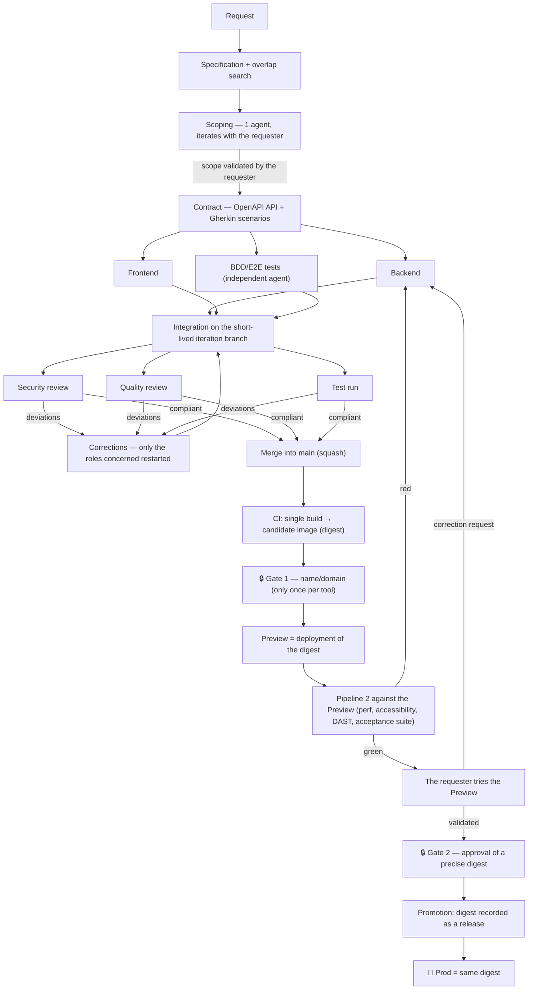

# Roadmap — Rebuilding a self-service software tool factory

## 1. Philosophy and general cycle

Goal: let any employee (even a non-developer) ask for a business tool in natural language and see it generated, secured and deployed by AI agents, with mandatory human checkpoints before anything goes to production.

Cycle in 6 steps: **Research → Design → Plan → Execute → Review → Ship.**

The central point of the whole design, the one that drives the economic efficiency of the system: **Execute splits into two distinct phases, never mixed up.**

- **Light phase (Scoping)**: repeated as many times as the requester clarifies or changes something in the chat. The agent writes real, working code so that the proposed visual is authentic, but **without aiming at full compliance with the security/quality rules at this stage**. The scope is still moving — auditing now would be work thrown away at the requester's next clarification.
- **Compliance phase (Hardening)**: triggered **only once**, only when the requester has validated the scope/design. The agent takes the code of the light phase and brings it to full compliance — code AND tests written together, never the tests afterwards (in v2, the acceptance tests go to an independent agent, see §8.2), all the security and quality rules respected. It is this pass, and it alone, that must be really solid.

Why this separation exists: the first version of such a system, without this distinction, re-audited the whole project at each chat round — a massive waste of time and cost, since most of that work is thrown away as soon as the requester refines their request. Splitting it into two phases made it possible to measure a cost saving of about 40-45% on a targeted correction in Hardening, by scoping the Review to the diff rather than to the whole project (details in §3).

The Review (security/quality audit) comes in **only after** the Hardening phase, never during the light phase. Two strictly read-only sub-agents check the checklists and report the deviations; the execution agent fixes them itself until compliance, without an attempt counter and without human intervention at this precise step — the only human decision point remains the requester, during the light phase, on the scope/visual.

Ship (commit + push) is triggered only once the Review is favourable, and triggers the CI pipeline — it is never an end in itself.

## 2. Precise design of the template repository

It is the repository duplicated for each new tool request. Expected file structure:

```
.
├── CLAUDE.md              # import of the charter file, read natively by the agentic tool
├── AGENTS.md              # full technical charter, adaptable by the generated tool
├── .claude/rules/         # backend.md, frontend.md, security.md, quality.md, tests.md
├── .claude/agents/        # two Review sub-agents, read-only
├── design/design-system.css
├── README.md
├── .gitea/ (or equivalent)/workflows/  # CI pipeline
├── .gitignore / .dockerignore
├── .env.example
├── Dockerfile
├── docs/
│   ├── DECISIONS.md               # decisions specific to THIS tool, empty at the start
│   └── capability-registry.md.example  # registry of the capabilities already covered, to fill in
├── api/ or web/            # Node.js code if applicable
└── pipeline/ or worker/    # Python code if applicable
```

The technical charter file must stay short on purpose (~200 lines) — the detail per domain lives in separate rule files, **loaded automatically as soon as a file concerned is opened**, never a document merely referenced in text that might never be read.

### Backend rules

- **Concurrent writes**: never an application-level read-then-write. A transaction or a conditional update. For a simple counter/lock, a single atomic statement (`INSERT ... ON CONFLICT DO UPDATE ... RETURNING`) rather than a separate `SELECT` then `INSERT` — applies to every sensitive route that writes or triggers a send, not only to the login.
- **Strict input validation, anti mass-assignment**: every request body goes through a strict schema that rejects unknown keys, never a raw injection of the body into an SQL/ORM write.
- **Origin anchored on a dedicated environment variable, never the `Host` header**: every absolute URL sent to a user (reset link, webhook, callback) is built from this variable — a forged `Host` header can redirect a link sent by email to a domain controlled by an attacker. The same variable is the reference for the CSRF check (`Origin`/`Referer` comparison) — a single source of truth for both problems.
- **Constant-time comparison of secrets**: every comparison of a token/key/password/signature uses a dedicated function, never the standard equality operator, which leaks the number of correct characters through the response time.
- **Authorisation by id**: every route/action that takes an id checks the role/authorisation on the first line, not only the session identity.
- **Historised statuses**: every state transition is written append-only (dedicated history table), the current column being only a convenient denormalisation.
- **Business rules as SQL constraints**, not only on the application side.
- **Soft delete** wherever a deletion can be disputed, with a restore script.
- **Errors**: log the full error on the server side, return to the client only a generic message + a correlation id — never a raw database message.
- **Integration with another system — API only, never direct access** to a remote database or an undocumented server-to-server call.
- **HTTP verbs with strict CRUD semantics**, never a verb diverted from its standard use.

### Frontend rules

- **Shared vanilla CSS design system, a single file**, copied as is into each generated tool at the Design step. Extend it by adding classes, never by changing the value of an existing token — otherwise the generated tools drift apart visually for no reason.
- **Status colours with a fixed meaning, not decorative**: one colour = success, one = warning, one = error, one = neutral action — never diverted "to look nice".
- **Default layout: sidebar + content**, not a horizontal banner. A compact banner variant stays available for an explicitly separate mobile/field sub-journey.
- **Categorical palette validated colour-blind-safe** for every chart, reused as is rather than invented for each tool.
- **Explicit anti-XSS**: `innerHTML` and equivalents forbidden without sanitisation, mandatory alternative (`textContent`, DOMPurify if rich HTML is needed).
- **Hiding something in the UI is never a security measure** — the only source of truth for an authorisation is the API.
- **Form robustness for field use**: anti double submission, explicit network states.
- **Never a session token in the browser's local storage.**
- **No third-party API key in the frontend code.**
- **React/Tailwind or Alpine.js/Petite-Vue escape hatches** decided only once, early (Design/Plan step, before the light phase), never a change of stack along the way — vanilla CSS/JS stays the default standard.
- **Non-trivial JS as native ES6 modules**, never a single file that mixes state/DOM/business logic.

### Quality rules (7 axes, beyond security)

1. **Observability + audit trail**: every history table includes an actor column that is never nullable for an authenticated human action; application logs in structured JSON; a `/metrics` route in Prometheus format if the tool has an HTTP surface.
2. **Tested accessibility**: integration of an automated audit tool (such as axe-core), zero critical/serious violation tolerated.
3. **Dependency hygiene**: lockfile always generated by really running the installer (never written by hand), vulnerability scan in the pipeline, every new dependency traced with its reason.
4. **API conventions**: a single JSON error envelope, systematic pagination on every unbounded collection, OpenAPI specification **always generated automatically from the code**, never maintained by hand separately.
5. **Baseline performance**: no query in a loop (N+1), SQL index on every main sort/filter column of a potentially long list.
6. **Rollback strategy**: every schema migration backward compatible over one step (add a nullable column rather than rename/delete directly), previous Docker image kept tagged.
7. **Data retention** (if personal data): documented duration, real mechanism of final purge beyond the soft delete.

Plus 4 cheap complementary mechanical checks, never covered elsewhere: a test server that runs a real production build (never a dev server), append-only consistency of the history tables, consistency of the soft delete (no direct SQL deletion on a table that otherwise has a logical-deletion column), basic robustness of the main forms.

### Security rules (18 categories) — the densest checklist

These categories must include, each with the rule, the reasoning and an expected test scenario:

1. **Authentication gates** — every route that needs a session returns 401 without it.
2. **Rate limiting / brute force, on every sensitive route** (not only the login) — atomic counter in a single SQL statement, **tested with truly parallel requests** (never sequential, otherwise the test proves nothing about the real race condition it is meant to check).
3. **XSS** — test payload that checks 3 things (global variable not triggered, no dialog box, no real node injected in the DOM), real write to the database then cleanup.
4. **Server-side input validation** — tested on the API side, never only prevented on the form side.
5. **Anti account enumeration AND timing oracle** — an unknown identifier returns the same message AND the same processing time as a wrong password (fire-and-forget sending, never waiting for an external send to finish before answering). Never a session issued before the account is actually verified.
6. **IDOR / URL tampering** — two systematic cases: increment/guess an id in the URL (test on the 4 CRUD verbs, not only read/delete), and copy-paste a URL holding an identifier into a different context. Prefer by default a logical deletion to a real `DELETE`.
7. **CSRF** — forged request without a token/origin check rejected.
8. **Security headers on the application side** — checked by an application test, not merely assumed present on the reverse-proxy side.
9. **Session cookie attributes** — appropriate `HttpOnly`, `Secure`, `SameSite`, never a token in local storage.
10. **SQL injection — explicit non-regression test**, even with queries already parameterised.
11. **Role-based access control** (if several roles) — tested directly through the API, not only by hiding a button.
12. **Static file server — mandatory allow-list, never a deny-list.** This is the most serious category: a home-made server with a deny-list ends up exposing all the source code, the documentation, the database schema and any test token left in clear text, through a simple anonymous request. Concerns only a home-made server, not a framework that already handles it correctly.
13. **Constant-time comparison of secrets** — see the corresponding backend rule.
14. **No third-party secret exposed on the browser side** — every call to a third-party service that needs a secret goes through a server function.
15. **Information disclosure through error messages** — concrete check that the `catch` blocks never return the raw message of a technical error.
16. **Authentication — interchangeable provider + revocable sessions.** Two parts:
    - Every tool that identifies a user goes through a standard OAuth/OIDC library that treats the identity provider as configuration, never as a hard-coded API call — so a change of identity provider needs only a configuration change, never a rewrite per generated tool.
    - If the tool keeps its own application session after sign-in: a `token_version` compared with the current value in the database at each sensitive request, incremented at any detected deactivation — invalidates at once every token issued before, with no revocation list to manage separately.
17. **Link built from the `Host` header — to be validated systematically.**
18. **Mass assignment / parameter pollution** — strict validation that rejects unknown keys. And **validation of file uploads** if applicable: strict allow-list of extensions, systematic renaming of the stored file, never a user SVG served without prior cleaning. Plus two cheap mechanical checks: identifiers generated with a cryptographic generator (never `Math.random()` or a non-cryptographic equivalent), integrity attribute on every third-party script loaded from a CDN.

**Lessons that cut across the whole checklist**:
- Test in real conditions (real HTTP request, real browser), never only by reading the code — several real flaws are confirmed exploitable only by really running them.
- An accepted risk is not frozen: its real reach must be reassessed at each audit, not settled once and for all — a real example showed a risk judged minor (access assumed restricted) becoming critical without anyone reviewing the decision.
- Allow-list > deny-list systematically as soon as the cost of maintaining it is reasonable.

### Review sub-agents

Two distinct sub-agents, **strictly read-only** (never any write access):

- **Security auditor**: reads the whole checklist, checks each category against the real code, checks for the categories testable by execution that a test exists **and really tests the right scenario** (not just a test that exists but proves nothing). Also checks 6 mechanical Docker rules (pinned image, non-root user, multi-stage build if relevant, correct `.dockerignore`, healthcheck present, memory/CPU limits declared), under a separate label.
- **Quality auditor**: same principle on the 7 quality axes, plus 4 complementary mechanical checks on the other rule files.

Two common, non-negotiable method principles for both:
- **Completeness of the causal class**: as soon as a concrete instance of a problem is found, check **all** the instances of the same class before concluding — never reveal the problems one by one over round trips with the execution agent, always report the complete class at the first attempt.
- **Adversarial check before any negative finding**: before reporting a deviation, reread the cited evidence yourself and run the smallest command able to refute it — a deviation announced and then invalidated by a simple reread costs more in trust than a slightly slower report.

Identical report format for both: verdict (compliant / non-compliant / not applicable / not checked — never "compliant" by default for lack of checking), concrete evidence (file:line or command result), severity if non-compliant.

### CSS design system

A single vanilla CSS file, zero dependency, zero build step, copied as is into each generated tool:
- Colour tokens named by function (brand colour, status palette of 4 colours with a fixed meaning, categorical palette of 6 series at most validated colour-blind-safe for every chart — a 7th series falls back on an "other" hue, never a newly invented hue).
- Default layout: sidebar + content, with a compact banner variant for a separate mobile/field use.
- Base components: cards/panels, forms, buttons (including a primary button), status badges, key figures for dashboards, tables.

## 3. Precise design of the agent execution service

Service that receives jobs from the orchestrator (polling a queue), clones/pulls the repository concerned, runs the coding agent in headless mode, writes the result.

### Security model — the heart of the design

- **The coding agent must run in a throwaway container, never in the persistent service itself.** Precise reason: the agent runs with a permission mode that bypasses the interactive confirmation (needed for autonomous operation) — if it ran as a direct child process of the persistent service, it would have write access to the source code of that service itself and to all its secrets through the inherited environment. A successful prompt injection could then change the service persistently between jobs. Solution: each job starts a dedicated Docker container, recreated from scratch, destroyed at the end of the job — success or failure.
- **Secrets passed to the throwaway container: only what the agent really needs** (API key of the model, forge token for its own code push) — never the credentials of the orchestrator itself.
- **Docker control through a proxy with restricted rights, never the raw socket mounted directly.** Explicitly allowed categories: create/inspect/list containers, list images, create networks. Explicitly blocked: run a command in an already existing container, manage volumes through the dedicated API, any Swarm/Services/Secrets/Plugins operation. A compromise of the service that calls the Docker API thus stays limited to creating throwaway containers.
- **Git tokens with minimal scope, injected by HTTP header at each command, never in the remote URL** — a URL with credentials would end up in clear text and persistent in the local Git configuration of the clone, a header never does.
- **Network egress allow-list, not a deny-list** — the throwaway container reaches only the strictly needed domains (model API, orchestrator endpoint) through a dedicated egress proxy.
- **Systematic hardening of the container**: no new privileges, all Linux capabilities dropped, memory/CPU/process-count limits, never an automatic restart.

### Review scoped to the diff

To avoid re-auditing the whole project at each post-validation correction: a manifest of SHA-256 hashes per file (no usable git commits, since nothing is committed before the end of the compliance phase), passed from one iteration to the next through the memory context. Only the files changed since the last Review pass are audited first — the agent may widen the scope if it judges it necessary, but the default is the reduced scope. Real measured saving: about 40-45% of cost on a targeted correction, without loss of rigour.

### Real difficulties met while building this service (generalised)

All these difficulties were met and fixed during the construction and the first real tests — to be anticipated directly in the rebuild rather than rediscovered:

- **The exact shape of the API filter of an external job queue** (key names, nested structure, encoding of the sort parameters) is rarely the one documented in theory — check it with a real live test before considering the client reliable.
- **Generating a new repository from a template usually copies only the default branch** — an intermediate working branch (such as `preview`) therefore does not exist yet at the first pass on a freshly generated tool and must be created on the fly, not assumed present.
- **An access token created under a personal/admin account has a much wider scope than intended** — always check explicitly the real scope of a token used by an automated service (create a dedicated service account, member only of the organisation/space concerned, never the administrator account).
- **A `reset --hard`/`clean` on a working directory that persists across several steps of the same pipeline can silently erase uncommitted work produced by a previous step** — to be avoided absolutely if several successive phases (backend, frontend, review) must accumulate their work in the same directory.
- **Check explicitly, phase by phase, that each write targets the right branch** — a confusion between the working branch and the protected branch can go unnoticed for a long time if the first tests cover only one phase.
- **A healthcheck based on a simple heartbeat written only at the start of the processing becomes falsely "failing" as soon as a legitimate processing exceeds the tolerance window** — the heartbeat must be independent of the processing cycle, refreshed continuously during the whole job, not only before it starts.
- **Isolate the Docker network of the agent execution service from any production application network** — a container generated by an AI agent without constant supervision must never be able to reach critical applications on the same host.
- **The native `fetch` of the runtime (Node.js) does not automatically honour the standard proxy environment variables** (unlike most other HTTP clients) — if the network applies a strict egress allow-list, this must be configured explicitly from the very first import of the program, otherwise the network calls fail silently with no visible error elsewhere.
- **The "attached" mode of starting a container (standard output streamed live) can stay blocked indefinitely when the Docker daemon is reached through a proxy rather than directly** — always prefer a detached start followed by periodic polling of the state + fetching the logs afterwards.

## 4. Precise design of the orchestration

Invocation mechanics: the orchestrator writes a job into a jobs table, the agent execution service polls it periodically with outbound connections only (no inbound access required), processes the job, writes the result.

### Mechanical guard-rails against a loop that never converges

Indispensable for both phases, carried by a dedicated technical memory (not by the agent itself, which has no state between two jobs):
- A cap of Execute↔Review iterations (about 10-15 for the compliance phase, lower for the light phase).
- A stagnation detection (the same non-compliance repeated over several consecutive passes).
- A global timeout per tool (about 1-2 h).
- A budget cap per tool and per phase, computed live from the real sum of the costs already incurred — never a separate total that could drift from reality — with human escalation when it is exceeded, never a silent block.

### Visual during the light phase, without exposing one machine per tool

Solution kept after several iterations: a single shared subdomain that always points to the only light-phase container active at a given moment (concurrency is bounded naturally since jobs are processed sequentially, one at a time). Rejected alternatives: a simple screenshot (no interaction possible for the requester), one subdomain per tool (much higher operating cost). Accepted and documented trade-off: this link briefly exposes code not yet audited, mitigated by a web application firewall and a very short container lifetime.

### Asynchronous resumption of the conversation with the requester

A native chat widget built into the orchestration tool generally turns out to be unsuitable as soon as a conversation paused for several hours or days must be resumed. Robust solution: an email + form mechanism, already proven for the other notifications of the system, reused for resuming the conversation rather than a real live chat router.

### Central registry and automatic decommissioning

A registry that records: tool name, owning service/role, deployment date and URL, feature covered, date of the last real access (computed from the reverse proxy logs, not from a simple creation date). Automatic decommissioning mechanism: graded reminders over several weeks without detected access, official notice, then a soft quarantine if there is no answer after an extra delay — with automatic reset of the counter as soon as a real access is detected again.

### Real difficulties met in designing the orchestration graph (generalised)

- **A context variable shared between several steps of the same visual orchestration tool can be silently reset by an intermediate step** — if several later steps depend on it, they all fail at the same time in a barely visible way. Always test the complete path end to end, not only each step in isolation.
- **Fields planned in a theoretical design form may never actually be wired into the final form** — check the exact match between what the form really sends and what each following step expects, not only on paper.
- **A visual orchestration tool edited at the same time in a web interface and through an API can silently overwrite changes made through the other channel** — avoid concurrent editing, or check explicitly afterwards that no change was lost.
- **A write mechanism tested only on synthetic cases can behave differently at its very first real use** (e.g. writing empty rows rather than failing cleanly) — always validate a critical write mechanism with a real first pass, not only isolated unit tests.
- **A single entry mechanism that plans only one path (always create a new tool) often forgets the case of changing an already existing/deployed tool** — plan from the initial design a separate entry point for a post-deployment evolution, which must go through the same full cycle again, never a shortcut.

## 5. Design of the underlying infrastructure

- **Git forge** with a "generate from a template" kind of API, service tokens with a scope limited per organisation/space (never a personal/admin account).
- **CI pipeline in 2 steps**:
  - Light step, blocking before any preview deployment: secret scan, automated tests, image build + vulnerability scan, **and a real smoke test of the built image** (really start it and check that it answers — a build that succeeds never guarantees that a container really starts and answers).
  - In-depth step, before any promotion to production: static security analysis (dangerous primitives, anti-patterns), Dockerfile lint, basic performance test, automated accessibility audit on the really deployed preview environment, dynamic security scan against the really served URL — a whole category of flaws (bad server configuration, headers missing in real conditions) is never visible by reading the code alone.
- **Containerisation**: dedicated network isolated from any production application network, no port published directly except through a reverse proxy, explicit memory/CPU limits per service.
- **Automatic backup**: automatic discovery of the databases to back up (never a static list to maintain by hand), multi-level rotation (daily/weekly/monthly), backup of the global metadata in addition to the data itself.

### Generalised infrastructure lessons

- **A container orchestration tool often silently prefixes the names of the declared volumes/networks** with the project name, unless a fixed name is declared explicitly — always check the real name on the container engine side before relying on it in a script, never assume that the name declared in the configuration is the real name.
- **A classic application firewall can be completely bypassed by the containerisation layer itself for outbound network traffic** — check explicitly, with a real test of an outbound connection attempt from a container, that the network rules meant to apply really apply at that level, not only at the host level.
- **Always check the real capacity of a target machine (memory available in real conditions, not only the total RAM declared) before committing to a precise stack** — a calculation on declared caps alone can underestimate a real risk of swap/instability under real load.
- **Before any major change of infrastructure tool (forge, orchestrator) already partly deployed**, compare objectively the real operating effort of each option on the real hardware constraint rather than on an a priori preference.

## 6. Rebuild roadmap — concrete order

1. **Minimal personal infra** (complexity: quick) — personal machine/VPS, Docker installed, dedicated network created. No dependency.
2. **Personal Git forge** (quick) — self-hosted instance or existing account, dedicated organisation, service account with a limited scope created right now (not afterwards). Depends on 1.
3. **Template repository** (medium) — recreate the file structure, `AGENTS.md`, the 4 detailed rule files, the 2 Review sub-agents, the CSS design system — from the specification above alone, without ever opening an old file next to it. Depends on 2.
4. **CI pipeline** (medium) — the 2 steps, with a runner able to build images and start containers. The real smoke test of the image is the part most easily forgotten — do not skip it. Depends on 3.
5. **Manual test of the template alone** (quick) — duplicate the template by hand once, check that the structure and the pipeline work before wiring anything automated. Depends on 4.
6. **Agent execution service** (long) — the densest piece in security: throwaway container, Docker proxy with restricted rights, tokens by header, network allow-list, review scoped to the diff. Plan a first real test that will probably reveal several of the difficulties listed in §3 — that is normal, not a design failure. Depends on 2 and 4.
7. **Jobs table / technical memory** (quick) — minimal schema (status, phase, result, cost, duration), cap/stagnation/timeout/budget guard-rails wired from the start, not added afterwards. Depends on 6.
8. **First manual end-to-end cycle** (medium) — insert a job by hand, check the whole Execute→Review→Ship cycle without yet going through a real visual orchestrator. Depends on 7.
9. **Visual container during the light phase** (medium) — shared subdomain, reverse proxy, mechanism to replace the active container. Depends on 6.
10. **Orchestration graph** (long) — intake, memory between iterations, guard-rails for the light phase, asynchronous resumption mechanism, alerts at the human checkpoints. The biggest piece in number of internal steps — build and test in small blocks rather than in one block. Depends on 7, 8, 9.
11. **Central registry + automatic decommissioning** (medium) — can be done after a first really deployed tool, not a prerequisite of the very first end-to-end test. Depends on 10.
12. **Real end-to-end test** (quick to run, but often long to reach) — a real trigger (form), not a manual workaround as in the previous steps. Often the step that reveals the most real integration bugs (see §4) — plan several iterations, not a single pass. Depends on everything above.

## 8. v2 design — factory of agents in parallel + delivery by promotion

> **Status: design, nothing is built yet.** This section eventually replaces the orchestration described in §4 (sequential visual graph) and the `preview` working branch described in §3. §1 to §3 (Scoping/Hardening cycle, template, security model of the execution service) remain valid.

### 8.1 What changes compared with v1, and why

| Topic | v1 | v2 | Reason |
|---|---|---|---|
| Orchestration | visual graph (~100 nodes), tool under a non-free licence | durable workflows in code with **DBOS** (TypeScript library, MIT licence), state in PostgreSQL | testable in BDD, versioned, reproducible in a company, no extra orchestration server; the visual graph was in fact a drawn state machine; licence compatible with redistribution under Apache 2.0 |
| Visual | the graph itself | read-only dashboard on the state tables | separate "see" and "orchestrate"; more readable for a non-developer |
| Execution | one job at a time, queue polled every 20 s | successive steps, **parallel inside each step** + several tools at the same time (DBOS queue with concurrency N) | back/front/review parallelism already existed in the graph but was serialised again by the execution service |
| Branches | long-lived `preview` branch + `main` | **trunk-based**: `main` + short-lived branches only | the environment is read from what is deployed, not from a branch; removes the trap "`preview` branch missing at the first pass" (§3) |
| Delivery | Gate 2 approved on the Preview, nothing guarantees that Prod receives the same image | **build once, promote by digest** (`sha256:…`) | what goes to Prod is bit for bit what was validated in Preview |
| Scoping visual | a single shared subdomain | one subdomain per tool in scoping (`<tool>.scoping.<domain>`, wildcard certificate) | needed as soon as several tools are in scoping at the same time |

### 8.2 Cycle of a tool

Successive steps (the next one starts only when the previous one is finished), parallel inside:



**The contract is the step that makes parallelism possible.** Without a contract, back and front move forward at the same time but contradict each other, and the merge costs more than the time saved. It is produced from the scope validated in scoping, once, then versioned in the repository (`docs/contract/openapi.yaml`, `tests/acceptance/features/*.feature`).

**Tests: split between two agents (decision settled).** It is the principle "responsibility lives with the reviewer" applied to tests: an agent that writes the code and its tests shares the same blind spots on both sides, and an agent blocked by a red test tends to change the test rather than the code.

| Tests | Written by | From |
|---|---|---|
| Acceptance: BDD scenarios (Gherkin), browser E2E, expected scenarios of the security checklist | **independent tests agent**, which does not see the code | specification + contract |
| Unit (internal functions) | agent of the code concerned | the code |

Two rules go with it:
1. **The code agents cannot write in `tests/acceptance/`** — enforced by the ownership of folders by role (§8.3), not by the agent's goodwill.
2. **A red acceptance test is arbitrated by the contract**: if the test contradicts the contract, the tests agent fixes it; otherwise, the code agent fixes the code.

Replaces the v1 rule "code AND tests written together by the same agent" (§1) for the acceptance tests; the template's `AGENTS.md` is to be updated accordingly (step 4 of §8.9).

### 8.3 Mechanics of parallelism (DBOS)

**Why DBOS.** The steps of a tool last minutes (agents) or days (waiting for a human). What matters is not the raw speed of the orchestrator, negligible next to that, but losing nothing if the server restarts in the middle of a wait. DBOS records each step of a workflow in PostgreSQL: after a crash, the workflow resumes at the last finished step, without replaying it. It is a library imported into the orchestrator's code, not a server to operate. Rejected alternative: Temporal (more proven at very large scale, but an extra server hungry for RAM) — to reconsider only if the volume exceeds hundreds of simultaneous tools. Also rejected: Windmill (AGPL licence + proprietary parts, incompatible with resale).

- **A tool = a DBOS workflow** that follows the cycle of §8.2. **An agent task = a child workflow** put in a **DBOS queue with global concurrency N**: parallelism (fan-out) consists in starting several children, waiting for the end of a step (fan-in) in waiting for all their results.
- **Each task also writes a row** in the business table `tasks` (tool, step, role, status, branch, cost, report): it is the one the dashboard and the guard-rails read; the internal state of DBOS stays an implementation detail.
- **A step can be replayed after a crash if it was not finished**: each step must therefore be idempotent. In particular, the throwaway container is named after the task id — on replay, an existing container is destroyed then restarted, never duplicated.
- **Each task = a throwaway container** (security model of §3 unchanged) **+ its own short-lived branch** `agent/<tool>/<role>`, destroyed after the merge.
- **Ownership of folders by role**, declared in the template's `AGENTS.md`: the builder writes in `api/`, `db/`, `web/`, `public/`, `tests/unit/`, the tests agent in `tests/acceptance/` (ADR-021). A merge conflict with `main` goes back to the owning role like a deviation on the file.
- **Routing of review deviations**: each deviation cites a `file:line`; the folder gives the owning role; only those roles are restarted. The review stays scoped to the diff (hash manifest, §3).
- **Guard-rails unchanged** (§4): iteration cap, stagnation, timeout, budget per tool — the cumulative cost is **always the sum of the real costs of the `tasks` table**, never a total kept apart.
- **New guard-rail: global concurrency** — at most N simultaneous agents (global concurrency of the DBOS queue), **set by an environment variable, never hard-coded**, plus a cap per tool (queue partitioned by tool: 3 agents at most for one tool, so that one tool does not take all N places). N is **measured**, not guessed:
  1. N = 1: must reproduce exactly the v1 behaviour (validates the migration to DBOS);
  2. N = 2 (tests and builder of one tool, ADR-021): measurement of the real RAM peak per agent and per scoping container;
  3. N = (RAM really available − margin) ÷ measured peak per agent, capped by the rate limit of the model's API account (often the real limit before RAM).
- **Constraint of deployment in a company: RAM possibly limited.** The platform must work **correctly at N = 1 on a small VM** — parallelism speeds things up, it is never required. Design consequences:
  - no infrastructure component beyond PostgreSQL (one more reason for choosing DBOS, without an orchestration server);
  - explicit memory/CPU limits on each throwaway container (already required, §3);
  - an idle scoping container is stopped after a short delay and restarted on demand, instead of running all the time;
  - the measured hardware requirements (minimal RAM of the platform, RAM per extra agent) are published in the installation documentation, so that a company sizes N before installing.
- **Separation of rights kept**: the process that drives the workflows has no access to Docker; only the execution processes (the v1 execution service, reduced to its container-launching functions) consume the agent task queue and go through the Docker proxy with restricted rights (§3). Both share the same PostgreSQL database.

### 8.4 Delivery: trunk-based, single build, promotion by digest

**Branches.** `main` + short-lived branches only. `main` receives only code that passed a compliant review. No `preview` branch, no `develop` and no branch per environment: the state of an environment is read from the `deployments` table (which digest runs where).

**Build once.** The CI builds the image **only once**, at the merge into `main`, and records its digest. No later step rebuilds — a trap to avoid explicitly: a "deploy to Prod" step that rebuilds deploys an image that was never validated.

**Promote by digest.**
1. Preview deploys the image **by digest**, never by tag (`latest` or another, which can change content).
2. Pipeline 2 (perf, accessibility, DAST, acceptance suite of the tool) runs against this Preview **before the requester is told**; its results are recorded **against the digest**. Red → back to hardening without disturbing the requester; green → the requester receives the link, and their agreement opens Gate 2 without running the pipeline again (decision of 2026-10-26, `docs/reflexions/2026-10-26-note-acceptance-on-preview.md` §3.5).
3. Gate 2 approves **a precise digest**, shown in the approval request.
4. Promotion = recording the digest as a release (not modifiable in the database).
5. Prod deploys this digest. **Rollback** = redeploy the digest of the previous release, without rebuilding anything.

**"Golden state" of a tool** = the last digest validated and deployed to production (table `deployments`). It is the return point in case of incident: we go back to it by redeploying that digest, never by rebuilding.

**Image registry**: the container registry built into the Git forge is enough. Its tags can be modified, so the guarantee comes from deployment by digest and from the digest recorded in the database, not from the tag. A dedicated registry (such as Nexus) does not bring enough for its RAM cost at this scale.

**Accounts separated by role** — a compromised account stays limited to its role:

| Account | Can | Cannot |
|---|---|---|
| Agent (throwaway container) | push on `agent/*` | merge into `main`, publish an image, deploy |
| Orchestrator | merge into `main` (after a compliant review) | publish an image, deploy |
| CI build | publish a candidate image | deploy |
| Deployment | **read** the registry, deploy an approved digest | publish, merge |

Enforced by the branch protection of the forge (`main`: merge by the orchestrator only) and by the scope of each token.

**Against the "poisoned pipeline"**: the pipelines run at each push on an agent branch, with the pipeline file of that branch. A manipulated agent could rewrite the pipeline to read the organisation's secrets. Two locks: (1) protection of the `agent/**` branches with protected files — Gitea refuses **at push time** any change to `.gitea/`, `.opengrep/`, `.claude/`, `agents/`, `AGENTS*.md`, `CLAUDE.md` (proven by `verify-forge.yml`); (2) two CI badges: read-only (`REGISTRY_READ_TOKEN`, to pull the golden image) and write (`REGISTRY_TOKEN`, used only by the publish step on `main`). The jobs that run the agents' code (tests) have no access to the Docker of the CI VM (runner `ci-standard`, §8.14 B), and a branch outside `agent/**` and `main` is writable only by the orchestrator. Single definition of the protections: `infra/ansible/group_vars/forge/vars.yml` (`gitea_branch_protections`), which the orchestrator will apply to each new repository.

**Schema migrations**: always backward compatible over one release (*expand / contract*: add, switch, delete in a later release), otherwise rollback by digest breaks on a database already migrated (joins quality rule no. 6, §2).

### 8.5 Minimal data

| Table | Content | Note |
|---|---|---|
| `tools` | name, requester, owning service, current state | current state = denormalisation |
| `tool_history` | each state transition, actor, date | append-only (backend rule §2) |
| `tasks` | tool, step, role, status, branch, cost, tokens, duration, report | single source of the cumulative cost |
| `approvals` | tool, gate, digest concerned, decision, actor, comment | an approval is about a digest, not a tool |
| `deployments` | tool, environment, digest, date, result of the health check | answers "what runs where" and the rollback |

The central registry and the decommissioning (§4) plug into `tools` + `deployments`. DBOS also creates its own system tables (separate schema) for the state of the workflows; they are never read directly by the dashboard.

**Retention (decision validated by Ilan)**: data and logs of the platform (append-only history tables, costs, approvals, deployments, messages, events, application logs) are kept **3 years**. The purge mechanism beyond that is not designed yet.

### 8.6 Humans in the loop

The email mechanism of v1 (§4) is kept to **notify**; the **decision** is taken on a dashboard page, behind OIDC authentication (interchangeable provider, security rule no. 16), and is written in `approvals` with the actor. No parsing of an email reply.

On the orchestrator side, a gate = the tool's workflow **waits for a message** (durable reception in DBOS); the decision page sends it that message. The wait survives restarts, whatever its duration. Reminders (email after 24 h without an answer, decommissioning steps) are **durable pauses** of the same workflow, not separate scheduled tasks.

**To be reworked later: the exchange with the requester (scoping, user stories, corrections) must look like a chat with history**, not like a series of forms sent one by one by email without memory of the conversation. Design to be done separately.

### 8.7 What disappears from v1

- the visual orchestration graph and its internal tables (replaced by the tables above);
- the `preview` branch and its creation on the fly;
- the sequential polling of an external queue every 20 s by a single service (replaced by the DBOS queue);
- the single shared scoping subdomain.

### 8.8 Decisions

Settled:
1. **Tests**: independent tests agent for acceptance, code agent for unit tests (§8.2).
2. **N**: adjustable, measured in steps (1 → 3 → calculation), operation guaranteed at N = 1 on a small VM (§8.3).
3. **Separation of Docker rights**: DBOS can limit a process to the queues it consumes (option `listenQueues`). The pilot process puts the agent tasks in the queue but never consumes it; only the execution processes (functions of the v1 service: throwaway container, clone by header, hash manifest, egress proxy) consume it, with access to the Docker proxy. To be confirmed by a real test at construction time, like every security mechanism (§1).
4. **Interchangeable agent engine** (§8.11): Claude Code first, input/output contract fixed from the start to plug in another engine without a rewrite.
5. **Agent rules (template)** — from a complete critical reading of the v1 rules:
    - **injected by the orchestrator**, not read by chance: `--bare` (security) disables the reading of CLAUDE.md files, and the per-folder rules trigger only on the Read/Write/Edit tools. The launcher passes to each agent `AGENTS.md` + the rule of its role + the report format (`--append-system-prompt-file` for Claude Code; same concatenation for another engine). `.claude/rules/` stays a convenience for interactive use;
    - **structure**: short `AGENTS.md` (~100 lines, always loaded, engine-neutral); short domain rules with narrow `paths`; one prompt per role in `agents/`; review report in schema-validated JSON; building blocks delivered in the template (escapeHtml, JSON logger, errors, authorisation guards, security test kit reading the contract) rather than paragraphs of rules; human documents (ARCHITECTURE, GOVERNANCE) outside the agents' context;
    - **checks before merge**: an agent can change neither its rules, nor the CI, nor the folders of another role (diff checked by the orchestrator);
    - **language**: official version in English, French translation in addition, meant for humans (the English is authoritative): `AGENTS.fr.md` at the root of the template, the others under `docs/fr/` (`docs/fr/rules/`, `docs/fr/agents/`) — never in `.claude/rules/`, otherwise the agent would load each rule twice.
    - **authentication of the generated tools: OIDC mandatory by default, without local accounts** (no stored password, central deactivation by the IT department, provider interchangeable by configuration — Entra ID/AD, Google, Keycloak…). Makes the rules on passwords, login brute force and anti-enumeration moot. Exception possible only if decided at scoping and noted in `DECISIONS.md`.

Open:
6. Conversational interface with the requester (see 8.6, 8.10, 8.11) — separate design.
7. **Framing the budget when the scope grows** — partly settled in §8.13 (budget per cycle, main guard-rail, traced top-up); still to decide: price announced per story, cap of stories per version, graded alerts to the requester. v1 finding: the cap per tool (e.g. 10 €) is blown because the requester adds one user story after another, each more expensive than the previous one (the agent rereads a growing code); the admin is alerted too late, on a tool already far along. The real problem is the growing scope, not money. Options:
    1. **Price announced before each story** (small/medium/large estimate shown in the chat with the running total), calibrated on the real costs recorded in `tasks` — the estimate improves with history.
    2. **Cap of stories per version** (e.g. 5 for V1); beyond, a "for V2" list; V1 is delivered, V2 goes through the evolution cycle again.
    3. **Graded alerts**: requester warned at 50 % and 80 %, admin at 100 % with the detail story by story.
    4. A question of organisation, not of technique: show the cost to the requester, or even charge it back to their service.

### 8.9 v2 build order

Replaces steps 7 to 10 of §6; steps 1 to 6 remain valid. **Order of work in force since 2026-10-12: §8.15.**

0. ✅ Errors met during the real tests of v1 converted to the "known error" format: §8.12. Their **[orchestrator test]** checks are the first scenarios to write.
1. ✅ PostgreSQL schema (tables above) + versioned migrations (`orchestrator/migrations/`).
2. 🔶 DBOS workflow of a tool, **BDD tests first** (one Gherkin scenario per transition, including each gate and each guard-rail), plus a test that kills the process in the middle of a gate wait and checks the resumption. **First slice done** (`orchestrator/`, October 2026): W1 `toolCycle` drives the whole machine (121 transitions) with DBOS Transact 5.2.11 (MIT, functional API, no decorator nor transpilation), `waitForDecision` (bounded reminders, decision + approval in one transaction), cancellation E15 in every non-final state, ends that notify and clean up; **fake** outside world behind fixed contracts (agent engine, forge, deployments, notifications); configuration checked at start-up (E10); Gherkin scenarios run by Cucumber against the real engine and a throwaway PostgreSQL (counter "N/89 wired" shown by `pnpm test`, the others carry `@to-wire`); resumption test: process killed in the middle of a task and then in the middle of Gate 2, resumed without duplicates. **Remaining**: deployment on the orchestrator's VM, Conductor, real implementations (Claude Code, Gitea, W4, mail), restart of a cycle with a new version (E14), `@to-wire` scenarios.
3. 🔶 DBOS queue of the agent tasks: W2 `agentTask` in a queue with concurrency N (`AGENT_CONCURRENCY`, default 1; 3 at most per tool, capped at N — DBOS requires partition ≤ global), engine through the fixed contract, report validated against the schema, unknown cost = cap; fake engine only. **Remaining**: plug in the functions of the execution service (throwaway container, `listenQueues` on a separate process), measure N > 1.
4. Contract step + ownership of folders by role in the template (including `tests/acceptance/` reserved to the tests agent) + update of the tests rule in `AGENTS.md`.
5. CI: single build at the merge, recording of the digest; Preview/Prod deployment by digest; separate accounts.
6. Read-only dashboard + decision pages of the gates.
7. Scoping subdomain per tool.
8. Real end-to-end test (§6, step 12).

### 8.10 Entry point: the user stories (to be designed — inspired by BMad Method)

> **Status: options kept, not designed yet.** Feeds open decision no. 4 (§8.8): the exchange with the requester as a chat with history.

**Source.** BMad Method (development method assisted by AI agents, MIT licence). The name "BMad" / "BMAD-METHOD" is a **registered trademark**: never use it in the name or the communication of the product ("inspired by" is allowed). We **rewrite our own templates in French** rather than copying theirs.

**Fundamental difference.** BMad is made for a developer who drives the agents in their code editor. Our requester is a non-developer who talks to the platform through a chat: we take over the **format** and the **way of questioning**, not the tool.

**To take over:**
- **A short specification** produced during Scoping, with six headings: *Why*; *Capabilities*, each with a testable success criterion; *Constraints*; *Out of scope*, **at least one item mandatory**; *Assumptions*; *Open questions*.
- **Short stories** (one sentence), with **acceptance criteria in Given/When/Then format**. They are directly the Gherkin scenarios of the Contract (§8.2), which the independent tests agent turns into tests: the request becomes the test, without an intermediate translation.
- **A "Must not change" section** per story, so that an agent does not "fill the void" by changing something else.
- **Notes that separate Decision / Assumption / Open question.** In the chat, the agent **shows the requester what it has assumed** and asks them to confirm, instead of inventing silently.
- **An "analyst" role during Scoping**: it asks the questions that matter, grouped, giving for each one its recommended answer and why. That is what makes the chat nicer than a form.

**Not to take over:**
- the multiplication of documents (brief, PRD, architecture, separate UX): too heavy for a business tool decided by a single person;
- the "persona" agents and the installation in a code editor;
- the split into several epics: most of our tools will have only one.

### 8.11 Decisions from the research (state of the art, technical meeting)

> Research carried out on: state-of-the-art frameworks for each part of the pipeline, tests of the Ansible recipes, disk partitioning, ITSM, decoupling of events. Versions, licences and activity of the repositories noted at the time of the research; to be checked again at the time of adoption.

**Interchangeable agent engine.** Claude Code runs only Claude models (Anthropic API, Bedrock, Vertex). So as not to close the door on companies that have another provider or require a model hosted on their premises, the agent launcher does not call "Claude Code" but **an agent engine**, behind a fixed contract:
- **input**: repository, instruction, rules, budget cap;
- **output**: changed code, JSON report in the common format, cost and tokens.

Claude Code is **engine no. 1** (the most reliable today for coding autonomously). A 2nd, model-agnostic engine (candidate: OpenHands, MIT) is plugged in only **when a client asks for it**. The rules stay neutral in `AGENTS.md`; what is specific to Claude (`.claude/agents/`) is isolated so it can be translated. Accepted limit: a model hosted at the client is to date worse at coding autonomously (more correction iterations).

**Licences — permanent rules.** Never **embed** in EupaDev: an ITSM (GLPI, iTop, Zammad: GPL/AGPL), Claude Code or the Agent SDK (Anthropic commercial terms: the client installs `claude` and provides their key), the official Semgrep rules (licence forbidding use in a resold product), nor any AGPL/SSPL/BSL component. An AGPL tool **run from the command line** in the CI (k6, Renovate as a separate service) is acceptable; embedding or modifying it is not.

| # | Decision | When |
|---|---|---|
| 1 | **Separate `/var/lib/docker` disk** on the CI VM and the forge VM (isolates images, database and repositories: a full disk no longer brings the system down) + Docker **log rotation** and cap of the system journal | now, with step 4 of the infra |
| 2 | **ansible-lint** in the infra CI | now, with step 4 |
| 3 | **"Known error" format**: symptom → root cause → generic rule in `.claude/rules/` → automatic check in CI if possible. Only the root causes are kept; each installation keeps its own memory, only generalised rules enrich the common engine. The "real difficulties met" (§3 to §5) are converted as we go | now, as we go |
| 4 | **Semgrep → Opengrep** (same rule format, LGPL), with **our own rules** for the 18 categories | CI step of the template |
| 5 | **Decoupling of events**: table `events` filled in the same transaction as the state change (outbox) + DBOS dispatcher workflow + one child workflow per subscriber, deterministic id `event-<id>-<subscriber>` (anti-duplicate), retries per subscriber, status `failed` + alert. Idempotent subscribers. No message broker. First real event: "tool deployed to prod" | design of the orchestrator |
| 6 | **gVisor** as runtime of the agent containers (no KVM required) after checking Playwright under it; Claude Code's **`--bare`** option (does not load the settings/extensions of the cloned repository); native budget cap per task | construction of the agent launcher |
| 7 | **cosign**: signature of the image and SBOM attestation (Trivy) at build time, **check of the signature before each deployment**; key in OpenBao (Gitea Actions does not allow keyless signing yet) | delivery by digest |
| 8 | **Dedicated, self-hosted Keycloak as OIDC identity provider** (Ilan's decision; replaces "Gitea as OIDC provider"). Reason: decouple identity from the forge where the agents write; Gitea has neither brute-force protection nor federated logout. **Optional and neutral federation**: Keycloak always stays EupaDev's IdP; the source of the users is the installation's choice (direct Keycloak accounts, LDAP/AD, or any OIDC/SAML IdP), no particular provider assumed (no dependency on Microsoft); a federated upstream directory may impose its own sign-in durations. **Session durations: we follow OWASP** (exact values for the tool, the Keycloak SSO session and the refresh tokens to set after the research in progress) — replaces the old rule "8 h of inactivity / 72 h max". **Rate limiting / anti brute force: common practice**, in three layers — edge (per IP), Keycloak (per account), tool (per user, already in place); **CrowdSec chosen** for the edge layer (engine and firewall bouncer under MIT licence; reads the logs of Caddy and Keycloak, bans at the host firewall); Keycloak with **temporary** lockout only (a permanent lockout lets someone block an account on purpose). **Sharing of IPs with the CrowdSec community disabled by default** (Ilan's decision; CrowdSec enables it by default): explicit choice mandatory at installation (Ansible variable with no default value, text explaining what is sent and to whom; the company that enables it records it in its GDPR register); without sharing, the reduced community list is still received. Trap noted: company NAT (many users behind a single IP) → the company's egress IP in the allow-list, the per-account check stays with Keycloak. **Open, not decided yet**: client registration through the Admin API + FGAP v2 vs DCR. Chat = **DBOS durable streams** + the **deep-chat** component (MIT, plain HTML) or ~150 lines of vanilla; history in table `messages` | design of the chat |
| 9 | **node-pg-migrate** for the migrations; nodemailer; `docker-postgres-backup-local` for the backups | construction of the orchestrator |
| 10 | **promptfoo** to test the prompts (e.g. reviewers facing trapped code) + 3 to 5 **reference requests** replayed at each prompt change | after the first complete cycle |
| 11 | **Molecule** (test of the Ansible recipes from a blank VM) | before the open core publication |
| 12 | **Bifrost** (LLM gateway: keys per client, cap independent of the agent, change of provider) | when several clients or providers |
| 13 | Complete ANSSI/CIS partitioning (`/tmp`, `/var/log`… with `noexec`, `nosuid`) | production hardening |
| 14 | **ITSM connector** to the client's tool (candidate for the private part of the open core); "report a problem" link in the generated tools, linked to the registry | later |
| 15 | **Reduce the cost of each scoping round**: the agent rereads only what the story touches (same principle as the review scoped to the diff), cheaper model for scoping (a mock-up), prompt cache. Framing the budget itself remains an open decision (§8.8, no. 7) | construction of the agent launcher and of the orchestrator |
| 16 | **Code map for the factory's agents** (graphify kind: graph of the relations between files, queryable) — so that an agent finds its way in an existing tool during a post-deployment evolution, and for us when the orchestrator has grown. Condition: rebuild the map at each change (an outdated map misleads) | long-term idea |
| 17 | **Test report readable by the requester** (Allure kind: business scenarios in plain words, screenshots of failures, history) — removed from the rules for now; to be studied again with the requester's dashboard (Allure or built-in summary), after checking that Gitea keeps the files produced by the CI | with the dashboard |
| 18 | **Fake agent engine** to test the whole chain (orchestrator, CI, Preview, gates, Prod) without any AI call: it drops code and a report prepared in advance, through the same input/output contract as the real engines. The real agents are plugged in only once the chain is validated end to end, with a budget cap per task, a minimal test request and a cheaper model for the plumbing tests. Reason: in v1, each attempt to reach the Preview cost real API calls. To be studied again at implementation time | implementation of the orchestrator |
| 19 | **Base golden image of the generated tools**: a EupaDev image prepared once (security updates applied, non-root user, npm removed, scanned), rebuilt regularly by the forge's CI, which every tool inherits (`FROM` through an organisation variable, to stay independent of the installation). A flaw fixed in the base is fixed for all tools; an agent cannot weaken it; faster builds | now, with the ready-to-use building blocks |
| 20 | **CI golden image**: pipeline tools preinstalled and pinned (pnpm, Opengrep, Playwright browsers…) instead of being downloaded again at each run. **Done (2026-10-08) for the check tools**: `ci` variant of `images/base-node` (gitleaks, hadolint, Opengrep, pnpm), built and scanned every week with the others, image of the jobs without Docker (§8.14 B); Playwright browsers to add with the test kit | with the real browser tests (test kit) |
| 21 | **Golden image of the agents**: Claude Code, git and tools in pinned versions, scanned, signed, used by its digest — an update of the engine does not change the behaviour without a decision | construction of the agent launcher |
| 22 | Golden image of the VMs (Packer): useless as long as Ansible rebuilds everything identically | not kept for now |
| 23 | **SonarQube: for humans only, on the EupaDev repository** (Ilan's decision, 2026-10-07, possibly to be reviewed) — never in the agents' loop: since November 2024 its analysers (Community Build included) are under the Sonar Source-Available License v1, whose definition of "Non-competitive Purpose" excludes the use of an AI outside the program to ingest its results or run analysis on them (text checked in the package). Community Build: main branch only, no Gitea integration, ≈ 4 GB of RAM (dedicated VM). Quality checks of the agents: free combination proposed (ESLint, test rules in Opengrep, coverage, jscpd, Stryker mutation testing on the diff) — **to be decided** | when we tool up quality |
| 24 | **Human review** of the critical parts (orchestrator, schema, security) by outside developers: expected at the move to open source | publication |
| 25 | **Model and effort per role, one notch up on failure** (Ilan's decision, 2026-10-08, after a model routing guide): (a) each role has a **model + effort level fixed in the launcher configuration** (e.g. scoping: cheaper model, low effort — complements no. 15; back/front: intermediate model, medium effort; security: high effort), passed to the agent engine like the budget cap (neutral input contract). No "triage" agent: the orchestrator already knows the role. Changing the model per role costs nothing in prompt cache (one throwaway container per task); (b) **red CI or pipeline → a single notch up** at the next round for the role concerned: more effort first, bigger model next; beyond that, the normal guard-rails take over (budget D1, stagnation D20, round cap). The checker stays the CI, never an LLM judge; (c) columns **`model` and `effort` in `tasks`**, to compare the **cost per successful task** and recalibrate the values on our real costs, not on the published figures. Not kept: automatic routers (LiteLLM, OpenRouter: one more component, drift towards the most expensive model), trajectory routing (research). **To be reassessed** at the construction of the agent launcher. Completed by §8.15 (ideas taken from Ruflo): digest of the instructions per task and column `verdict_source`, so that the cost per successful task is compared with equal instructions and counts only the tasks judged by the CI; Ruflo's automatic routing (keywords + bandit) confirms the "not kept" | construction of the agent launcher |

Rejected: agent frameworks (LangGraph, Mastra, CrewAI — DBOS + CLI are enough), Langfuse/Phoenix (too heavy or licence), Zitadel (AGPL since v3; Keycloak is no longer rejected, see no. 8), micro-VMs (KVM rarely available — to watch), feature flags (a settings table is enough). `eslint-plugin-sonarjs` (announced LGPL on npm, but the LICENSE file shipped is the same Sonar licence with the AI clause).

**ADR registry** (`docs/adr/`, reference of the decisions and their reasons; format rule: ADR-026, which supersedes ADR-011) — generated by `.github/scripts/verify-adr.py --write` between the markers `adr-registry:start` / `adr-registry:end`, do not edit by hand. Empty date = proposed, not decided yet; column Check = field `check` of the ADR (`in-place`, `partial`, `planned`, `none`), what is still missing is in the progress table that follows:

<!-- adr-registry:start -->
| ADR | Title | Status | Date | Check |
|---|---|---|---|---|
| [ADR-000](docs/adr/000-adr-format-and-lifecycle.md) | ADR format and lifecycle | superseded by ADR-011 | 2026-10-12 | — |
| [ADR-001](docs/adr/001-appliance-on-vms-provided-by-the-it-department.md) | Appliance on VMs provided by the IT department (option C) | proposed | — | planned |
| [ADR-002](docs/adr/002-one-stack-and-two-operating-profiles.md) | One stack that grows and two operating profiles | proposed | — | planned |
| [ADR-003](docs/adr/003-keys-and-modelling-of-the-tools-database.md) | Keys and modelling of the tools database | proposed | — | planned |
| [ADR-004](docs/adr/004-immutable-migrations-without-down-checked-by-squawk.md) | Immutable migrations, without Down, checked by Squawk | proposed | — | partial |
| [ADR-005](docs/adr/005-images-and-ci-actions-pinned-by-digest.md) | Images and CI actions pinned by digest | accepted | 2026-10-13 | partial |
| [ADR-006](docs/adr/006-interchangeable-agent-engine.md) | Interchangeable agent engine behind a fixed contract, Claude Code first | superseded by ADR-013 | 2026-10-13 | partial |
| [ADR-007](docs/adr/007-licences-no-embedded-agpl-sspl-bsl-component.md) | Licences, no embedded AGPL, SSPL or BSL component | accepted | 2026-10-13 | planned |
| [ADR-008](docs/adr/008-keep-gitea-move-to-incus-and-opentofu.md) | Keep Gitea (not Forgejo), move to Incus and OpenTofu before publication | rejected | 2026-10-12 | — |
| [ADR-009](docs/adr/009-scoping-mockup-served-as-static-files.md) | Scoping mock-up served as static files | accepted | 2026-10-14 | planned |
| [ADR-010](docs/adr/010-lab-on-incus-and-opentofu-before-publication.md) | Lab on Incus and OpenTofu before publication | proposed | — | planned |
| [ADR-011](docs/adr/011-adr-format-and-lifecycle-v2.md) | ADR format and lifecycle, v2 | superseded by ADR-026 | 2026-10-13 | in-place |
| [ADR-012](docs/adr/012-forge-stay-on-gitea-door-open-to-forgejo.md) | Forge, stay on Gitea while keeping the door open to Forgejo | accepted | 2026-10-13 | partial |
| [ADR-013](docs/adr/013-interchangeable-agent-engine-claude-code-signed-binary.md) | Interchangeable agent engine behind a fixed contract, Claude Code first, installed from its signed binary | accepted | 2026-10-13 | partial |
| [ADR-014](docs/adr/014-tool-deployer.md) | Tool deployer, forced-command SSH to a platform Compose model | superseded by ADR-022 | 2026-10-14 | planned |
| [ADR-015](docs/adr/015-preview-domain-order-of-preference.md) | Domain of the Previews and of the mock-up, order of preference depending on the client | accepted | 2026-10-14 | partial |
| [ADR-016](docs/adr/016-read-only-npm-registry-for-agents.md) | Read-only npm registry for agents, Verdaccio mirror | proposed | — | planned |
| [ADR-017](docs/adr/017-identity-of-people.md) | Identity of people, (issuer, subject) under Keycloak, two hats and four eyes | accepted | 2026-10-16 | partial |
| [ADR-018](docs/adr/018-instructions-come-from-the-signed-image.md) | Instructions come from the signed image; the repository, the task and the database are data | accepted | 2026-10-16 | partial |
| [ADR-019](docs/adr/019-common-core-of-generated-tools-and-allowed-dependencies.md) | Common core of generated tools and allowed dependencies | accepted | 2026-10-17 | planned |
| [ADR-020](docs/adr/020-read-only-reviewers-enforced-by-the-harness.md) | Read-only reviewers enforced by the harness, with a shell reduced to the read-only set | accepted | 2026-10-24 | in-place |
| [ADR-021](docs/adr/021-a-single-builder-agent-writes-the-code.md) | A single builder agent writes the code; tests written first, fresh-context reviewers | accepted | 2026-10-19 | planned |
| [ADR-022](docs/adr/022-tool-deployer-revised.md) | Tool deployer, forced-command SSH to a platform Compose model (revision of ADR-014) | accepted | 2026-10-21 | partial |
| [ADR-023](docs/adr/023-core-distributed-through-the-forge-npm-registry.md) | Core distributed through the forge's npm registry | proposed | — | planned |
| [ADR-024](docs/adr/024-requester-web-page-served-by-the-engine.md) | Requester web page served by the engine, server-side OIDC session with client eupadev-web, deep-chat vendored by content hash, CSP without Trusted Types on that page | proposed | — | planned |
| [ADR-025](docs/adr/025-repository-language.md) | Repository language | accepted | 2026-10-28 | planned |
| [ADR-026](docs/adr/026-adr-format-and-lifecycle-v3.md) | ADR format and lifecycle, v3 | accepted | 2026-10-28 | planned |
<!-- adr-registry:end -->

**Progress of the checks described by the ADRs** (an ADR never holds a progress state, ADR-026) — what is still missing, in free text, as of 2026-10-13. The summarised state (`in-place`, `partial`, `planned`, `none`) is the `check` field of the ADR, shown in the Check column of the registry above, which is authoritative; it is not repeated here, and the CI does not compare this table with the ADRs:

| ADR | What is missing |
|---|---|
| 001 | Ansible recipe for the prerequisites at the client; complete rebuild from blank VMs; blockers before a real client: §8.15 |
| 002 | kit test "2 instances behind a proxy" (N-5); profile as an inventory variable; copy of the backup outside the VM (restic: decided, §8.14) and restore test from that copy (PITR in the reinforced profile). Already exists: local backup and real restore of the platform VMs (`verify-backup.yml`) |
| 003 | kit test on the catalogue of a throwaway database (D-8); Opengrep rule `serial` / `gen_random_uuid`; test of the two purges (personal data, audit too old); question of the retention periods in the Gate 1 screen |
| 004 | Squawk (two protected configurations: general and `-contract-`); diff check of `db/migrations/` (number already taken, file changed, Down, `SET LOCAL`); line of the `.gitea/exceptions.txt` registry required for a `-contract-` or a `.js`; oasdiff comparison of the contract for a `-contract-` (kit). Already exists: `squawk-ignore` counted by `guard-rails.sh` |
| 005 | closed list of the image variables in `verify-digests.py`; at the build of each tool: cosign signature of the golden image checked, tag resolved into a digest, digest in the OCI label and the SBOM; cosign signature of the images and check before deployment (M2, M3) |
| 006 | CI of the engine (end-to-end chain with the fake engine); rule "`claude` started only by the adapter"; check "no image published by EupaDev contains Claude Code"; signature of the launcher image by the installation's key and check before use |
| 007 | Trivy licence scan of the repository with an allowed list, GitHub CI (the blocking list of M1-M3 is about the generated tools, not this repository) |
| 009 | real tests of the mock-up in the lab (`verify-*`), with the real deployer (E5): paths, trapped extraction, caps, CSP, navigation blocked by `frame-src` of the frame page, mock-up page requested outside the frame (`Sec-Fetch-Dest` ≠ `iframe`) redirected to the frame page, fake form |
| 010 | rebuild of the lab on Incus + OpenTofu, pattern check on `infra/`; before the publication |
| 011 | nothing |
| 012 | Renovate application to install on the GitHub side: `renovate.json` is written but has no effect as long as it is not (`docs/reflexions/2026-10-13-note-suivi-versions.md`). Already exists: `verify-forge.yml` (Bot accounts, `audit_event`) |
| 014 | superseded by ADR-022; same follow-up: switch of the Prod (E5g, `verify-prod-switch.yml`). Already exists: `verify-deployer-access.yml`, `verify-deployer.yml` (E5d, Preview: signature, Compose model, idempotence, other cycle, cut output, resumption after a crash, `served`), unit tests of the script (GitHub CI, `infra-lint.yml`); Opengrep rule `cookie-no-host-prefix` of the template (server and browser) and its test cases, replayed by `template-rules.yml` |

### 8.12 Known errors of v1 (real end-to-end tests)

> Source: first real end-to-end tests of v1 (orchestration by visual graph), about 97 agent tasks for ≈ $42 (≈ $0.43 per task on average). The Preview was never reached. Each error is converted to the "known error" format: symptom → root cause → v2 rule → automatic check. The checks marked **[orchestrator test]** are scenarios to write **before** the orchestrator's code (§8.9, step 2), run with the fake agent engine (§8.11, no. 18): they cost no AI call.

**A. Guard-rails silenced — the most serious**

| # | Symptom | Root cause | v2 rule | Check |
|---|---|---|---|---|
| E1 | 9 state rows with an empty `tool_name` and `iteration` at 0: the iteration cap, the stagnation, the timeout and the budget ($20/tool) **never** triggered | the identity of the tool was read indirectly from a fragile step; an empty value caused no error | the tool id is a **mandatory parameter** of the workflow, and `NOT NULL` + foreign key in the database on every state and cost table: a missing piece of data fails loudly, never silently | SQL constraint + **[orchestrator test]** "the budget triggers": the fake engine declares a cost per task, the escalation must start when the cap is crossed; same for the iteration cap, stagnation and timeout |
| E2 | the computation of the cumulative cost existed but was never guaranteed to be evaluated | the guard-rail step was outside the execution path | the check of the guard-rails is a **mandatory step before each agent start**, in the workflow code, never a parallel branch | **[orchestrator test]**: each task start is preceded by a budget check (trace in `tasks`/`tool_history`) |
| E3 | 11 state steps killed the pipeline at the first pass, with no visible error | the case "no existing state" was not planned | every state read handles the "first pass" case explicitly; no step can stop without a result or an error | **[orchestrator test]** "first pass" for each phase (scoping, hardening), empty database |

**B. Duplicates and hidden costs**

| # | Symptom | Root cause | v2 rule | Check |
|---|---|---|---|---|
| E4 | each hardening task started twice (≈ 2× the cost) | grouping of the results in "append" mode: each input restarted what followed | explicit wait for **all** the child workflows (fan-in), and a deterministic id per task (`<tool>-<iteration>-<role>`): DBOS runs a given id only once | **[orchestrator test]**: exactly one task per role and per iteration in `tasks` |
| E5 | the scoping and the overlap search also ran twice, cause never found | unknown (mechanism of the graph) | same rule as E4: uniqueness is guaranteed by the task id, not by the shape of the graph | same test, on the scoping and overlap phases |
| E6 | crash "several matches" at the compliance evaluation | ambiguous selection of one piece of data among several | the steps exchange typed values (inputs/outputs of functions), never a selection in a stream of items | unit tests of the steps |

**C. Context and identity lost between the steps**

| # | Symptom | Root cause | v2 rule | Check |
|---|---|---|---|---|
| E7 | the conversation context was lost between two scoping corrections | a step (cost computation) replaced the shared object instead of enriching it | no modifiable shared object between steps: each step receives its inputs and returns its outputs; the conversation memory lives in the database (table `messages`, §8.11 no. 8) | **[orchestrator test]**: two successive scoping corrections, the complete context is passed to the 3rd |
| E8 | the reviewers did not receive the deviations of the previous round | passing not wired | the orchestrator gives the reviewers the JSON reports of the previous round (role prompts, input "previous reports") | **[orchestrator test]**: the 2nd review round receives the deviations of the 1st |
| E9 | the stagnation was never detected reliably | comparison on the free text (reworded by the AI) and on the line numbers (which move); a free label also let the reviewer change the name from one round to the next (SEC-IDOR → SEC-AUTHZ) | fingerprint of a deviation = `rule` + `file`, never the text nor the line; `rule` and `category` are **generated closed lists** from the template's rule files (`agents/report.schema.json`, `$defs`); cascade `rule`+`file` → `category`+`file` → `previous_id`, patience on the number of deviations, Git tree hash per role (D20) | CI test of the template: schema ≡ rule files; **[orchestrator test]**: the fake engine returns the same deviation reworded, moved by 3 lines **and** under another valid label (SEC-IDOR → SEC-URL → SEC-IDOR) → stagnation detected; label outside the list → invalid report, deviation `report:<role>`; unchanged code → deviation; A → B → A → escalation; 3, 2, 3, 2, 3 deviations → escalation (`orchestrator/tests/stagnation.test.ts`, scenarios "D20 Mn") |

**D. Configuration and execution contract**

| # | Symptom | Root cause | v2 rule | Check |
|---|---|---|---|---|
| E10 | 6 escalation alerts and 3 mails to the requester never sent | fictitious addresses never replaced, sending account missing | every mandatory configuration item (escalation addresses, sending account, URL) is **checked at start-up** of the orchestrator: it refuses to start if one is missing (same principle as `:?missing` in the Compose files) | start-up test + **[orchestrator test]**: each gate does send its notification (fake mail server) |
| E11 | a hardened tool crashed at start-up in the scoping container | the platform did not pass it `APP_URL`, on which the origin check (CSRF) depends | platform ↔ tool execution contract: the list of the variables provided by the platform (`PORT`, `APP_URL`, `NODE_ENV`…) is written in the template's README, passed by each deployment (scoping, Preview, Prod); the tool refuses to start with a clear message if one is missing | the CI smoke test starts the image with exactly these variables; **[orchestrator test]**: the scoping container receives them |
| E12 | the health check of the scoping container went through the egress proxy | Node's `fetch` ignores `NO_PROXY` | the internal calls of the platform (health, forge, database) never go through the egress proxy; explicit HTTP client for internal calls | test of the agent launcher: working health check with the egress proxy active |
| E13 | the hosted orchestrator could not reach the forge (filtered address) | orchestrator and forge on different networks | everything is self-hosted on the same private network; the forge is reached through its internal address | already covered by the architecture (§8.1) |

**E. Operations**

| # | Symptom | Root cause | v2 rule | Check |
|---|---|---|---|---|
| E14 | a fix took effect only on a brand-new run | a run in progress keeps the version of the code that started it | each deployment of the orchestrator carries a **version**; a workflow in progress continues with its version or is explicitly restarted; a fix is always validated on a new run | deployment procedure + **[orchestrator test]**: restart of a tool after an update |
| E15 | no clean way to stop a run: the containers had to be stopped by hand | no cancellation command | the admin can **cancel** a tool from the dashboard: the workflow is cancelled (cancellation function of DBOS) and its agent containers stopped; the cancellation is traced | **[orchestrator test]**: cancelling a tool in the middle of a task stops its container and leaves a consistent state |

**F. Sandbox and identity (feedback of 2026-10-06)**

| # | Symptom | Root cause | v2 rule | Check |
|---|---|---|---|---|
| E16 | the agents could neither install the dependencies nor start the test browser; the failures looked like false architecture bugs | egress firewall of the sandbox without the package registry nor the download of the browsers | dependencies and browsers **preloaded in the image** of the agents and of the CI (§8.11 no. 20-21); minimal egress allow-list, documented, each domain justified; supply-chain risk accepted as in any CI | **[real test]**: an agent installs a dependency and starts a browser; a domain outside the list is refused |
| E17 | work done in an identity realm created by mistake while an existing realm was to be used | the operation created what was missing instead of stopping | the identity automation **never creates a realm**: it checks that the configured realm exists and stops otherwise; it creates only the clients of the tools | **[real test]**: configured realm missing → clear error, nothing created |
| E18 | with local accounts, the departure of an employee is not automatic | no federated directory | without a connected directory, the dashboard and the weekly summary list the **inactive accounts** to deactivate | **[orchestrator test]**: account without sign-in since the threshold → present in the summary |
| E19 | a change announced as "done" had not taken; a configuration syntax was guessed | no reread after a change; no check in the docs | every change is reread afterwards; a configuration that serves real traffic follows the official documentation and goes through the lab first | Ansible recipes replayed (`changed=0`) and real tests `verify-*` |

**G. Real wiring, carry-over to the kit, network, method (feedback of 2026-10-07)**

| # | Symptom | Root cause | v2 rule | Check |
|---|---|---|---|---|
| E20 | a whole chain (push the code, wait for the CI, read its verdict) never worked, without any error: empty steps and a condition on a field that does not exist; ≈ $31 spent without any tool getting past that point | prototype steps never replaced; nothing checked the real effect | each real wiring (forge, CI, deployment, notification) is "done" only with an **end-to-end test on the lab that checks the real effect** (commit present on the forge, CI run and its verdict read, image served); the coverage "transitions really traced" (already in place) also applies to the scenarios with the real services | **[real test]** per adapter, before declaring it wired |
| E21 | the same bug rediscovered for each tool (key rotation of the package manager) | the fix stayed in the tool's repository, never brought back to the kit | when a fixed deviation comes from a **general pattern** (and not from the tool), the orchestrator **reports it to the admin for an update of the kit** — the agents never write in the kit (§8.14 B) | **[orchestrator test]**: deviation marked "pattern" → notification "update of the kit" |
| E22 | an internal service cannot reach a public name of the same machine (hairpin NAT), fixed on one network then rediscovered on another | fix applied only where the symptom appeared | the internal services reach Keycloak and the forge through their **internal name, on all the networks concerned** | **[real test]**: resolution and connection from each Docker network concerned |
| E23 | a security setting applied to silence a warning would have bypassed the authentication | exact meaning of the setting not checked | method: understand the cause and the exact meaning (docs, source code) before applying a setting; never a setting "to silence" | review of every change of security configuration |
| E24 | a task looked for 41 turns for a bug already fixed in the infra | the context passed on held an outdated error message | at the "continue" gate, the admin can **mark the previous errors as outdated** (infra fix in the meantime): they are no longer passed to the agents | **[orchestrator test]**: error marked outdated → absent from the next context |
| E25 | a research sub-agent changed an infra file without being asked to | prohibition given by instruction only | the research agents **technically** have no write right (read-only tools), not just an instruction; applies to our own work sessions and to the factory's reviewers (*corrected on 2026-10-18: their repository is an ordinary clone, not a read-only mount; writes refused by the harness — Bash without permission in `dontAsk`, reduced to the read-only set —, thrown away by the launcher, reads confined to the working directories: ADR-020, proposed*) | checked at each start |

Kit (to add): connection to the database with bounded retry (the database can answer "ready" on its local socket before accepting the network); the package manager never downloads anything in the sandbox (check the golden image). Cost landmark: a medium-sized tool needed ≈ $31 and 4 review rounds to reach full compliance — default hardening budget ($20) to recalibrate with the real costs.

**Cost landmark for framing the budget (§8.8 no. 7)**: ≈ $0.43 per agent task on average on v1 (all roles together), without an effective guard-rail. To recalibrate with the real costs recorded in `tasks`.

### 8.13 Orchestrator: state machine, split and thresholds (from the study of v1)

> Source: complete study of the v1 orchestration (visual graph, 49 transitions, real runs and tables) and of the execution service. Ideas and mechanisms taken over, rewritten; nothing copied. Decisions validated by Ilan.

**What v1 had already settled and v2 keeps**: two distinct loops (scoping, hardening), each with its memory and its guard-rails; a single admin escalation with **three outcomes** (approve / specify a correction — the text becomes the next instruction / refuse) for all blocking situations (only Gate 1 has a fourth button, "scope change", D9); **cautious** overlap search (technical failure or unreadable answer ⇒ the admin decides); Gate 1 only once per tool; Preview → hardening loop without going back to scoping; path **evolution of an existing tool** planned from the entry; decommissioning in steps recomputed every day, reset by a real access; weekly summary.

**Defects of v1 fixed by design (in addition to §8.12)**
- **Failed review = non-compliant** (never "0 deviation so compliant"): a failed review task or a report invalid against the schema makes the round non-compliant and counts as an iteration.
- **The agents that write code receive the deviations** of the previous round that concern them (not only the reviewers).
- **The memories passed on are really wired**: file manifest for the review limited to the diff, digest of the dependencies, flag "Gate 1 granted" — stored in `tasks` / `approvals`, never on a state that gets deleted.
- **Unknown cost (interrupted task) = cap of the task**, never $0.
- **Reviewers really read-only**: repository mounted read-only, no Git token.
- **The agent launcher does not build an image**: the scoping mock-up is built by the CI or a dedicated builder (consistent with "build once"); configurable wait for availability (≥ 60 s) + health check.
- **Authenticated request and decisions** (OIDC): no more public form nor anonymous decision link.
- **Texts coming from the registry or from humans** (features of other tools, clarifications) passed to the agents as **data**, never concatenated as instructions.
- **Each end of cycle** (abandonment, refusal, success) is traced, notifies the requester and cleans up containers, branches and scoping subdomain.

**Decisions (validated)**

| # | Decision |
|---|---|
| D1 | **The budget is the main guard-rail**; the round cap is raised so that it serves only as a safety net (a hardening round costs ≈ $4 in v1: back $1.00, front $1.21, security $0.89, quality $0.83) |
| D2 | **Budget per cycle** (creation or evolution), never over the whole life of the tool; a "top-up" approved by the admin raises the cap of the cycle and is traced |
| D3 | **Duration = real working time of the agents** in the cycle (sum of the durations of the tasks); the wait in the queue and the human wait do not count |
| D4 | **Bounded reminders**: 24 h, 48 h, 72 h, then at **96 h** (24 h after the 3rd reminder) the tool is **paused** (mock-up container stopped, admin notified); the requester's answer resumes it where it stopped (mock-up restarted, free message treated as a correction request, D18). After **30 days** of pause without an answer, the tool is **archived**, never deleted (see D7). Admin gate without an answer: shown "waiting > 72 h" on the dashboard and in the weekly summary, and **reminded once a week** until the decision (§8.14 A (a), done: S6) |
| D5 | **The new dependencies (SBOM diff since the last release) are shown at Gate 2**; Gate 1 stays "once per tool" without condition |
| D6 | **Correction requested at the Preview**: the **requester** chooses, two buttons: bug (contract unchanged) → hardening; new capability → contract |
| D7 | **End ≠ deletion.** No end of cycle deletes data. Except for success, a **creation** cycle (abandonment, refusal, cancellation, pause of 30 days) **archives** the tool, permanently: mock-up container and subdomain removed, Gitea repository archived (read-only), history and costs kept in the database, no further cycle possible. An **evolution** cycle that stops leaves the tool in prod intact |
| D8 | **Abandonment**: the requester can abandon themselves **before the merge** (waiting for feedback on the mock-up, pause); after the merge they go through the admin, who cancels |
| D9 | **Correction at Gate 1**: two buttons for the admin — "correction" (contract unchanged) → hardening; "scope change" → contract. Never back to scoping after the merge |
| D10 | **Red Preview pipeline → automatic return to hardening** with the failed checks in the context, until it is solved; green → requester's feedback, then Gate 2 (since 2026-10-26 the pipeline runs **before** the requester is told, S5 of the note acceptance-on-preview: they never try a version that fails its own acceptance; a digest they validate has already been checked and does not go through the pipeline again). If it loops, the normal hardening guard-rails (stagnation, budget, round cap, duration) escalate to the admin, who then sees precisely which check fails, its result and for how many rounds (table `pipeline_results`, one result per check and per round, against the digest). Same mechanism for the red CI |
| D11 | **Budget checked once per round** (before starting it: scoping, contract, hardening) and at the evaluation, never before each agent. The possible overrun is bounded by (number of tasks of the round) × cap per task ($3) — unknown cost = cap |
| D12 | **Top-up** = decision "approve" + amount `budget_top_up_usd`; "continue" without a top-up when the budget is what blocks immediately triggers the same gate again |
| D13 | **Technical blocks**: failure of the repository creation → gate "scoping blocked" ("continue" goes through the creation again, idempotent); contract failed or budget → dedicated gate "contract blocked"; after the merge (technical failure of the merge — Git error, forge —, CI or pipeline silent for **60 min**, failed Preview deployment) → gate "delivery blocked", whose "retry" starts again from the merge without restarting any agent; failed Prod deployment → dedicated gate "prod blocked" (D19). A `blocked` agent is treated as `failed`, its reason is shown to the admin. An **out-of-scope diff** detected at the merge is **not** a technical block: automatic return to hardening, the deviation (`rule = scope:<file>`) passed on to the roles concerned and counted in the round, like the red pipeline (D10) |
| D14 | **Schema**: a single active cycle per tool (constraint in the database); no `releases` table (the prod `deployments` row stands for the release); role `overlap` added to the report schema for the overlap search; decommissioning fields: later |
| D15 | **Counters checked at the entry of the round**: stagnation, round cap and duration are checked at the evaluation **and** at the entry of `hardening_execution` (like the budget, D11). A red Preview pipeline, a red CI or an out-of-scope diff that repeat escalate to the admin **without replaying a round of agents** (from the writing of the scenarios: the machine could escalate only after a complete round, ≈ $4) |
| D16 | **Budget of the contract**: no envelope of its own, the contract is counted in the **hardening** budget ($20, same envelope) |
| D17 | **Scoping cap = 5 attempts in total** (so 4 restarts); a failure of the mock-up deployment counts in the 5 attempts and in "same error ×3" |
| D18 | **Resumption after a pause**: the requester's free message is treated as a **correction request** (mock-up restarted, then scoping restarted with this message in the context) |
| D20 | **Anti-loop of the hardening (M1–M7)**, because the v1 loop ran without detecting the stagnation when the reviewer reworded the same deviation (different text, line, label) and the literature shows that the identity of an LLM finding is not stable from one pass to the next (Snyk VulnBench JS 1.0, June 2026: ≈ 50 % of the "LLM only" findings appear in only 1 pass out of 5) whereas the deterministic signals are: M1 `rule` and `category` as **generated closed lists** from the template's `.claude/rules/*.md` (report outside the list = invalid, task failed + deviation `report:<role>` that counts); M2 **identity cascade** (`rule`+`file`, then `category`+`file` as a safety net); M3 **patience** (number of deduplicated deviations without a new minimum for 3 evaluations → "no progress"); M4 **Git tree hash per role** at each round (unchanged → deviation `code:unchanged:<role>`, judged only for a role that had a real deviation to address that round, so the deviation never feeds itself; already seen → "oscillation", immediate escalation); M5 Opengrep identified by its SARIF `matchBasedId` (`ci:opengrep:<id>`, on the targeted file); M6 budget / cap / duration unchanged; M7 the reviewer's optional `previous_id` = 3rd stage of the cascade and information for the admin, **never** a reset. No embeddings nor LLM judge. Counters reset only by "continue" at the gate. Computation in pure functions (`orchestrator/src/hardening/stagnation.ts`), storage `deviations` (one per `rule`+`file` and per round, `UNIQUE`) and `tasks.tree_hash`. Accepted consequence: a different deviation at each round (1, 1, 1, 1) escalates at the 4th round through the patience **Provisional (Ilan's decision)**: D20 and its three associated choices (a deviation that comes back without progress triggers the patience; a task without a valid report counts as a deviation; a return to the initial state of the code is seen only by the patience) are **to be reassessed at the first real tests** if they produce unjustified escalations or let a loop through |
| D19 | **Failure of the Prod deployment**: dedicated gate "prod blocked", whose "retry" restarts **only the Prod deployment of the same digest approved** at Gate 2 (no return to the merge, nor CI, Preview or Gate 2 redone); the last healthy prod deployment stays the reference. The other delivery blocks (merge, silent CI, Preview, silent pipeline) keep the gate "delivery blocked" (D13). Two distinct gates rather than a memory of the blocked step: the machine knows where the block comes from, the "no dead end" test checks it |
| D21 | **"Technical incident" gate** (`gate_incident`, Ilan's decision): safety net of the engine. Any unexpected internal error (database or outside service unavailable after the automatic retries, unexpected message, bug) while processing a non-final state leads to this gate through a dedicated trigger `incident`, instead of letting the workflow die: tasks and operations in progress stopped, exact error shown to the admin, workflow still alive. Outcomes: "retry" (`resume:<state>`) **goes back to the state of origin and to it alone** — the origin is the last `incident` row of the history, the database trigger refuses any other resumption; "refuse" → `end_refusal`; cancellation → `end_cancellation`; reminders at 24/48/72 h like any gate. No "correction". A single gate with a checkable origin rather than one gate per state: 1 state, 59 generated transitions, tested like the others (no dead end, scenario per origin) |
| D22 | **No volatile memory** (Ilan's decision, 2nd review): everything the resumption of a cycle depends on is read again from the database, never kept only in the memory of a workflow. The memory of W1 (instruction, admin's clarification, message received during a pause, candidate digest, reason of the gate, scoping counters, "reviewer only" round) is written in `cycle_memory` **in the same transaction as each transition** and read again at the start of each state; reminders already sent and deadlines are read from the history (date of entry into the state); operations in progress in DBOS. A W1 that really died, resumed from the start under the same id (`DBOS.rewindWorkflow`, §8.14 S1), therefore resumes exactly where it was; an update of the code no longer replaces any workflow (DBOS patching) |
| D23 | **A single engine at a time, enforced by the database** (Ilan's decision, 3rd review): at start-up, the orchestrator takes a PostgreSQL advisory lock (`pg_try_advisory_lock`) on a dedicated connection held for the whole life of the process; a 2nd process on the same database refuses to start with a clear error as long as the 1st holds the lock; if the lock's connection is lost, the process stops cleanly (a supervisor restarts it) instead of continuing without the lock. Deploying = stop the old engine then start the new one. No other living executor possible any more: the sweep no longer has to arbitrate between two engines (G6 of the targeted review) |
| D24 | **Review that converges, Gate 2 that does not correct** (Ilan's decision, 2026-10-08; research: Snyk VulnBench JS 2026 — ≈ 50 % of the findings of an LLM alone appear in only 1 pass out of 5, whereas the findings confirmed by a deterministic check almost always come back; incremental review by default at CodeRabbit; filtering by severity at Codex and Anthropic; majority voting measures repetition, not correctness). (1) Round 1: **exhaustive** review that sets the **baseline** of the deviations (rule + file, D20); (2) next rounds: review **of the change only**; a deviation restarts the loop only if it is **new AND blocking**; (3) **blocking = serious AND confirmed by a deterministic check** (failing test, Opengrep rule, CI) — a deviation seen by the LLM alone becomes **debt**; a **serious security** deviation seen by the LLM alone triggers the writing of a **test that proves it** (tests role): if it fails, the deviation becomes a confirmed blocker (Meta TestGen-LLM method); (4) **last exhaustive review before the merge**: only a confirmed blocker sends back to hardening, the rest becomes debt; (5) the debt is **recorded automatically and passed to the next evolution** as its baseline; (6) at **Gate 2**, the admin sees read-only the tests, the blockers (zero by construction) and the number and list of debt items — **they neither sort nor fix anything**: approve / clarify (a sentence sent back to the agents) / refuse. No majority voting (cost doubled, measures repetition). To build with the real review |

**Deadline rule (Ilan's decision, 3rd review)**: deadlines (30-day pause, CI or pipeline 60 min, reminders at 24/48/72 h) and the counter of reminders already sent are counted from the **first entry** into the state (the "pass"); a round trip through the incident gate (`resume:<state>`) or a replacement of the workflow resets neither. Otherwise, deployments more frequent than every 30 days would prevent any archiving.

**Robustness of the engine (cold reviews, October 2026; each rule has its test)** — the guarantees remain; several mechanisms that carried them were replaced by the native functions of DBOS (§8.14, S1–S8): pinned version and replacement of the workflows of another version (A1 (2), M1, M2) → patching and resumption by `rewindWorkflow`; message `task_finished` and check of the children on wake-up (A4) → native end of the children; home-made deadline of the operations (B1 (2)) → `timeoutMS`; sweep by timer (B2 (2), M7) → scheduled task; queue cleaned of the W2 of another version (G2) → moot (constant version); messages set aside at the incident gate (M2) → asked for again.
- A1 — gate `gate_incident` (D21) in the machine, origin remembered by the history and checked by the trigger.
- A2 — W1 has a last-resort error boundary around each state: trace + admin notification + transition `incident`, never a workflow in ERROR; replayable (step error recorded by DBOS).
- A3 — Every step that touches the database or a service is retried with a growing wait (×2); a data or rule error (SQLSTATE 22/23/42/P0) is not; at the end: incident.
- A4 — W2 always notifies W1, even when failing (task failed, cost = cap); engine output bounded (cost, duration, tree hash); task timeout enforced by a race against the timer; W1 checks the status of the child workflows at each wake-up.
- A5 — Every message and every request is validated in full on entry (constraint by constraint of the schema); invalid = refused to the caller, never passed on; an invalid message that arrives anyway leads to the incident.
- A6 — At start-up, every open cycle without a living workflow is restarted (no workflow) or goes to the incident with a new workflow (dead workflow); the admin is notified; tool and cycle are created in a single transaction.
- A7 — End of cycle: each cleanup action is retried alone; a failure ends in an explicit admin alert, the cycle stays finished.
- A8 — The configuration refuses any delay, concurrency or number of attempts that is zero or negative.
- B1 — A Gate 2 approval is exactly about the candidate digest (last healthy Preview deployment); any other is refused on entry; the Prod deploys the approved digest, read from the database.
- B2 — The working time is counted per envelope, like the cost (scoping = overlap + scoping; hardening = the rest, contract included).
- B3 — On cancellation (or incident), a task never started costs $0, a started task the cap.
- B4 — A top-up raises the envelope of the phase of its gate (scoping; contract and hardening); elsewhere, refused.
- B5 — No DBOS step changes the memory of the workflow (otherwise the replay diverges): the instruction is cleared in the workflow, after the step.
- B6 — A deviation `report:<role>` restarts only that code role (none for a reviewer; at least one role per round).
- B7 — `cycles.finished_at` and `tools.archived_at` are set only by the triggers; a cycle is born in `request_received`; `deployments`, `pipeline_results`, `messages` are append-only.
- B8 — An escalation reason is announced only once (readable form for a red check or an invalid report; one per category and file).
- B9 — A message is valid only for the pass in the state where it was sent (`visit`): a double send is never applied twice.

**Cold counter-review (2nd round); each rule has its test and its mutation**
- A1 (2) — The version of the code is set by the configuration (`ORCH_VERSION`, mandatory), never computed from the source; a cycle waiting under another version (or another executor) is replaced: incident, new workflow, admin alert. Changing version = catching up the open cycles through the incident gate.
- A2 (2) — D22: a W1 replaced at any state (candidate image, deployment, pause with a message, gate after a correction, scoping with counters) runs to the end of the cycle.
- B1 (2) — Every outside operation and every step attempt have a maximum duration; silent beyond that = failure towards the planned gate of the state (or incident), never an infinite wait.
- B2 (2) — The sweep runs at start-up then periodically; a cycle in error does not hold up the others (alert); it also cancels the tasks and operations (`op-<cycle>-`) of the dead workflow; `send` to a dead workflow replaces it and refuses the message (the cancellation, for its part, goes to the replacement).
- B3 (2) — "Retry" really restarts the work: a failed task gets a new attempt (`-r<n>`), a successful task is not billed again.
- B4 (2) — A failure during the incident gate or during the recording of an incident is retried with a short, growing wait (1 min → 1 h); a cancellation is read during the wait.
- B5 (2) — The digest really deployed is compared with the expected one (CI for the Preview, Gate 2 for the Prod); difference = failure of the deployment, never `end_success`.
- B6 (2) — The Preview is removed at every end of cycle; a creation that does not succeed after a Prod deployment removes the Prod, and traces it.
- B7 (2) — A task run cut by a hard stop is billed at the cap in addition to the one that succeeds; undeclared cost = cap.
- B8 (2) — Deployments and pipeline results: one per pass in the state (uniqueness constraint, transaction); a retried step writes nothing twice.
- B9 (2) — Database: TRUNCATE refused on the append-only tables; type, tool, trigger and budgets of a cycle and `tools.current_state` modifiable only by the machine (budget: approved top-up, applied by a trigger); approval only at the gate where the cycle is; Prod only from an approved digest; transition history row written only by the trigger; in-place loop only if planned.
- C (2) — Admin's clarification cleared after use; invalid report of a reviewer = that reviewer alone restarted; tool name without a control character; timer delays ≤ 2³¹−1 ms; message that became irrelevant during the send reported to the caller; at Gate 2, the admin cites the digest they approve.
- D (2) — Tests that do not lie: 39 realistic mutations (`orchestrator/tests/mutations/`) must all be killed by the expected test; counters read in the engine; absences observed longer than the delays; coverage of the transitions without the rows of the set-up, global check recognised by the number of scenarios; persistent log of the side effects on replay.

**Targeted review (3rd round); each rule has its test and its mutation**
- G1 (3) — The sweep decides on the real state of each cycle at the moment it processes it (DBOS status read first, cycle read again next), never on the snapshot of the list: a finished workflow (SUCCESS) on a finished cycle = nothing to do; a cycle that finishes during the sweep is neither replaced nor sent to the incident; neither an end replayed nor a false alert. One sweep at a time, the timer does not pile them up (M7).
- G2 (3) — No task blocks the queue: at start-up and at each sweep, every task (W2) queued or in progress of another version, or orphaned (cycle finished, task closed), and every outside operation of another version or of a finished cycle, is cancelled.
- G3 (3) — A deployment recorded per operation (and not per pass): the last row says what is served; the candidate digest is the one of the last Preview deployment if it is healthy, never an outdated digest presented at Gate 2.
- G4 (3) — The final cleanup touches only the resources of the cycle (mock-up, Preview, Prod, branches `agent/<tool>/<cycle>/…` identified by the cycle), never those of a later cycle; the monitoring removes, with an alert, a mock-up or a Preview still served for a finished cycle and a Prod still served for an archived tool.
- G5 (3) — Deadline rule above. G6 (3) — Settled by D23.
- M1–M9 (3) — Replacement = largest suffix + 1; unread messages (cancellation included) passed to the replacement, those of the original pass received at the incident gate given back after "retry", `send` answers "passed on" only if the message is with a living workflow; decision at the incident gate accepted even if the W1 is dead; cancellation: cost = cap × runs not counted; Prod serving another digest: digest really served recorded, Prod removed (creation) or restored on the last healthy digest (evolution), alert; in-place restart idempotent; database: `tasks` without DELETE nor TRUNCATE, cost set only once at closing, `cycle_memory` written only with a transition, Gate 2 bound to the candidate digest, top-up only with the approval transition, a single creation cycle per tool; effects that count (notifications, deployments) idempotent by key when an attempt that timed out continues in the background.
- Tests: 69 mutations, including the 4 survivors of the targeted review, each killed by a dedicated test.

**Default thresholds** (configuration, adjustable per installation)

| Guard-rail | Scoping | Hardening (contract included, D16) |
|---|---|---|
| Budget of the cycle | $10 | $40 (main guard-rail; $20 before A-R5, 2026-10-18: measurement pass, $50 per cycle) |
| Round cap (safety net) | 5 technical attempts in total, mock-up failures included (D17) | 25 rounds |
| Stagnation | same error 3 times in a row | same deviation 3 consecutive rounds — `rule` + `file`, or `category` + `file`, or `previous_id` (D20); a stage absent for one round starts again at 1; **patience**: no new minimum of deviations for 3 evaluations; Git tree of a role back to an earlier state: immediate |
| Working time of the agents | 4 h | 4 h (2 h before A-R5) |
| Per task | caps per role (A-R5, provisional, to measure): 60 min, 150 turns, $10; $4 of budget for overlap and scoping, under the scoping envelope (before: 15 min, 40 turns, $3) | same |
| Human reminders | 3 (24 / 48 / 72 h) then pause at 96 h; archiving after 30 days of pause | 3 then "waiting > 72 h"; admin gate: then a reminder per week (S6) |
| Silent CI / pipeline | — | 60 min then gate "delivery blocked" |

Order of the escalation reasons shown to the admin: stagnation, round cap, duration, budget. "Continue" resets the counters, never the cost spent. The budget is checked once per round (D11): the maximal overrun is one round, i.e. the sum of the budget caps of the tasks of the round (per role since A-R5). The counters are checked at the evaluation and at the entry of the round (D15).

**Split into DBOS workflows**

| Workflow | Role | Replaces in v1 |
|---|---|---|
| W1 `toolCycle` | one per creation or evolution: entry → (creation) overlap + repository creation → scoping loop → contract → hardening loop (fan-out back/front/tests, reviews, evaluation) → merge → CI → Gate 1 → Preview → Preview pipeline → requester feedback → Gate 2 → Prod → end. **Built** (`orchestrator/src/workflows/toolCycle.ts`): loop "read the state → process → transition", a single DBOS mailbox for humans and the forge, native end of the child workflows (W2 tasks, outside operations), hardening counters derived from the tables, scoping counters in the workflow | the main graph |
| W2 `agentTask` | one agent task (queue with concurrency N, 3 max per tool, consumed by the execution process only): container named after the task, engine through a fixed contract, report validated against the schema, cost/duration, manifest and digest of the dependencies. **Built** with the fake engine; the budget check is in W1 (once per round, D11), not in W2 | dispatch sub-workflow + execution service |
| `waitForDecision` (function of W1) | notification, durable wait for a decision message, bounded reminders, 3-outcome decision written in `approvals`. **Built** | approval sub-workflow |
| W4 `deploy` | deploys a digest (mock-up, Preview, Prod, quarantine), idempotent, health check with the execution contract (E11), writes `deployments`. **Sketched**: child workflow `externalOperation` of W1 (deployment, repository creation, integration, merge), cancellable, behind a fake `Deployer` contract; real W4 to come | scoping container + Preview deployment |
| W5 `decommissioning` | daily, steps day 83 → day 104, real quarantine through W4, anti-duplicate (tool, step) | decommissioning workflow |
| W6 `weeklySummary` | costs, tasks, delivered tools, gates waiting > 72 h | weekly summary |
| W7 event dispatcher | §8.11 no. 5, later | — |

**Technical choices (validated)**: the orchestrator is written in **TypeScript** (first-choice language of DBOS; the types catch before execution errors such as a missing tool id, E1), checked by `tsc` in CI, without a heavy build tool — the generated tools stay in vanilla JavaScript. It runs on **a dedicated VM** with its own PostgreSQL database, separate from the forge and the CI.

**No dead end, checked by the machine**: the state machine is described in a single place (each state and all its exits, including timeout exceeded, error and absence of answer). An automatic test refuses any state without an exit that is not an end, any unreachable state, any wait without a timeout outcome, any gate that does not handle its three outcomes, any end that does not notify the requester. The database itself refuses an unplanned transition. Each transition is compared with the state machine of v1.

Messages expected by W1: `scoping_feedback` (satisfied / correction), `preview_feedback` (satisfied / bug / new capability), `requester_abandonment` (before the merge only), `requester_message` (resumption from a pause) (requester); `decision:<gate>` for overlap, budget, scoping blocked, contract blocked, hardening blocked, Gate 1 (with the 4th button "scope change"), Gate 2, delivery blocked, prod blocked, technical incident ("approve" = retry, or "refuse", D21) (admin); `ci_finished` (green / red), `preview_pipeline_finished` (green / red) (forge); `cancellation` (admin, E15).

**Tables to add to §8.5**: `cycles` (tool, type creation/evolution, budget, state), `messages` (chat, §8.11 no. 8), `events` (§8.11 no. 5), `pipeline_results` (D10), `tools.archived_at` (D7), `deviations` (one per `rule` + `file` and per round, all sources — reviewers, CI, pipeline, scope, invalid report, unchanged code —, deduplication by a `UNIQUE` constraint, D20) and `tasks.tree_hash` (Git tree hash of the role, D20) for the stagnation; the complete reports stay in `tasks.report`. No `releases` table (D14).

**Test scenarios**: those of §8.12 (marked [orchestrator test]) + 46 scenarios from the study, covering each transition: entry and overlap, scoping (reminders, pause, abandonment by the requester, top-up), hardening (fail-closed, deviations to the right roles, consecutive stagnation, working time, idempotent replay, read-only reviewers, red CI), gates and delivery (Gate 1 once, Preview → hardening or contract, Gate 2 on a digest with the diff of the dependencies), operations (decommissioning steps, quarantine, weekly summary, N = 1). They will be written in Gherkin at step 2 of §8.9.

### 8.14 "State of the art" audit (2026-10-08) — Ilan's decisions

> Audit of the whole repository (orchestrator, tests, infra, images, CI, forge) against recognised tools and methods, weighing the pros and cons each time. Principle kept: prefer a native function or a standard tool to home-made code, except when the home-made code is justified (nothing equivalent, or an equivalent that is heavier or riskier).

**Rule: what DBOS does natively, we do not code again.** Inventory kept up to date during the guided walkthrough (functions checked in the installed SDK; each replacement goes through the tests and the mutation campaign again):

| Need | Done by hand before | Native DBOS function used |
|---|---|---|
| Timeout of an outside operation (forge, deployment) | wait loop, status polling, manual cancellation (`operation()`) | **done (S3)**: `DBOS.startWorkflow(…, {timeoutMS})`, DBOS cancels the child at the timeout |
| Knowing that an agent task (W2) is finished, dead or cancelled | message `task_finished` sent by W2 + status polling by W1 | **done (S4)**: native end of the children (`DBOS.waitAll` then status and output through `listWorkflows`); conclusive prior trial (several children, cancellation, deadline, replay after a hard stop); the cancellation wakes W1 up because `send` also cancels the children |
| Retrying a step after a transient failure | already native | retry options of the steps; **done (S7)**: nested safety nets of W2 removed (a W2 in ERROR is closed by W1), error boundary of W1 in a single block |
| Periodic monitoring of the runs | `setInterval` | **done (S2)**: DBOS scheduled task (`registerWorkflow` + `applySchedules`, `MONITORING_CRON`) |
| Updating the code with runs in progress | cancel each run of the old version, incident gate, new run, copy of the messages | **done (S1)**: DBOS **patching** (`enablePatching`, constant application version, `DBOS.patch` / `deprecatePatch` documented in the engine's README); incident gate reserved for runs really dead, resumed from the start under the same id (`rewindWorkflow`) |
| Sending / reading messages between runs | direct write in the internal tables `dbos.notifications` | **done (S1, S5)**: no copy at all any more (the unread messages of a dead W1 are asked for again); only `DBOS.send` / `recv` |
| Listing the runs and their status | SQL read of `dbos.workflow_status` | **done (S2)**: `DBOS.listWorkflows` / `getWorkflowStatus`; the engine no longer reads any internal `dbos.*` table |
| Repairing a precise run | nothing | `forkWorkflow` / `rewindWorkflow` (one-off repair, not an automatic mechanism) |
| Seeing the runs going | nothing | DBOS Conductor **in the lab only** (proprietary licence); home-made dashboard for delivery |

**Ilan's decisions of 2026-10-09 (after the night of the 8th to the 9th)**:
- **Copy of the backups outside the VMs (restic)**: disk of the host machine in the lab, **off-site object storage in production** (3-2-1 rule: 3 copies, 2 media, 1 off site; lock against deletion in prod). Moving from one to the other = configuration of restic.
- **Vault password**: in a **password manager** (Bitwarden recommended: free, open source, command-line tool) read by Ansible through a password script, instead of the plain-text file `~/.eupadev-vault-pass`; **paper copy** offline; procedure written in `infra/README.md`. **Done on 2026-10-09** (Bitwarden + paper copy). **Still to do by Ilan: copy of the encrypted vaults (`infra/ansible/group_vars/*/vault*.yml`) on a USB key** — without them, the password alone does not allow a restore. With OpenBao: unseal keys shared between several people (Shamir sharing, native).
- **Gitea stopped ≈ 30 s every night** during the backup (required by the Gitea docs): accepted.
- **Next version of Node: 24** (already validated on the development workstation, supported until 30/04/2028), in a step separate from Debian trixie, before the end of Node 22 (30/04/2027).
- **PostgreSQL account of the engine (step 6)**: the current superuser is **kept as an emergency account** (never used by a program); "default" rights of PUBLIC **left** for now; in production, the structure of the database is updated by a **one-off "migrate" service of the Compose**, started before the engine.

| # | Decision | When |
|---|---|---|
| A | **Simplify the engine with the native functions of DBOS** (checked in SDK 5.2.11): messages through `dbos.send_message` instead of writing in the internal tables; `listWorkflows` / `getWorkflowStatus` instead of reading `dbos.workflow_status`; timeout of the operations through `startWorkflow(…, {timeoutMS})`; monitoring through a DBOS scheduled task instead of `setInterval`; version upgrade through DBOS *patching* (`enablePatching` + `DBOS.patch`), the incident gate being reserved for really dead workflows. The "single engine" lock (D23) is kept as long as N = 1. Decided during the guided walkthrough: (a) **admin gate without an answer after its 3 reminders → one reminder per week** until the decision (the dashboard and the weekly summary do not exist yet; complements D4); (b) **a message received during a technical incident is not kept by a special mechanism: it is asked for again** (the admin decides again, the forge sends its result again) — remove the deferral of the messages (topic `REPORT`). **Done (2026-10-08)**: S1 patching + resumption of the dead W1 through `rewindWorkflow` (no more `cycle-<id>.<n>` ids nor copy of messages), S2 scheduled task + `listWorkflows`, S3 `timeoutMS`, S4 native end of the children, S5 messages asked for again at resumption, S6 weekly reminder (`LONG_REMINDER_DELAY_MS`), S7 nested safety nets reduced, S8 short header of `states.ts`, field `to_confirm` removed; 70 mutations | with the guided walkthrough of the engine |
| B | **Security before the first real agent**: remove the access to the Docker of the CI VM from the jobs that run the agents' code (today `docker_host: ""` mounts it in all jobs) **while keeping the pipelines working** (check tools in a dedicated CI image, `image` job on a separate runner, checked by `verify-template.yml`); tooling images pinned by digest; golden image on Debian trixie (bookworm in partial LTS since July 2026); PostgreSQL account with minimal rights for the engine; backup of the Git repositories and of the registry (`gitea dump`) with a real restore test. **Done (2026-10-08) for the Docker access**: two runners on the CI VM — `ci-standard` (secrets, tests, analysis, in the CI golden image, without socket nor `DOCKER_HOST`) and `ci-image` (the only one with Docker: build, Trivy, smoke test, publication, checks of the Preview); any branch outside `main` and `agent/**` reserved to `svc-orchestrator` (otherwise an agent wrote there a pipeline targeting `ci-image`); proven by `verify-ci.yml`, `verify-template.yml` (an agent test that tries Docker fails), `verify-forge.yml`. **Images by digest: done (2026-10-09)** — every public image (Compose of the forge, of the runners and of the orchestrator, job image `ci-image`, `docker run` of the pipelines including Trivy, `FROM` of the Dockerfiles, PostgreSQL of the tests) is designated by `name:tag@sha256:…` (multi-architecture index, format compatible with Renovate); our golden images stay designated by tag (rebuilt every week on purpose, private registry written by `svc-ci` alone); automatic check `.github/scripts/verify-digests.py` on GitHub; proven by the `verify-*`. **Backups: done (2026-10-09)** — native methods, every night (systemd timer, visible failure: `failed` unit and journal): `gitea dump` on the forge (repositories, registry, database, `app.ini`; Gitea stopped ≈ 30 s as the Gitea docs require), `pg_dump` custom format on the orchestrator; 7 backups kept on the Docker disk of each VM, root only; restore procedure in `infra/README.md`; proven by `verify-backup.yml`, which really restores in throwaway containers (complete Gitea: accounts, sha256 of each blob of the registry, `git clone` + `git fsck` of the template; database of the orchestrator: tables and rows, witness). Remaining: trixie, minimal PostgreSQL account, **off-site copy of the backups** (restic, with the prod; until then a backup disappears with its VM) | before plugging in the first real agent |
| C | **Renovate** from the command line, scheduled (dedicated robot, protected branches) for the updates; CycloneDX **SBOM** produced by Trivy and shown at Gate 2. **OpenTofu** (Terraform under the BSL licence since 1.6): **before the publication, with Incus (§8.15)**. **Secrets: OpenBao stays the target** (traceability of accesses, rotation) — sops + age rejected; Ansible Vault in the meantime | at the step concerned |
| D | Test tools (Stryker on the tests without a database, official Gherkin parser, fast-check, Toxiproxy, Schemathesis + Spectral in the template); agent launcher from the Anthropic reference (sandbox); Keycloak documented with its RAM needs (≈ 1.25 GiB); OpenSSF Scorecard before the publication | each at its step |

### 8.15 Weekend scoping (2026-10-11/12) — Ilan's decisions

> Decisions taken on 2026-10-12 from the working document "EupaDev — weekend decisions" (column "Choice"). Reasons and details: `docs/reflexions/2026-10-11-contexte-projet.md`, `docs/reflexions/2026-10-10-strategie-deploiement-et-exploitation.md` §9, `docs/reflexions/recherche-2026-10-11/` (stack, `docs/reflexions/recherche-2026-10-11/05-revision-croissance-fable.md`, `docs/reflexions/recherche-2026-10-11/06-modelisation-et-adr-fable.md`), `docs/reflexions/recherche-2026-10-12/` (forge/lab, hypervisors/NIS2), `docs/reflexions/ruflo-2026-10-12/`. The regulatory research is not legal advice.

> **Revised on 2026-10-16 (Ilan's decision, after the analysis `docs/reflexions/2026-10-16-analyse-concurrents.md`).**
> The order in force becomes: (1) in-depth research "common core" and "agents" (mandate of 2026-10-16);
> (2) ADR "common core and allowed dependencies"; (3) hardened core in the tool template (OIDC sign-in,
> sessions, database, CSRF, rate limiting, audit, validation by the contract, SEC-* kit) + an example tool written by hand;
> (4) agent instructions rewritten to rely on the core; (5) first real cycle (simple request, then complex
> tool in the XP-G way with 3 evolutions), measured by the view `cycle_measures`. **Paused until the 2nd real tool**:
> npm mirror (ADR-016), OpenBao, CrowdSec, monitoring (Gatus/VictoriaMetrics), 5th quarantine VM,
> decommissioning, XP-F, new ADRs and mutation campaigns not needed by a real tool; gVisor and Smokescreen
> stay as they are. The list below stays as history.
>
> **Progress as of 2026-10-17**: step (1) done — `docs/reflexions/2026-10-17-recherche-socle-commun.md` and
> `docs/reflexions/2026-10-17-recherche-agents.md` (collection and critical reviews in
> `docs/reflexions/recherche-2026-10-17/`); step (2): ADR-019 **proposed**, waiting for Ilan's decisions
> (D0 to D21 of the core, 14 decisions of the agents part). Defect of the current template found by the research, to fix
> before any real agent: `Dockerfile` owned by the backend role and installed without `--ignore-scripts
> --ignore-pnpmfile`, `.pnpmfile.mjs` not forbidden (A-R0 of the agents part). **A-R0 done** (Ilan's decision of
> 2026-10-17, `docs/reflexions/2026-10-17-note-dockerfile-fixe.md`): fixed `Dockerfile` of the platform
> (`tool-template/.gitea/image/`, BuildKit, `-f`), `Dockerfile`, `.dockerignore` and `.pnpmfile.mjs` forbidden,
> lifecycle scripts and `devEngines` refused by guard-rails, `/app` not writable; `verify-template` to
> run again on the lab; entry point of the core (`bin/start.js`) and `--read-only` posture postponed to the core.
> **A-R4 and A-R5 (code part) done** (decisions 6, 7, 8 and 14 of 2026-10-17,
> `docs/reflexions/2026-10-18-note-relecteurs-plafonds.md`): reviewers `Bash,Read` without permission, `overlap` with
> `Read` only, ADR-020 **proposed** (E25 corrected); caps per role (provisional, measurement pass: 60 min /
> 150 turns / $10 per task, $4 for overlap and scoping, 240 min per phase, 10 + 40 = $50 per cycle), table of the starting models, Haiku 5.5 in
> the lab trials. Postponed: one notch up (no. 25 b, after the measurement of the first real cycle, Ilan's decision of 2026-10-18), `--fallback-model`, cache share
> in `cycle_measures`. Agents image to rebuild and `verify-engine-claude` / `verify-executor-claude` to run again.
> **A-R1 (E0 to E3) done** (ADR-021 **proposed**, `docs/reflexions/2026-10-17-note-constructeur-unique.md`): tests then builder, roles `backend`, `frontend` and `integration` removed.
> **A-R1 E4 done** (ADR-021): lab recipes on `tests` and `builder` (variant `conflict` of `verify-engine-integration` = branch of the builder in conflict with `main`), images of the engine and of the agents published again, migrations 0011-0012 applied, recipes green, `changed=0`; `verify-engine-claude` and `verify-executor-claude` (paid) to run again with Ilan's approval.
> **Decision A (2026-10-27) done in the engine**: at the start of an evolution, the platform moves the tool to the latest published version of the core before any agent (ADR-023 *Updates*; `MACHINE.md` entry; scenarios 7 bis to 7 quater; mutations A-CORE-*). Lab: engine image to rebuild, `verify-engine-claude` to run again (the real `pnpm add --lockfile-only` against the forge's registry is proven only by the tests with a fake Docker).
> **A-R2a (a) and (c) done in the engine** (`docs/reflexions/2026-10-19-note-tests-avant-code.md`): tests then builder through an explicit wait (failed tests = builder not started), findings of the builder with `owner_role = tests` routed to the tests role (migration 0013, `deviations.target_role`); (b) done with A-R1; (d) waits for the core's kit; points to settle: note §7. Lab (engine image, 0013) to do.

**Order of work** (replaces §8.9 from now on):
1. Gitea 28, then the new runner (`gitea-runner` 5.x), each step validated by the `verify-*`.
2. **M1-M3** (flaws found thanks to the external developer's input), before any pass of real agents, even if it takes longer; relying on what Gitea 28 provides natively (robot accounts, audit log, CODEOWNERS approval). M4-M5 right after.
3. **Simple thin slice** (*revised on 2026-10-18, A-R5: measurement pass, $50 per cycle at most — $10 scoping + $40 hardening —, no top-up during this pass, `PAUSE_AGENTS=1` as a manual circuit breaker*): a real simple request end to end by real agents, to test the wiring; current vanilla template.
4. **XP-F**: a complex tool end to end by real agents, criterion set in advance, $50-100; settles the front and measures the real cost. **"The end" of v2 = the simple thin slice then XP-F succeeded.** XP-G (tool that evolves over 8 iterations) later.
5. For a real client, then before the publication: **OpenTofu + Incus** in a single "free lab" work package. *(Corrected on 2026-10-13: before the publication only, not for a client — at the client the IT department provides the VMs; ADR-010.)*

**System base** (an `ops/` branch, merged): `needrestart` in list mode (no service restarted on its own after an update) + alert "reboot pending for more than 7 days"; a maintenance **time slot** (night, outside the backup) instead of a check "no CI in progress".

**Installation at the client**:

| # | Decision |
|---|---|
| 1 | **Option C, appliance**: the IT department provides the VMs, EupaDev never accesses the hypervisor; *below* the VMs = IT department, *inside* the VMs = Ilan |
| 2 | Operation **managed by Ilan** at the start |
| 3 | **4 VMs**: Platform (forge, orchestrator, Keycloak, Caddy, monitoring), CI (runners + Previews), Young tools (quarantine), Mature tools; ≈ 14-16 vCPU, 42-46 GB, ≈ 700 GB — estimates to measure during the thin slice |
| 4 | **Quarantine**: a new tool moves to "Mature tools" after 4 weeks without incident, promotion validated by Ilan |
| 5 | One PostgreSQL per VM, **one database and one account per tool** (connection cap, query duration), never shared tables |
| 6 | Previews on the CI VM, throwaway database, never next to the prod; a sensitive tool (HR, payroll, personal data) has **its own VM**, decided at Gate 1 |
| 7 | Between tools: **HTTPS API via Caddy only**, Keycloak service account per tool, dependency declared at Gate 1, OpenAPI contract; neither load balancing nor API gateway for now |
| 8 | Monitoring: Gatus + ntfy on the Platform VM (VictoriaMetrics/Logs later, no Grafana) + a probe at Ilan's |
| 9 | Administration: Ansible from Ilan's workstation through VPN/bastion, one inventory and one vault per client; Terraform/OpenTofu optional at the client. Remote access **nominative, MFA, logged** (NIS2 through the contract, ANSSI guide PA-022) |
| 10 | Diagnostics by Claude: read-only Ansible recipes, SSH account "diagnostic" without admin rights, personal data masked, corrections applied by Ilan; no Claude at a very sensitive client |
| 11 | **AI key in the client's name** |
| 12 | Gates validated by a **business referent**; IT department notified, **veto** on sensitive tools or tools with the reinforced profile |
| 13 | Prerequisites sheet: **blank Ubuntu 24.04 VM installed from the ISO + SSH key** (Ansible does the rest); flow matrix in domain names; two-tier backup (VM by the IT department, data by EupaDev). VMware, Hyper-V, Proxmox to plan for; Hyper-V to test in the lab |
| 14 | **Operations dashboard**: "does it work?" = Gatus status page; "what needs doing?" = Maintenance tab of the EupaDev dashboard (pending reboot, golden image, CVE, missed backup, unused tool), which links to Gatus without redoing it. The template enforces `/health` (with the database), checked in CI; each tool registers itself in Gatus at deployment |
| 15 | Compliance: notice "you are talking to an AI" in the chat (AI Act art. 50); check at Gate 1 "does the tool use AI for an HR purpose?" (high risk); data processing agreement (DPA) with each client; no production data sent to the AI. To check at the source: EU hosting of the Anthropic API |

**Stack of the generated tools** (Fable's revision with the assumption "more and more complex tools"):
- **A single stack that grows without changing technology**, two operating profiles (standard / reinforced) reassessed at each Gate 1 (N-1).
- **Front**: no library imposed for now; XP-F decides between Preact + htm and Lit, maintenance included (N-2). JSDoc typing + `tsc --checkJs --strict` right now, front and back (N-3, replaces F4).
- Kit: `ETag` / `If-Match` / 412 (N-4); sessions in the database and test "2 instances" (N-5); registry of the contracts, CI of the consumer against the pinned version of the provider, Deprecation/Sunset (N-6); Keycloak service account per tool, never the user's token passed on (N-7); audit, history and version in the starting migration (N-8); size limits, generated code map, no acceptance scenario deleted without a major version (N-9); AI budget per cycle, cap per tool and per month (N-10); "framework = scoping decision per tool" removed, every new technology = ADR + kit version (N-11); SVG module of the kit (N-12); standard CI budgets < 10 min, image < 20 min (N-13, replaces F11).
- Confirmed: F1 (neither NestJS, nor Prisma, nor React/shadcn), F2 (one repository per tool + versioned kit), F3 (no "complete SME model", reference data through APIs), F5 (RFC 9457), F6, F7, F8 (oasdiff, Schemathesis), F9, F10, F12, F13 (Trusted Types, named policies in an allow-list).

**Database modelling and ADRs** (rules DB-01 to DB-16 in `docs/reflexions/recherche-2026-10-11/06-modelisation-et-adr-fable.md`):
- D-1 keys `uuid DEFAULT uuidv7()` (native in PostgreSQL 18: **the kit sets PostgreSQL 18 minimum**), `bigint identity` for the append-only tables, natural `text` key for the reference tables with codes; D-2 database in English, `snake_case`, plural tables, `<singular>_id` (the orchestrator keeps its names); D-3 `timestamptz`, `created_at` / `updated_at` / `deleted_at` / `deleted_by`, `version bigint` set by a single trigger; D-4 `CHECK (IN)`, `ENUM` forbidden, `jsonb` limited; D-5 partial uniqueness, audit in `SELECT, INSERT` only; D-6 immutable `NNNN_intention.sql`, without Down, `lock_timeout` / `statement_timeout` at the top; D-7 Squawk (Apache 2.0) protected, `squawk-ignore` forbidden, expand/contract in CI; D-8 test of the kit on the real schema.
- D-9 an accepted ADR is never modified, it is superseded by a new ADR; D-10 `docs/adr/`, registry generated in §8.11, CI check.

**Forge and lab** (`docs/reflexions/recherche-2026-10-12/recherche-forge-labo.md`): **stay on Gitea** (MIT; migration to Forgejo blocked since 1.27; Forgejo stays pluggable behind the "forge" contract); Gitea 28 (24 CVEs fixed; `DOMAIN` ignored, `runs-on` mandatory with runner 5.x); **Incus** (Apache 2.0) instead of LXD (AGPL), by rebuilding, with OpenTofu. *(2026-10-13: ADR-008, which brought together forge and lab, is rejected; lab → ADR-010; the Gitea / Forgejo choice waits for a comparative research.)*

**Ideas taken from Ruflo**:

| Package | Content | Step |
|---|---|---|
| M1-M3 | Trivy exceptions with an expiry date (native); blocking list of allowed licences; exception counters capped by a dated registry (see "Exceptions validated by a human" below); mutation score to come | M1-M3 |
| Launcher | Cap per call `--max-budget-usd` (native in Claude Code); sha256 digest of the injected instructions, recorded per task; column `verdict_source` (complements no. 25) | agent launcher |
| Dashboard | Queue "waiting for someone"; decision cards with the diff; "done" vs "done and checked"; real cost per tool, honest figures ("n/a", "≥", "≈", never €0) | "real client" step |
| Not kept | Circuit breaker on a 429 error: DBOS retries first, to review if the thin slice shows a need | — |

**Exceptions validated by a human (Ilan's decision, 2026-10-13, after a state-of-the-art research; note `docs/reflexions/2026-10-13-note-exceptions.md`)**: exceptions are code in protected files, which reach `main` only through a PR merged by a designated human (native rules of Gitea 28: protected files on `main` and `**`, bypass list `ilan` + emergency admin, `block_admin_merge_override`, `force_merge`). Human path: branch `exception/**` (only `ilan` and the admin push there). The `guard-rails` job caps each exception marker by a dated registry `.gitea/exceptions.txt` (expiry ≤ 1 year, expired line = red), read on the forge's `main`. The orchestrator drops its administration of each tool it generates (Gitea makes it the admin of the created repository). Rejected for now: DefectDojo, Dependency-Track (too heavy), VEX and signed commits (no expiry). Proven by `verify-forge` and `verify-template`.

**Publication and framework**: publish early a version "under construction" that describes what EupaDev aims to do; agreement of the external developer on their documents: OK; status for invoicing and professional liability insurance: to study; before publication, reread `docs/reflexions/` (including the mention of v1 "used internally") and check the intellectual property clause of Ilan's employment contract.

**Blockers before a real client (found by the prerequisites sheet)**: no support of an outbound proxy in `infra/` (apt, Docker, CI); data disk found by its LXD name (`docker_disk_device` = `…lxd_docker`), not to be found on a VM provided by the IT department; Caddy without a way to use a certificate provided by the client (today `internal` or Let's Encrypt by DNS-01 at OVH, which exposes nothing but assumes this single DNS host); handover of the secrets vault to the client at the end of the contract (reversibility) to plan for. Open questions: one central Caddy or one per tools VM; direction of the external probe (it polls the client, or the client notifies it).

### 8.16 Engine for real and agent launcher (2026-10-13) — Ilan's decisions

> Decisions taken on 2026-10-13 on the questions of the notes `docs/reflexions/2026-10-13-note-moteur-en-vrai.md` and `docs/reflexions/2026-10-13-note-lanceur.md`, each checked against the state of the art (rule: no tinkering when a proven solution exists): `docs/reflexions/recherche-2026-10-13/recherche-decisions-A.md` (secrets, image, deployment), `-B.md` (mock-up, branches, rights, mails, events), `-C.md` (sandbox of the agents).

| # | Decision |
|---|---|
| M1 | **Secrets on the VMs**: `systemd-creds` (host key, `--with-key=auto`, **no TPM** required at the client), decrypted in memory at start-up into files owned by the container's user, mounted as Compose secrets, read through `*_FILE`. Stays the bottom layer when OpenBao arrives (it also needs a first key to restart without a human) |
| M2 | **Engine image**: built by the forge's CI, signed by cosign (key); at publication, GitHub Actions → ghcr.io with keyless signing and SLSA provenance; at the client, signature checked then image copied by digest into their forge (nothing in production depends on GitHub). An image built upstream does not inherit the local golden image |
| M3 | **Deployment**: hardened forced-command SSH (`restrict,from=`; account outside the `docker` group with a single sudo rule to the script; `@sha256` images only; cosign signature checked on the target). The engine itself is deployed by Ansible. Rejected: Kamal, Coolify (root), Dokploy (proprietary part), Komodo, Portainer (agent with Docker access), Watchtower (archived, follows tags); doco-cd in reserve for a client without inbound connection. **→ ADR-014** (Tool deployer, Ilan's decision of 2026-10-14 on the questions of `docs/reflexions/2026-10-14-note-e5-deployeur.md` §7: 5th "tools" VM for the Prod, ADR-009 accepted, no lifetime for the Previews but a quota per VM, `__Host-` cookies in the template and separate domain recommended, signing key specific to the tools). **E5a and E5b passed in the lab on 2026-10-14** (site.yml ×2 without change, `verify-deployer-access.yml` green, Preview and Prod answer 502 from Ilan's machine): tools VM (Terraform, inventory), generic DNS (dnsmasq of the LXD network, `lab-host.yml` for Ilan's machine), generic Caddy on the CI and tools VMs (role `deployer`), firewall 443, `lab_ca` extended to the authorities of the targets; account `deployment`, forced-command SSH key (vault `vault-deployer.yml` by `init-vault.sh`), single sudo, skeleton script `eupadev-deployer` (`served`, `stop`, `remove`, validation, `journald`); real test `verify-deployer-access.yml`. E5c done (signature of the tool images). **E5d (target side, d1-d3) passed in the lab on 2026-10-21**, simple template mode (D-E1): `deployer preview` (lock, refusal of another cycle, "already done", quota of 3, cosign with the tools key, `pull` with a `svc-deployment` read token per target encrypted by `systemd-creds`, Compose model `tool.compose.yml`, health through Caddy), complete `remove`, `Domain` removed from the `Set-Cookie` headers by the Caddy of the Previews (ADR-015); `site.yml` ×2 without change, `verify-deployer.yml` green twice. **d4 passed in the lab on 2026-10-22**: `SshDeployer` adapter of the engine (`deployer=ssh`, only with `forge=gitea`), key and `known_hosts` on the engine's VM through `systemd-creds`, engine image with `openssh-client`; `verify-deployer.yml` also calls the targets through the engine's code, in its image. **ADR-022** supersedes ADR-014 (D-E6). **E5e (mock-up) passed in the lab on 2026-10-22**: `deployer mockup` receives the archive of the scoping commit on standard input (digest checked again, only `web/` extracted, trapped archive refused before any write), Caddy `mockup.<domain>/<digest>/` with the CSP of ADR-009 and the frame page depending on `Sec-Fetch-Dest`, no alias per cycle (ADR-022); the engine reads the archive of `agent/<tool>/<cycle>/scoping` and pushes it through SSH (`verify-mockup.yml`). **E5f** (Preview pipeline started by W1, read by the watcher with a check of `served`) and **E5g** (side-by-side Prod switch) **passed in the lab on 2026-10-22**: `verify-engine-preview.yml` (real CI of a tool, Preview deployed by the engine, pipeline started and read by the engine, perf, pa11y and ZAP green) and `verify-prod-switch.yml` (creation, switch, unhealthy version refused without downtime, rollback through the previous digest). **g3 (real complete cycle, 2026-10-22)**: reversible switch `orchestrator_real_world` (`site.yml -e orchestrator_real_world=true`: pilot in `forge=gitea,deployer=ssh`, executor in fake mode that pushes, durable token of `svc-orchestrator` created by Ansible); `verify-engine-deployment.yml` passes creation, mock-up, real CI, Gate 1, Preview and Preview pipeline, but `accessibility-preview` stays red: the template has no page at `/` and `index.js` belongs to no role (decision to take); the lab is put back on the fakes. Also remaining: d5 (core mode). **Domain of the Previews → ADR-015** (Ilan, 2026-10-14 evening: most companies have only one domain): separate domain bought by default, `.internal` if internal DNS and authority, subdomain as a last resort with the risk accepted in writing; the variable `preview_domain` remains (removal of `Domain` done in E5d). **Let's Encrypt by DNS-01 at OVH written in code (2026-10-27, branch `feat/letsencrypt-ovh`)**: Caddy image + module `caddy-dns/ovh` built and signed by the forge's CI (`images/caddy`), global options shared by the four public Caddy instances, OVH secrets through `systemd-creds` (forge: `.env`), switch `caddy_tls`/`caddy_image`/`caddy_acme_staging`, real test `verify-letsencrypt.yml`; to run in the lab (README "Public certificates") |
| M4 | **Scoping mock-up**: static files (archive of the scoping commit checked by sha256, served by Caddy `file_server`, CSP `sandbox`), never an image published outside `main` (otherwise the registry's write badge would go to an agent branch) — ADR-009 |
| M5 | **Branches and archiving**: no branch is deleted (Gitea 28 makes any branch covered by a rule indestructible, even for the admin); the archiving of a tool is done by a human with the admin, at the engine's request by mail, then checked by the monitoring (field `archived`). Forge contract, D7 and G4 to review. **Forge contract done (E2)**: `deleteBranches` and `archiveRepo` removed, the end of a creation asks the admin for the archiving; remaining: the check of `archived` by the monitoring |
| M6 | **Team `orchestrator`**: + `repo.actions: write` only (start a pipeline); `repo.packages: read` useless (every member already reads the images). No token per repository nor expiry in Gitea 28: least privilege through one account per role. The watcher never reads the commit statuses (an agent can write some). **E4 done in code** (`docs/reflexions/2026-10-14-note-e4-guetteur.md`): `repo.actions: write` added (and realigned on the existing team); found in the code of Gitea 28.1: the **token** of `svc-orchestrator` must also have the `read:package` scope to read the registry; real test `verify-engine-ci.yml` to run in the lab |
| M7 | **Mails**: Mailpit in the lab (MIT); at the client, their SMTP relay — prerequisites sheet: Microsoft 365 cuts simple SMTP authentication at the end of 2026 (relay by IP/certificate or OAuth2). **E1 done in code**: nodemailer adapter (`notifications=smtp`), idempotency table `sent_notifications` (migration 0007, key and send in one transaction), requester's mail address required, Mailpit in the orchestrator's Compose; real test `verify-engine-mails.yml` to run in the lab |
| M8 | **Inputs of the engine**: a watcher polls the forge (Gitea never replays a failed webhook; DBOS has no native durable webhook); humans through a local API (`curl` through an SSH tunnel) with a check of `Host`, a mandatory header against browser requests, `Idempotency-Key`. Gate pages next |
| L1 | **Dedicated "agents" VM** (Anthropic's recommendation for untrusted code); 4 GiB in the lab at the start (memory of the machine), 4 vCPU / 8 GiB targeted. Risk written down: the `svc-agent` token and a PostgreSQL account are on this VM, acceptable in v1 thanks to the protections of the forge |
| L2 | **gVisor isolation** (`runsc`, systrap mode): the only isolation with a separate kernel without KVM in the VM; Kata/Firecracker as a variant if the client exposes KVM; Anthropic's `srt` and Sysbox are not boundaries. `pnpm install` measured on the lab on 2026-10-13 (72 packages): 2.08 s under `runc`, 2.32 s under `runsc` (+12 %); Chromium still to measure; too slow → tune gVisor before `runc` |
| L3 | **Network egress**: Smokescreen (Stripe, MIT; blocks private IPs by default) rather than Squid; npm allowed by this proxy, with the native protections of pnpm ≥ 11 (minimal publication age, scripts blocked, git/tarball dependencies refused) to confirm in the image; Verdaccio later; Socket Firewall rejected (licence, external API) |
| L4 | **AI proxy**: Caddy adds the key (it never enters the container) + a dedicated Anthropic workspace with a monthly spending limit and a service account key limited to it; Bifrost later; LiteLLM rejected (PyPI versions compromised on 2026-03-24). **Step 3 of the launcher written** (`docs/reflexions/2026-10-13-note-proxy-ia.md`): Caddy AI proxy (key in a file, `systemd-creds`, vault `vault-ai.yml`), internal network per task instead of the shared `agents` network; proven locally (runc, fake upstream, `claude --bare`), lab test `verify-agents.yml` to run |
| L5 | **Agent branches**: `agent/<tool>/<cycle>/<role>` (the one in the code, `orchestrator/src/db.ts`); never an `agent/<tool>/<cycle>` branch alone (Git refuses it under existing branches) |
