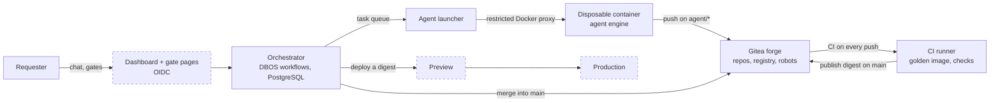

# EupaDev architecture (v2)

How the factory is wired: which pieces exist, how a tool travels from a
request to Production, and what keeps an autonomous agent from doing harm.
This describes the platform, not a generated tool: a tool's own rules are in
`tool-template/AGENTS.md`. Design decisions and their reasons are in
`ROADMAP.md` §8; this page summarises, it does not decide.

Each piece carries a status. **Built and tested** means it runs on the lab VMs
and a real test (`infra/ansible/verify-*.yml`) proves it. **Code and tests, not
deployed** means the code exists and its tests pass locally, but it does not
run as a service on the lab VMs yet. **Designed, not built yet** means the
design is settled in `ROADMAP.md` §8 and no code exists.

## The pieces

| Piece | What it does | Status |
|---|---|---|
| Git forge (Gitea) and organisation | Hosts one repository per tool, the template, the platform repositories (`engine`, `agent`, `keycloak`, `base-image`) and the container registry. Protected files (agent rules, pipelines, `Dockerfile`, `.dockerignore`, `.pnpmfile.*`…) are refused to agents. Installed by Ansible (`infra/`). | Built and tested (`verify-forge.yml`) |
| Robot accounts | Four accounts, one per role: `svc-agent`, `svc-orchestrator`, `svc-ci`, `svc-deployment`. Each has only the rights of its role (table below). | Built and tested (`verify-forge.yml`) |
| CI runners | A dedicated VM with two runners: `ci-standard` runs the checks that execute agent code (secrets, tests, analysis, guard rails) in the CI golden image, **without any Docker access**; `ci-image` is the only one with Docker (build with the fixed Dockerfile, scan, boot check against a throwaway migrated database, publication). | Built and tested (`verify-ci.yml`, `verify-template.yml`) |
| Golden image | Hardened Node.js base image, `build` and `run` variants, rebuilt and scanned weekly by the forge's CI; every tool image starts `FROM` it (`images/base-node/`). A third variant, `ci`, is the CI job image (gitleaks, Opengrep, pnpm preinstalled, pinned). | Built and tested (`verify-base-image.yml`) |
| Template | The repository copied for every new tool: agent charter, role prompts, domain rules, analysis rules, CI and the fixed Dockerfile of the platform, `.gitea/image/` (no agent writes a Dockerfile; installs run without any script; `/app` is read-only in the image; `tool-template/`). Its pipeline is green on a clean copy, red on an injected fault, and publishes on `main`. | Built and tested (`verify-template.yml`); the Preview pipeline is written but has never run (no Preview exists yet) |
| Shared base of the tools (`@eupadev/core`) | The common code every generated tool will use instead of writing it (ADR-019): Fastify 5 with a closed configuration, routes derived from the API contract (no start without an access rule per operation), Ajv 2020-12 validation of requests and responses, RFC 9457 errors, parameterised PostgreSQL access, append-only audit, separate database roles. Sign-in, sessions, web protections, front modules and the security test kit come next. | Code and tests, not deployed (`core/`, steps 2-3: unit tests, tests against a real PostgreSQL, type check, Squawk, GitHub CI); not yet wired into the template |
| Orchestrator | Durable workflows with DBOS 5.3 (TypeScript library, state in PostgreSQL): one workflow per tool, one child workflow per agent task, a queue with global concurrency N. Survives restarts; a gate is a durable wait. Also holds the registry of tools, runs the overlap search before scoping, and exposes per-cycle measures (`cycle_measures`: cost, durations, turns). | Built and tested (`verify-orchestrator.yml`, `verify-engine.yml`, `verify-engine-mails.yml`, `verify-engine-forge.yml`, `verify-engine-integration.yml`, `verify-engine-ci.yml`): signed image deployed by digest on its VM, local API through an SSH tunnel; unit, DB, Gherkin tests and mutations in GitHub CI |
| Agent launcher (executor) and disposable containers | The same engine code in the DBOS executor role, on the agents VM: takes tasks from the queue, starts one throw-away container per task under gVisor on an internal network, egress only through Smokescreen (public npm registry) and the AI proxy, which adds the key (never inside the container). Refuses any push that touches a forbidden path or leaves the role's scope. | Built and tested (`verify-agents.yml`, `verify-executor-claude.yml`) |
| Agent engine, interchangeable | The launcher calls an "engine" behind a fixed contract (in: repository, instruction, rules, budget cap; out: changed code, JSON report, cost). Claude Code is engine n°1: pinned signed binary (ADR-013), restricted mode, instructions taken from the signed engine image and never from the repository it reads (ADR-018); a test against a fake AI server in the agent image's CI blocks a version that could be hijacked. A **dummy engine** replays prepared answers so the whole chain can be tested without any AI call. | Built and tested (`verify-image-agent.yml`, `verify-engine-claude.yml`; a real paid call succeeded) |
| Identity | One identity provider, Keycloak 26, in front of the engine's API (and later the dashboard and the generated tools): realm `eupadev`, named administrator with MFA, admin console through an SSH tunnel only. A person is the stable pair (issuer, subject) of their access token, linked to an internal `actors` row by an append-only table, with an admin-recorded merge of identities; e-mail is a contact attribute. The engine verifies the token itself (`jose`: JWKS, `typ at+jwt`, issuer, audience `eupadev-api`, closed algorithm list) and reads two hats from the client roles: `requester`, `admin`; four eyes at Gate 2, enforced in code and in the database (ADR-017). | Built and tested (`verify-keycloak.yml`; engine side: `orchestrator/src/auth.ts`, migrations 0008 and 0010, unit, DB, API and Gherkin tests, mutations) |
| Dashboard and gate pages | Read-only view on the state tables, plus the pages where humans approve; sign-in through OIDC (Keycloak as provider). | Designed, not built yet |
| Secrets store | Today an encrypted Ansible vault per installation, decrypted in memory on the VMs (`systemd-creds`); OpenBao planned to replace it and to hold the image signing key. | Planned (paused until the 2nd real tool) |
| Deployment by digest | Preview and Production run an image named by its digest; the running digest per environment is recorded in a table. | `deployments` table and a fake deployer (W4) in `orchestrator/` (tests only). Deployment targets installed in the lab (ADR-022): previews on the CI VM, production on a dedicated tools VM, each behind a generic Caddy and reached by forced-command SSH on a `deployment` account; the target script deploys a Preview of a signed image in the platform Compose model (step E5d, lab test `verify-deployer.yml`); the engine's `SshDeployer` adapter calls it (ADR-022; the lab pilot still runs the fake deployer), mock-up and Production switch to come; unit tests of the script run in GitHub CI |

Dashed boxes do not run yet: the dashboard is designed, the deployment targets are installed but no tool has been deployed.

## The journey of a tool

| Step | What happens | Who |
|---|---|---|
| 1. Request | The requester describes the tool. The orchestrator searches its own registry (tables `tools`, `deployments`) for an existing tool covering the same need; a plausible overlap is raised to the product owner. | orchestrator |
| 2. Scoping | One agent builds a working mock-up with the requester and writes a short spec with stories (Given/When/Then). Not audited yet: the scope is still moving. | scoping agent |
| 3. Contract | The validated scope becomes an OpenAPI file and Gherkin features, then is frozen for the cycle. | contract agent |
| 4. Hardening | The tests agent writes the acceptance suite from the contract, without reading the code; then the builder agent writes the code (API, data, web interface) against the contract and that suite, which it can read but not change (ADR-021). Each works on its own branch `agent/<tool>/<cycle>/<role>` and folder. | tests agent, then builder agent |
| 5. Review | Two read-only reviewers (security, quality) report gaps with file and line; only the owning roles are relaunched. | two agents |
| 6. Merge | Once compliant, the orchestrator squashes into `main`. Only `svc-orchestrator` may write there. | orchestrator |
| 7. CI | One build, from the golden image: checks, scan, boot check (read-only, migrated throwaway database), then publication of the image **with its digest**. | CI |
| 8. Gate 1 | A human approves the tool's name and domain, once per tool. | human |
| 9. Preview | The digest is deployed; performance, accessibility, dynamic security checks and the tool's own acceptance suite run against it; only when all are green is the requester told and tries the tool. A red check or a requested change goes back to step 4 (the new digest is checked again before the requester is asked). | orchestrator, CI, requester |
| 10. Gate 2 | A human approves **this digest**, shown in the request. | human |
| 11. Production | The same digest is deployed. Nothing is rebuilt. | orchestrator |

Changes after Production go through the same cycle; there is no shortcut.
`main` plus short-lived branches only: no long-lived branch per environment,
the state of an environment is read from the `deployments` table.

## Trust model

The agent runs without interactive confirmation, so nothing relies on its
cooperation; everything relies on what it can reach.

| Measure | Effect | Status |
|---|---|---|
| Disposable container | One container per task, named after the task id, destroyed afterwards; no new privileges, all capabilities dropped, memory, CPU and process limits, no automatic restart. A replayed step destroys and recreates it, never duplicates it. | v1 code; v2 not built |
| Restricted Docker proxy | The launcher never sees the Docker socket. Allowed: creating, inspecting and listing containers, listing images, creating networks. Blocked: exec, volumes, swarm, secrets, plugins. | v1 code |
| Tokens by header | Git credentials are passed as an HTTP header on each command, never in the remote URL, never written to the clone's configuration. | v1 code; Ansible does the same |
| Network egress allow-list | The container reaches only the model API and the orchestrator, through an egress proxy; no open internet. | v1 code |
| Protected files refused at push | On `agent/**` branches, Gitea refuses at push time any change to `.gitea/`, `.opengrep/`, `.claude/`, `agents/`, `AGENTS*.md`, `CLAUDE.md`. An agent cannot rewrite its own rules or the pipeline to read organisation secrets. | Built and tested |
| CI jobs that run agent code have no Docker | Tests run on the `ci-standard` runner: no Docker socket, no `DOCKER_HOST`, no Docker client. Only the `image` job (runner `ci-image`) drives Docker; agent code is only built there and started in an isolated container without the socket. The pipeline file, which picks the runner, is protected; any branch outside `agent/**` and `main` is writable by the orchestrator only. | Built and tested |
| Two CI badges | A read-only registry token to pull the golden image on every branch; a write token used only by the publish step on `main`. | Built and tested |
| Robot accounts per role | See the table below. A compromised account stays within its role. | Built and tested |
| Rules injected by the orchestrator | The launcher passes the charter, the role prompt and the report format to the engine itself (Claude Code runs with `--bare`, which ignores the repository's own settings). Rules are not picked up from the clone. | Designed |
| Diff checked before merge | The orchestrator refuses a branch that touches another role's folders, the rules or the CI. | Designed |
| Everything read is data | Request text, files, web pages and command output are never instructions; written in the charter, backed by the measures above. | Charter |

| Account | Can | Cannot |
|---|---|---|
| `svc-agent` | push on `agent/*` | merge into `main`, publish an image, deploy |
| `svc-orchestrator` | create repositories, merge into `main` | publish an image, deploy |
| `svc-ci` | publish a candidate image | deploy, merge |
| `svc-deployment` | read the registry, deploy an approved digest | publish, merge |

Branch protections and tokens are defined once, in
`infra/ansible/group_vars/forge/vars.yml`; a tool repository generated from the
template gets them at creation (`verify-forge.yml`).

## Delivery

- **Build once.** The image is built at the merge into `main` and nowhere
  else. A deployment step that rebuilds would ship an image nobody validated.
- **Promote by digest.** Preview and Production pull `sha256:…`, never a tag
  (tags can be moved). Check results and approvals are recorded against the
  digest. The registry is the forge's own; the guarantee comes from the digest,
  not from the registry.
- **Golden state.** The last digest approved and running in Production. An
  incident is handled by redeploying it, never by rebuilding.
- **Rollback** = deploy the previous release's digest. Schema migrations are
  therefore backward compatible for one release (expand, switch, contract).
- **Signature.** Every image is signed with cosign at build time (one key for
  the platform images, another for the tools) and the signature is checked
  before anything runs. **Planned:** SBOM attestation, key moved to OpenBao.

## Sizing

The platform must work correctly at N = 1 agent on a small VM; parallelism
speeds things up, it is never required. N is set by environment variable and
measured in steps (1, then 3, then from available RAM and the model API's rate
limit), with a cap of 3 concurrent agents per tool. PostgreSQL is the only
extra infrastructure component.

## Where to look

- Rebuild the lab, run the real tests: `infra/README.md`.
- Base image variants and rebuild schedule: `images/base-node/README.md`.
- Decisions, alternatives rejected, open questions: `ROADMAP.md` §8.
- Who approves what, budgets, decommissioning: `docs/governance.md`.
- Installation at a client (VMs, isolation, monitoring, maintenance): `docs/deployment.md`.
