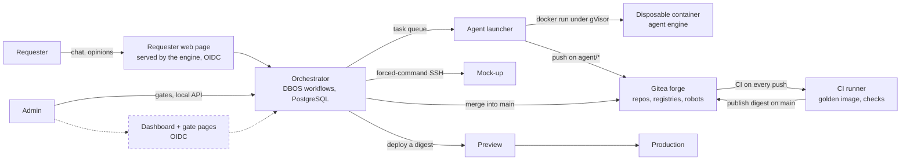

# EupaDev architecture (v2)

How the factory is wired: which pieces exist, how a tool travels from a
request to Production, and what keeps an autonomous agent from doing harm.
This describes the platform, not a generated tool: a tool's own rules are in
`tool-template/AGENTS.md`. Design decisions and their reasons are in
`ROADMAP.md` §8; this page summarises, it does not decide.

Each piece carries a status. **Built and tested** means it runs on the lab VMs
and a real test (`infra/ansible/verify-*.yml`) proves it. **Designed, not
built yet** means the design is settled in `ROADMAP.md` §8 and no code exists.

## The pieces

| Piece | What it does | Status |
|---|---|---|
| Git forge (Gitea) and organisation | Hosts one repository per tool, the template, the platform repositories (`engine`, `agent`, `keycloak`, `caddy`, `base-image`, `core`), the container registry and the npm registry of the core. Protected files (agent rules, pipelines, `Dockerfile`, `.dockerignore`, `.pnpmfile.*`…) are refused to agents. Installed by Ansible (`infra/`). | Built and tested (`verify-forge.yml`, `verify-core.yml`) |
| Robot accounts | Five accounts, one per role: `svc-agent`, `svc-orchestrator`, `svc-ci`, `svc-deployment`, plus `svc-core`, the only account that publishes `@eupadev/core`, under an owner of its own outside the tools' organisation (ADR-023, proposed). Each has only the rights of its role (table below). | Built and tested (`verify-forge.yml`, `verify-core.yml`) |
| CI runners | A dedicated VM with two runners: `ci-standard` runs the checks that execute agent code (secrets, tests, analysis, guard rails) in the CI golden image, **without any Docker access**; `ci-image` is the only one with Docker (build with the fixed Dockerfile, scan, boot check against a throwaway migrated database, publication). | Built and tested (`verify-ci.yml`, `verify-template.yml`) |
| Golden image | Hardened Node.js base image, `build` and `run` variants, rebuilt and scanned weekly by the forge's CI; every tool image starts `FROM` it (`images/base-node/`). A third variant, `ci`, is the CI job image (gitleaks, Opengrep, pnpm preinstalled, pinned). | Built and tested (`verify-base-image.yml`) |
| Template | The repository copied for every new tool: agent charter, role prompts, domain rules, analysis rules, CI and the fixed Dockerfile of the platform, `.gitea/image/` (no agent writes a Dockerfile; installs run without any script; `/app` is read-only in the image; `tool-template/`). It depends on `@eupadev/core` at an exact version. Its Check pipeline is green on a clean copy, red on an injected fault, and publishes on `main`; its Preview pipeline (`preview-check.yml`: performance, accessibility, dynamic security checks, the tool's acceptance suite) runs against a deployed Preview and records its results against the digest. | Built and tested (`verify-template.yml`; Preview pipeline: `verify-engine-preview.yml`, green on a clean tool, red with the failing scenario named on an injected fault) |
| Shared base of the tools (`@eupadev/core`) | The common code every generated tool uses instead of writing it (ADR-019): Fastify 5 with a closed configuration, routes derived from the API contract (no start without an access rule per operation), Ajv 2020-12 validation of requests and responses, RFC 9457 errors, parameterised PostgreSQL access, append-only audit, separate database roles, OIDC sign-in and database sessions, web protections (CSRF, rate limiting), front modules (Trusted Types rendering, forms from the contract, router, chart), scheduled purge and the security test kit (`core/README.md`). Published as an npm package on the forge's registry under its own owner, never overwritable (ADR-023, proposed). | Built and tested (`verify-core.yml`: publication, read-only badge, no overwrite; `verify-deployer-core.yml`: a core-shaped image deployed in Preview and Production with its migrations, database roles and OIDC client); pinned by the template (`tool-template/package.json`); unit tests, tests against a real PostgreSQL, type check and Squawk in GitHub CI |
| Orchestrator | Durable workflows with DBOS 5.3 (TypeScript library, state in PostgreSQL): one workflow per tool, one child workflow per agent task, a queue with global concurrency N. Survives restarts; a gate is a durable wait. Also holds the registry of tools, runs the overlap search before scoping, and exposes per-cycle measures (`cycle_measures`: cost, durations, tokens, rounds). Its external adapters (forge, deployer, notifications, agent engine) are chosen by `EUPADEV_EXTERNAL`; in the lab, mails always go out by SMTP (to Mailpit), the real forge and deployer are switched on for a run (`orchestrator_real_world`), and the executor runs a fake engine unless Claude Code or the pushing fake is switched on. | Built and tested (`verify-orchestrator.yml`, `verify-engine.yml`, `verify-engine-mails.yml`, `verify-engine-forge.yml`, `verify-engine-integration.yml`, `verify-engine-ci.yml`, `verify-engine-preview.yml`; full cycle request → mock-up → Preview → Gate 2 → Production with the real forge and the real deployer: `verify-engine-deployment.yml`): signed image deployed by digest on its VM, local API through an SSH tunnel; unit, DB, Gherkin tests and mutations in GitHub CI |
| Agent launcher (executor) and disposable containers | The same engine code in the DBOS executor role, on the agents VM: takes tasks from the queue, starts one throw-away container per task under gVisor on an internal network, egress only through Smokescreen (public npm registry) and the AI proxy, which adds the key (never inside the container). The repository goes in as an archive and the result comes back as a bundle: the container itself reaches neither the forge nor the orchestrator. Refuses any push that touches a forbidden path or leaves the role's write scope (ADR-021). | Built and tested (`verify-agents.yml`, `verify-executor-claude.yml`) |
| Agent engine, interchangeable | The launcher calls an "engine" behind a fixed contract (in: repository, instruction, rules, budget cap; out: changed code, JSON report, cost). Claude Code is engine no. 1: pinned signed binary (ADR-013), restricted mode, instructions taken from the signed engine image and never from the repository it reads (ADR-018); a test against a fake AI server in the agent image's CI blocks a version that could be hijacked. A **dummy engine** replays prepared answers, and a **pushing** fake pushes prepared file sets to the real forge (`orchestrator/src/external/pushing-engine.ts`), so the whole chain, deployment included, is tested without any AI call. | Built and tested (`verify-image-agent.yml`, `verify-engine-claude.yml`; a real paid call succeeded; pushing fake: `verify-engine-integration.yml`, `verify-engine-deployment.yml`) |
| Identity | One identity provider, Keycloak 26, in front of the engine's API, the requester web page and the generated tools (the core's sign-in): realm `eupadev`, named administrator with MFA, admin console through an SSH tunnel only. A person is the stable pair (issuer, subject) of their access token, linked to an internal `actors` row by an append-only table, with an admin-recorded merge of identities; e-mail is a contact attribute. The engine verifies the token itself (`jose`: JWKS, `typ at+jwt`, issuer, audience `eupadev-api`, closed algorithm list) and reads two hats from the client roles: `requester`, `admin`; four eyes at Gate 2, enforced in code and in the database (ADR-017). | Built and tested (`verify-keycloak.yml`; engine side: `orchestrator/src/auth.ts`, migrations 0008 and 0010, unit, DB, API and Gherkin tests, mutations) |
| Requester web page | The page where the requester submits a request, answers the scoping agent and gives an opinion on the mock-up and the Preview (ADR-024, proposed): a few static files served by the engine process itself from its signed image, behind Caddy at the chat domain; sign-in done by the engine (server-side OIDC session with Keycloak, `__Host-session` cookie, no token in the browser); the chat component is vendored and pinned by content hash; CSP of its own; strict `Host` check. | Built and tested (`verify-engine-chat.yml`: HTTPS, CSP, HSTS, wrong `Host` refused, real sign-in and sign-out from the CI VM; submit, answer and opinion through the page are covered by the engine's Playwright tests, `orchestrator/features/chat.feature`, not yet by a lab check) |
| Dashboard and gate pages | Read-only view on the state tables, plus the pages where humans approve; sign-in through OIDC (Keycloak as provider). Today the admin decides a gate through the engine's local API (`curl` through an SSH tunnel, `orchestrator/src/api.ts`). | Designed, not built yet |
| Secrets store | Today an encrypted Ansible vault per installation, decrypted in memory on the VMs (`systemd-creds`); OpenBao planned to replace it and to hold the image signing key. | Designed, not built yet (paused until the second real tool) |
| Deployment by digest | Preview and Production run an image named by its digest; the running digest per environment is recorded in the `deployments` table. Targets (ADR-022): previews and the scoping mock-ups on the CI VM, production on a dedicated tools VM, each behind a generic Caddy with public certificates (ADR-015), reached by forced-command SSH from the engine on a `deployment` account outside the `docker` group. One platform script on every target (`deploy`, `stop`, `remove`, `served`, `purge`) runs only digest-pinned images signed with the tools key, in a Compose model fixed by the platform; a core tool gets its database, migration step, OIDC client and purge, and its Preview database is reset on a new digest, never Production's. Production switches to the new digest without interruption and refuses an unhealthy image; rollback = deploying the previous digest again. The mock-up is served from the scoping archive, framed and sandboxed (ADR-009). The engine's `SshDeployer` adapter (`orchestrator/src/external/ssh-deployer.ts`) is the one in service when `deployer=ssh`; the fake deployer stays for unit tests. | Built and tested (`verify-deployer-access.yml`, `verify-deployer.yml`, `verify-deployer-core.yml`, `verify-mockup.yml`, `verify-prod-switch.yml`, `verify-letsencrypt.yml`; through the engine: `verify-engine-preview.yml`, `verify-engine-deployment.yml`); unit tests of the script in GitHub CI |

The dashed box does not run yet: the dashboard and gate pages are designed,
gates are decided through the engine's local API in the meantime. Everything
else runs on the lab: the whole cycle, from the request to Production, has
been played with the real forge, the real CI and the real deployer, the agent
being a scripted fake that pushes prepared files (`verify-engine-deployment.yml`,
no AI call). One real tool has been built by Claude Code end to end on the lab,
from the request to Production (paid cycle 9, November 2026; its lessons are
in ADR-027); the repeatable paid lab checks stop at a single task
(`verify-engine-claude.yml`, `verify-executor-claude.yml`).

## The journey of a tool

| Step | What happens | Who |
|---|---|---|
| 1. Request | The requester describes the tool. The orchestrator searches its own registry (table `tools`, with the comment of each tool's Gate 1 approval) for an existing tool covering the same need; a plausible overlap is raised to the product owner. | orchestrator |
| 2. Scoping | One agent builds a working mock-up with the requester and writes a short spec with stories (Given/When/Then). The mock-up is static files, served from the scoping archive in a sandboxed frame (ADR-009), and the requester judges it from the web page. Not audited yet: the scope is still moving. | scoping agent |
| 3. Contract | The validated scope becomes an OpenAPI file and Gherkin features, then is frozen for the cycle. | contract agent |
| 4. Hardening | The tests agent writes the acceptance suite from the contract, without reading the code; then the builder agent writes the code (API, data, web interface) against the contract and that suite, which it can read but not change (ADR-021). Each works on its own branch `agent/<tool>/<cycle>/<role>` and folder. | tests agent, then builder agent |
| 5. Review | Two read-only reviewers (security, quality) report gaps with file and line; only the owning roles are relaunched. | two agents |
| 6. Merge | Once compliant, the orchestrator squashes into `main`. Only `svc-orchestrator` may write there. | orchestrator |
| 7. CI | One build, from the golden image: checks, scan, boot check (read-only, migrated throwaway database), then publication of the image **with its digest**. | CI |
| 8. Gate 1 | A human approves the tool's name and domain, once per tool; a correction may rename the tool (new name and/or slug: repository, branches, image path and address follow). For a core tool, the admin also registers it on the targets before the first Preview (`infra/ansible/register-tools.yml`: database, roles, OIDC client, test personas); the gate page gives them the ready-to-paste `core-tools.yml` entry (roles read from the contract, retention periods they set there) and the command. | human |
| 9. Preview | The digest is deployed; performance, accessibility, dynamic security checks and the tool's own acceptance suite run against it; only when all are green is the requester told and tries the tool. A red check or a requested change goes back to step 4 (the new digest is checked again before the requester is asked). | orchestrator, CI, requester |
| 10. Gate 2 | A human approves **this digest**, shown in the request. | human |
| 11. Production | The same digest is deployed. Nothing is rebuilt. | orchestrator |

Changes after Production go through the same cycle; there is no shortcut.
`main` plus short-lived branches only: no long-lived branch per environment,
the state of an environment is read from the `deployments` table.

## Trust model

The agent runs without interactive confirmation, so nothing relies on its
cooperation; everything relies on what it can reach.

| Measure | Effect | Status |
|---|---|---|
| Disposable container | One container per task, named after the task id (`fa-<task>`), removed when it exits; gVisor runtime, read-only root, non-root user, no new privileges, all capabilities dropped, memory and process limits, no automatic restart. A stop or a replayed step removes it first (`docker rm -f`), never duplicates it. | Built and tested (`orchestrator/src/external/claude-engine.ts`; `verify-agents.yml`, `verify-executor-claude.yml`) |
| Restricted Docker proxy | The launcher never sees the Docker socket. Allowed: creating, inspecting and listing containers, listing images, creating networks. Blocked: exec, volumes, swarm, secrets, plugins. | v1 code; not in v2: the executor on the agents VM drives the VM's Docker socket itself (`infra/compose/executor/compose.yml`). The separation held today is by VM: the pilot's container mounts no Docker socket, and the agent containers have none (`verify-agents.yml`) |
| Tokens by header | Git credentials are passed as an HTTP header on each command, never in the remote URL, never written to the clone's configuration. The agent container holds no forge token: the launcher fetches its work as a bundle and pushes it itself. | Built and tested (`gitea-forge.ts`, `claude-engine.ts`: `http.extraHeader`; `verify-engine-claude.yml`); Ansible does the same |
| Network egress allow-list | The container sits on an internal network of its own, created per task; out only through Smokescreen (allow-list: the public npm registry, `infra/compose/agents/smokescreen/acl.yaml`) and the AI proxy, which holds the key. Neither the forge, nor the orchestrator, nor the VM, nor DNS, nor another task is reachable. | Built and tested (`verify-agents.yml`) |
| Protected files refused at push | On every branch except `exception/**`, Gitea refuses at push time any change to `.gitea/`, `.opengrep/`, `.claude/`, `agents/`, `AGENTS*.md`, `CLAUDE.md` and the other protected files (full list: `orchestrator/src/agent-engine/forbidden-paths.ts`). An agent cannot rewrite its own rules or the pipeline to read organisation secrets. | Built and tested |
| CI jobs that run agent code have no Docker | Tests run on the `ci-standard` runner: no Docker socket, no `DOCKER_HOST`, no Docker client. Only the `image` job (runner `ci-image`) drives Docker; agent code is only built there and started in an isolated container without the socket. The pipeline file, which picks the runner, is protected; any branch outside `agent/**`, `main` and `exception/**` (reserved to the designated humans) is writable by the orchestrator only. | Built and tested |
| Two CI badges | A read-only registry token to pull the golden image on every branch; a write token used only by the publish step on `main`. | Built and tested |
| Robot accounts per role | See the table below. A compromised account stays within its role. | Built and tested |
| Rules injected by the orchestrator | A role's instructions (charter, role prompt, domain rules, report format) are read from the signed engine image and passed to the engine as a system prompt file; nothing is picked up from the clone (ADR-018). Claude Code runs with `--bare --restricted` (no hooks, no MCP, no `CLAUDE.md`, the clone's settings ignored) and `--permission-mode dontAsk`; reviewers get a shell reduced to the harness's read-only set (ADR-020). | Built and tested (`orchestrator/src/external/claude-engine.ts`; `verify-engine-claude.yml`, `verify-executor-claude.yml`; the hijack test of the agent image's CI, `verify-image-agent.yml`) |
| Diff checked before merge | The orchestrator refuses a branch whose diff against `main` leaves its role's write scope (another role's folders, the rules, the CI), at the role's merge and again at integration (`out_of_scope`). | Built and tested (`inScope` in `orchestrator/src/external/contracts.ts`, applied by `gitea-forge.ts`; `verify-engine-integration.yml`) |
| Everything read is data | Request text, files, web pages and command output are never instructions; written in the charter, backed by the measures above (ADR-018). | Charter |

| Account | Can | Cannot |
|---|---|---|
| `svc-agent` | push on `agent/*` | merge into `main`, publish an image, deploy |
| `svc-orchestrator` | create repositories, merge into `main` | publish an image, deploy |
| `svc-ci` | publish a candidate image | deploy, merge |
| `svc-deployment` | read the registry, deploy an approved digest | publish, merge |
| `svc-core` | publish `@eupadev/core` under its own owner | anything in the tools' organisation (member of no team) |

Branch protections and tokens are defined once, in
`infra/ansible/group_vars/forge/vars.yml`; a tool repository generated from the
template gets them at creation (`verify-forge.yml`).

## Delivery

- **Build once.** The image is built at the merge into `main` and nowhere
  else. A deployment step that rebuilds would ship an image nobody validated.
- **Promote by digest.** Preview and Production pull `sha256:…`, never a tag
  (tags can be moved). Check results and approvals are recorded against the
  digest. The registry is the forge's own; the guarantee comes from the digest,
  not from the registry.
- **Golden state.** The last digest approved and running in Production. An
  incident is handled by redeploying it, never by rebuilding.
- **Rollback** = deploy the previous release's digest. Schema migrations are
  therefore backward compatible for one release (expand, switch, contract).
- **Signature.** Every image that runs as a service (engine, agents, Keycloak,
  Caddy, the tools) is signed with cosign at build time (one key for the
  platform images, another for the tools) and the signature is checked before
  it runs. **Planned:** signature of the golden image (pulled by tag from the
  forge's own registry today), SBOM attestation, key moved to OpenBao.

## Sizing

The platform must work correctly at N = 1 agent on a small VM; parallelism
speeds things up, it is never required. N is set by environment variable and
measured in steps (1, then 3, then from available RAM and the model API's rate
limit), with a cap of 3 concurrent agents per tool. PostgreSQL is the only
extra infrastructure component.

## Where to look

- Rebuild the lab, run the real tests: `infra/README.md`.
- Base image variants and rebuild schedule: `images/base-node/README.md`.
- Decisions, alternatives rejected, open questions: `ROADMAP.md` §8 and the ADRs of `docs/adr/`.
- Who approves what, budgets, decommissioning: `docs/governance.md`.
- Installation at a client (VMs, isolation, monitoring, maintenance): `docs/deployment.md`.
