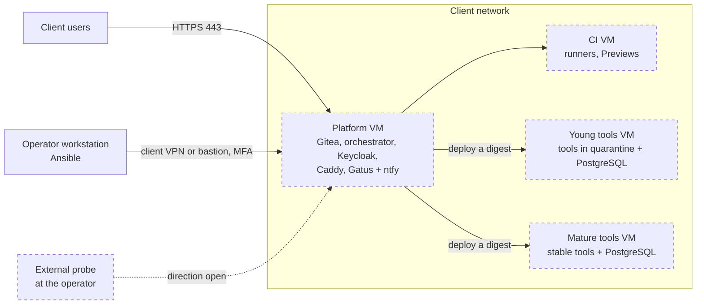

# Installing EupaDev at a client

How EupaDev runs inside a client's network: which VMs, what runs on each,
how tools are kept apart, and how the installation is monitored, administered,
updated and backed up. This page explains the operating model; what the
client's IT department must provide (VMs, network flows, accounts, checklist)
is in `docs/client-prerequisites.md`, not repeated here. Decisions behind this
page: `ROADMAP.md` §8.15 ("Installation at the client", decisions 1-15).

Each item carries a status. **In place** means it runs on the lab VMs and a
real test (`infra/ansible/verify-*.yml`) proves it. **Decided, not built**
means the decision is settled in `ROADMAP.md` §8.15 and nothing runs yet.
**Open** means not decided. No client installation exists yet: the lab runs
5 VMs (forge, CI, orchestrator, AI agents, tools), not the 4-VM layout below.
The lab's tools VM hosts the production of the generated tools behind a
generic Caddy (`*.<domain>`), reached by the engine only through a restricted
`deployment` account (ADR-022); previews stay on the CI VM.

## The appliance model

EupaDev is installed as an **appliance** (option C, decision 1): the
client's IT department provides blank Ubuntu 24.04 VMs on its own hypervisor;
EupaDev never accesses the hypervisor.

| Below the VMs: the client's IT department | Inside the VMs: the EupaDev operator |
|---|---|
| Hypervisor, storage, VM creation and resizing | System configuration, security updates, reboots |
| Network, firewall between zones, DNS, directory | EupaDev, the generated tools, their databases |
| Backup of whole VMs | Application backups, monitoring |

Operation is **managed by the operator** at the start (decision 2). The AI
key is in the **client's name** (decision 11). Gates are approved by a
**business referent**; the IT department is notified and has a **veto** on
sensitive tools or tools on the hardened profile (decision 12). Status:
decided, not built.

## The four VMs

| VM | What runs on it |
|---|---|
| Platform | Git forge and image registry (Gitea), orchestrator, identity (Keycloak), reverse proxy (Caddy), monitoring (Gatus, ntfy) |
| CI | CI runners and Previews (code not yet approved) |
| Young tools | New tools during their quarantine, with their PostgreSQL |
| Mature tools | Stable tools, with their PostgreSQL |

About 14-16 vCPU, 42-46 GB RAM, 700 GB disk in total; these are estimates, to
be measured during the first real runs (decision 3). Sizes per VM are in
`docs/client-prerequisites.md` §1. A sensitive tool may add a fifth VM (below).
Measured on the lab on 2026-11-07, the five lab VMs idle use about 4.7 GB of
RAM and about 90 GB of disk in total: the figures above are the sizes given to
the VMs for a company's load, not what the platform needs to start.
During a whole free cycle on 2026-11-10 (made-up agents, real forge, CI,
Preview and checks; memory used inside each VM, sampled every 30 s), the peaks
were: forge 0.9 GB, CI 1.4 GB (Preview checks), engine 1.4 GB, agents 0.6 GB,
tools 0.7 GB, about 5 GB in total. Real AI agents add their containers on the
agents VM; that peak is still to measure.

Dashed boxes are decided, not built (the lab has a forge VM, a CI VM, an
orchestrator VM, an AI agents VM and a tools VM).

## Isolation

| Measure | Status |
|---|---|
| One container per tool, with its own network, RAM/CPU limits, a non-root user and a read-only file system | In place in the lab (`infra/compose/deployer/tool.compose.yml`; `verify-deployer.yml`, `verify-prod-switch.yml`) |
| One PostgreSQL per VM, **one database and one account per tool**, with a connection cap and a maximum query duration; never a shared table (decision 5) | In place in the lab for core tools (one database and three roles per tool, `register-tools.yml`, `verify-deployer-core.yml`); connection cap and query duration: decided, not built |
| Previews run on the CI VM with a throw-away database, **never next to Production** (decision 6) | In place in the lab (`verify-deployer.yml`, `verify-engine-preview.yml`): the Preview database is emptied on a new digest |
| A sensitive tool (HR, payroll, personal data) gets **its own VM**, decided at Gate 1 (decision 6) | Decided, not built |
| **Quarantine**: a new tool moves to the Mature tools VM after **4 weeks without incident**; the promotion is approved by the operator (decision 4) | Decided, not built |

## Communication between tools

Tools talk to each other **only through HTTPS APIs via Caddy**, never through
the other tool's database (decision 7):

- each tool has its own **Keycloak service account**; a user's token is never
  forwarded;
- the dependency is declared at Gate 1 and backed by an OpenAPI contract;
- no load balancer and no API gateway for now: one instance per tool is
  enough for internal tools. Tools stay stateless to keep that door open.

Status: decided, not built (Keycloak is in place, `verify-keycloak.yml`; calls
between tools are not). Whether there is one central Caddy or one per tool VM
is **open**.

## Monitoring and operations dashboard

| Item | Status |
|---|---|
| **Gatus** status page and **ntfy** notifications on the Platform VM; VictoriaMetrics/Logs later, no Grafana (decision 8) | Decided, not built |
| An **external probe** at the operator's site (decision 8); its direction (it polls the client, or the client notifies it) | Decided, not built; direction **open** |
| Each tool registers itself in Gatus when deployed (decision 14) | Decided, not built |
| Each tool exposes `/health`; the template's CI checks that the built image answers 200 on it | In place (`verify-template.yml`) |
| `/health` also checks the tool's database | In place (the core's `/health`, `core/src/http.js`) |
| **Operations dashboard**: "does it work?" is the Gatus status page; "what needs doing?" is the Maintenance tab of the EupaDev dashboard (pending reboot, golden image, CVEs, missed backup, unused tool), which links to Gatus rather than redoing it (decision 14) | Decided, not built |

## Remote administration and diagnostics

| Item | Status |
|---|---|
| Ansible run from the operator's workstation; one inventory and one encrypted vault per client (decision 9) | In place in the lab (the lab inventory and its vaults) |
| Access through the **client's VPN or bastion**, **nominative, MFA, logged** (NIS2 through the contract, ANSSI guide PA-022) | Decided, not built |
| SSH by key only, no root login | In place (`verify-system.yml`) |
| No software agent installed at the client; Terraform/OpenTofu optional there | Decided |
| **Diagnostics by Claude**: Claude runs on the operator's workstation, launches **read-only** Ansible diagnostic recipes with a `diagnostic` SSH account that has no admin rights; personal data is masked; the operator reviews and applies any correction; consent in the data processing agreement; no Claude at all for a very sensitive client (decision 10) | Decided, not built |

## Maintenance

All of this is in the `base` role, on every VM, and proven by
`verify-system.yml` (details: `infra/README.md`, "Operations: system base
and maintenance"). **In place** in the lab.

- **Automatic security updates** every day (`unattended-upgrades`, security
  origins only), without automatic reboot.
- `needrestart` in list mode: no service (Docker included) is restarted on
  its own after an update.
- **Night maintenance window**: when Ubuntu asks for a reboot, each VM
  reboots at its own time (lab: from 03:15 to 04:15 UTC, a quarter of an hour
  apart), after the backup and never two VMs at the same time.
- **Alert** if a reboot has been pending for more than 7 days (the check
  fails).
- Immediate reboot by hand: `maintenance.yml` reboots only the VMs that need
  it, **one at a time**, and waits for their containers to come back healthy
  before the next one.

## Backups

Two tiers (decision 13): the IT department backs up whole VMs, EupaDev
backs up its own data.

| Item | Status |
|---|---|
| Nightly application backup at 02:30 UTC with each service's native method (`gitea dump` for the forge, `pg_dump` for the orchestrator and Keycloak databases), 7 kept (4 on the forge) | In place |
| Real restore tested automatically in throw-away containers | In place (`verify-backup.yml`) |
| Encrypted copy outside the VMs (restic, to a target the client provides) | Decided, not built: today backups stay **on the VM** |
| Backup of each tool's database | In place on the tools VM: one `pg_dump` per Production database (`verify-deployer-core.yml`) |

Rebuilding = blank VMs + the Ansible recipes + the latest backup (procedure in
`infra/README.md`). Details for the IT department: `docs/client-prerequisites.md`
§4.

## What is missing before a real client

From `ROADMAP.md` §8.15 (blockers found while writing the prerequisites):

- **Outbound proxy**: no support in `infra/` (apt, Docker, CI).
- **Data disk**: found by its LXD name (`docker_disk_device`), which does not
  exist on a VM supplied by the IT department.
- **Certificates**: Caddy cannot yet use a certificate supplied by the client
  (today `internal` or Let's Encrypt by DNS-01, which exposes nothing but needs
  API access to the DNS host; OVH is the lab's DNS provider, Caddy has DNS
  modules for other providers, none built or tested here).
- **Reversibility**: handing over the secrets vault to the client at the end
  of the contract is to be designed.
- **Open questions**: one central Caddy or one per tool VM; direction of the
  external probe.

Also planned for the client step: a Hyper-V test in the lab (decision 13). The
move of the lab to **OpenTofu + Incus** (ADR-010, rejected) does not concern a
client installation, where the IT department provides the VMs.
