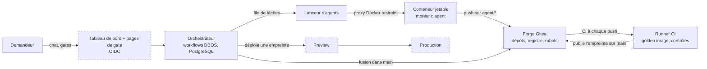

> Traduction destinée aux lecteurs humains. La version anglaise `docs/architecture.md` fait foi.

# Architecture de EupaDev (v2)

Comment l'usine est câblée : quelles pièces existent, comment un outil va de la
demande à la Production, et ce qui empêche un agent autonome de nuire. Ce
document décrit la plateforme, pas un outil généré : les règles d'un outil sont
dans `tool-template/AGENTS.md`. Les décisions de conception et leurs raisons
sont dans `ROADMAP.md` §8 ; cette page résume, elle ne décide pas.

Chaque pièce porte un statut. **Construit et testé** : la pièce tourne sur les
VM du labo et un test réel (`infra/ansible/verify-*.yml`) le prouve. **Code
et tests, pas déployé** : le code existe et ses tests passent en local, mais il
ne tourne pas encore en service sur les VM du labo. **Conçu, pas encore
construit** : la conception est arrêtée dans `ROADMAP.md` §8 et aucun code
n'existe.

## Les pièces

| Pièce | Ce qu'elle fait | Statut |
|---|---|---|
| Forge Git (Gitea) et organisation | Héberge un dépôt par outil, le template, les dépôts de la plateforme (`engine`, `agent`, `keycloak`, `base-image`) et le registre de conteneurs. Les fichiers protégés (règles des agents, pipelines, `Dockerfile`, `.dockerignore`, `.pnpmfile.*`…) sont refusés aux agents. Installée par Ansible (`infra/`). | Construit et testé (`verify-forge.yml`) |
| Comptes robots | Quatre comptes, un par rôle : `svc-agent`, `svc-orchestrator`, `svc-ci`, `svc-deployment`. Chacun n'a que les droits de son rôle (tableau plus bas). | Construit et testé (`verify-forge.yml`) |
| Runners CI | Une VM dédiée avec deux runners : `ci-standard` exécute les contrôles qui font tourner le code des agents (secrets, tests, analyse, garde-fous) dans la golden image CI, **sans aucun accès à Docker** ; `ci-image`, le seul avec Docker (construction avec le Dockerfile fixe, scan, démarrage contre une base jetable migrée, publication). | Construit et testé (`verify-ci.yml`, `verify-template.yml`) |
| Golden image | Image de base Node.js durcie, variantes `build` et `run`, reconstruite et scannée chaque semaine par la CI de la forge ; chaque image d'outil part d'elle (`FROM`) (`images/base-node/`). Une 3e variante, `ci`, est l'image des jobs de CI (gitleaks, Opengrep, pnpm préinstallés, versions figées). | Construit et testé (`verify-base-image.yml`) |
| Template | Le dépôt copié pour chaque nouvel outil : charte des agents, prompts de rôle, règles par domaine, règles d'analyse, CI et le Dockerfile fixe de la plateforme, `.gitea/image/` (aucun agent n'écrit de Dockerfile ; installation sans aucun script ; `/app` en lecture seule dans l'image ; `tool-template/`). Son pipeline est vert sur une copie propre, rouge sur une faute injectée, et publie sur `main`. | Construit et testé (`verify-template.yml`) ; le pipeline de Preview est écrit mais n'a jamais tourné (aucune Preview n'existe encore) |
| Socle commun des outils (`@eupadev/core`) | Le code commun que chaque outil généré utilisera au lieu de l'écrire (ADR-019) : Fastify 5 à configuration fermée, routes tirées du contrat d'API (pas de démarrage sans règle d'accès sur chaque opération), validation Ajv 2020-12 des requêtes et des réponses, erreurs RFC 9457, accès PostgreSQL paramétré, audit en ajout seul, rôles de base séparés. Viendront ensuite la connexion, les sessions, les protections web, les modules front et le kit de tests de sécurité. | Code et tests, pas déployé (`core/`, étapes 2-3 : tests unitaires, tests contre un vrai PostgreSQL, typage, Squawk, CI GitHub) ; pas encore branché dans le template |
| Orchestrateur | Workflows durables avec DBOS 5.3 (bibliothèque TypeScript, état dans PostgreSQL) : un workflow par outil, un workflow enfant par tâche d'agent, une file à concurrence globale N. Survit aux redémarrages ; une gate est une attente durable. Tient aussi le registre des outils, fait la recherche de chevauchement avant le cadrage, et expose les mesures par cycle (`cycle_measures` : coût, durées, tours). | Construit et testé (`verify-orchestrator.yml`, `verify-engine.yml`, `verify-engine-mails.yml`, `verify-engine-forge.yml`, `verify-engine-integration.yml`, `verify-engine-ci.yml`) : image signée déployée par empreinte sur sa VM, API locale par tunnel SSH ; tests unitaires, base, Gherkin et mutations dans la CI GitHub |
| Lanceur d'agents (exécuteur) et conteneurs jetables | Le même code que le moteur, en rôle exécuteur DBOS, sur la VM agents : prend les tâches dans la file, démarre un conteneur jetable par tâche sous gVisor sur un réseau interne, avec pour seules sorties Smokescreen (registre npm public) et le proxy IA, qui ajoute la clé (jamais dans le conteneur). Refuse toute poussée qui touche un chemin interdit ou sort du périmètre du rôle. | Construit et testé (`verify-agents.yml`, `verify-executor-claude.yml`) |
| Moteur d'agent interchangeable | Le lanceur appelle un « moteur » derrière un contrat fixe (entrée : dépôt, consigne, règles, plafond de budget ; sortie : code modifié, rapport JSON, coût). Claude Code est le moteur n°1 : binaire signé figé (ADR-013), mode restreint, consignes tirées de l'image signée du moteur et jamais du dépôt qu'il lit (ADR-018) ; un essai contre un faux serveur IA, dans la CI de l'image des agents, bloque une version qui se laisserait détourner. Un **moteur factice** rejoue des réponses préparées pour tester toute la chaîne sans aucun appel d'IA. | Construit et testé (`verify-image-agent.yml`, `verify-engine-claude.yml` ; un vrai appel payant a réussi) |
| Identité | Un seul fournisseur d'identité, Keycloak 26, devant l'API du moteur (puis le tableau de bord et les outils générés) : realm `eupadev`, administrateur nominatif avec MFA, console d'administration par tunnel SSH seulement. Une personne est le couple stable (émetteur, sujet) de son jeton d'accès, lié à une ligne interne `actors` par une table en ajout seul, avec une fusion d'identités enregistrée par l'admin ; le mail est un attribut de contact. Le moteur vérifie lui-même le jeton (`jose` : JWKS, `typ at+jwt`, émetteur, audience `eupadev-api`, liste d'algorithmes fermée) et lit deux casquettes dans les rôles du client : `requester`, `admin` ; quatre yeux à la Gate 2, appliqué par le code et par la base (ADR-017). | Construit et testé (`verify-keycloak.yml` ; côté moteur : `orchestrator/src/auth.ts`, migrations 0008 et 0010, tests unitaires, base, API, Gherkin, mutations) |
| Tableau de bord et pages de gate | Vue en lecture seule sur les tables d'état, plus les pages où les humains approuvent ; connexion par OIDC (Keycloak comme fournisseur). | Conçu, pas encore construit |
| Coffre des secrets | Aujourd'hui un coffre Ansible chiffré par installation, déchiffré en mémoire sur les VM (`systemd-creds`) ; OpenBao prévu pour le remplacer et porter la clé de signature des images. | Prévu (en pause jusqu'au 2e outil réel) |
| Déploiement par empreinte | Preview et Production font tourner une image désignée par son empreinte ; l'empreinte en cours par environnement est enregistrée dans une table. | Table `deployments` et déployeur factice (W4) dans `orchestrator/` (tests uniquement). Cibles de déploiement installées au labo (ADR-022) : Previews sur la VM CI, Prod sur une VM outils dédiée, chacune derrière un Caddy générique et atteinte par SSH à commande forcée sur un compte `deployment` ; le script des cibles déploie une Preview d'une image signée dans le modèle Compose de la plateforme (étape E5d, test au labo `verify-deployer.yml`) ; l'adaptateur `SshDeployer` du moteur l'appelle (ADR-022 ; le pilote du labo garde le déployeur factice), maquette et bascule de la Prod à venir ; tests unitaires du script dans la CI GitHub |

Les cadres en pointillé ne tournent pas encore : le tableau de bord est conçu, les cibles de déploiement sont installées mais aucun outil n'y a été déployé.

## Le parcours d'un outil

| Étape | Ce qui se passe | Qui |
|---|---|---|
| 1. Demande | Le demandeur décrit l'outil. L'orchestrateur cherche dans son propre registre (tables `tools`, `deployments`) un outil existant couvrant le même besoin ; un chevauchement plausible est remonté au propriétaire produit. | orchestrateur |
| 2. Cadrage | Un agent construit une maquette fonctionnelle avec le demandeur et écrit une spécification courte avec des stories (Given/When/Then). Pas encore audité : le périmètre bouge. | agent de cadrage |
| 3. Contrat | Le périmètre validé devient un fichier OpenAPI et des features Gherkin, puis est figé pour le cycle. | agent de contrat |
| 4. Durcissement | L'agent de tests écrit la suite d'acceptation à partir du contrat, sans lire le code ; puis l'agent builder écrit le code (API, données, interface web) contre le contrat et cette suite, qu'il peut lire mais pas modifier (ADR-021). Chacun travaille sur sa branche `agent/<outil>/<cycle>/<rôle>` et son dossier. | agent de tests, puis agent builder |
| 5. Review | Deux relecteurs en lecture seule (sécurité, qualité) signalent les écarts avec fichier et ligne ; seuls les rôles propriétaires sont relancés. | deux agents |
| 6. Fusion | Une fois conforme, l'orchestrateur fusionne (squash) dans `main`. Seul `svc-orchestrator` peut y écrire. | orchestrateur |
| 7. CI | Une seule construction, à partir de la golden image : contrôles, scan, démarrage (lecture seule, base jetable migrée), puis publication de l'image **avec son empreinte**. | CI |
| 8. Gate 1 | Un humain approuve le nom et le domaine de l'outil, une seule fois par outil. | humain |
| 9. Preview | L'empreinte est déployée ; les contrôles de performance, d'accessibilité, de sécurité dynamique et la suite d'acceptation de l'outil tournent dessus ; seulement quand tout est vert, le demandeur est prévenu et essaie l'outil. Un contrôle rouge ou une correction demandée renvoie à l'étape 4 (la nouvelle empreinte est recontrôlée avant de solliciter le demandeur). | orchestrateur, CI, demandeur |
| 10. Gate 2 | Un humain approuve **cette empreinte**, affichée dans la demande. | humain |
| 11. Production | La même empreinte est déployée. Rien n'est reconstruit. | orchestrateur |

Toute modification après la Production repasse par le même cycle ; il n'y a pas
de raccourci. `main` plus branches courtes uniquement : pas de branche longue
par environnement, l'état d'un environnement se lit dans la table `deployments`.

## Modèle de confiance

L'agent tourne sans confirmation interactive : rien ne repose sur sa
coopération, tout repose sur ce qu'il peut atteindre.

| Mesure | Effet | Statut |
|---|---|---|
| Conteneur jetable | Un conteneur par tâche, nommé d'après l'identifiant de la tâche, détruit ensuite ; pas de nouveaux privilèges, toutes les capacités retirées, limites mémoire, CPU et processus, pas de redémarrage automatique. Une étape rejouée détruit et recrée le conteneur, jamais ne le duplique. | code v1 ; v2 pas construite |
| Proxy Docker restreint | Le lanceur ne voit jamais le socket Docker. Autorisé : créer, inspecter, lister des conteneurs, lister des images, créer des réseaux. Bloqué : exec, volumes, swarm, secrets, plugins. | code v1 |
| Jetons par en-tête | Les identifiants Git passent en en-tête HTTP à chaque commande, jamais dans l'URL du remote, jamais écrits dans la configuration du clone. | code v1 ; Ansible fait de même |
| Sortie réseau en liste blanche | Le conteneur n'atteint que l'API du modèle et l'orchestrateur, via un proxy sortant ; pas d'Internet ouvert. | code v1 |
| Fichiers protégés refusés au push | Sur les branches `agent/**`, Gitea refuse au moment du push toute modification de `.gitea/`, `.opengrep/`, `.claude/`, `agents/`, `AGENTS*.md`, `CLAUDE.md`. Un agent ne peut pas réécrire ses règles ni le pipeline pour lire les secrets de l'organisation. | Construit et testé |
| Pas de Docker pour les jobs qui exécutent le code des agents | Les tests tournent sur le runner `ci-standard` : ni socket Docker, ni `DOCKER_HOST`, ni client Docker. Seul le job `image` (runner `ci-image`) pilote Docker ; le code des agents n'y est que construit et démarré dans un conteneur isolé, sans le socket. Le fichier de pipeline, qui choisit le runner, est protégé ; toute branche hors `agent/**` et `main` n'est modifiable que par l'orchestrateur. | Construit et testé |
| Deux badges CI | Un jeton de registre en lecture seule pour télécharger la golden image sur toute branche ; un jeton d'écriture utilisé uniquement par l'étape de publication sur `main`. | Construit et testé |
| Comptes robots par rôle | Voir le tableau ci-dessous. Un compte compromis reste borné à son rôle. | Construit et testé |
| Règles injectées par l'orchestrateur | Le lanceur passe lui-même au moteur la charte, le prompt du rôle et le format du rapport (Claude Code tourne avec `--bare`, qui ignore les réglages du dépôt). Les règles ne sont pas ramassées dans le clone. | Conçu |
| Diff contrôlé avant fusion | L'orchestrateur refuse une branche qui touche les dossiers d'un autre rôle, les règles ou la CI. | Conçu |
| Tout ce qui est lu est une donnée | Texte de la demande, fichiers, pages web et sorties de commande ne sont jamais des instructions ; écrit dans la charte, appuyé par les mesures ci-dessus. | Charte |

| Compte | Peut | Ne peut pas |
|---|---|---|
| `svc-agent` | pousser sur `agent/*` | fusionner dans `main`, publier une image, déployer |
| `svc-orchestrator` | créer des dépôts, fusionner dans `main` | publier une image, déployer |
| `svc-ci` | publier une image candidate | déployer, fusionner |
| `svc-deployment` | lire le registre, déployer une empreinte approuvée | publier, fusionner |

Protections de branche et jetons sont définis une seule fois, dans
`infra/ansible/group_vars/forge/vars.yml` ; un dépôt d'outil généré depuis le
template les reçoit dès sa création (`verify-forge.yml`).

## Livraison

- **Construire une fois.** L'image est construite à la fusion dans `main` et
  nulle part ailleurs. Une étape de déploiement qui reconstruirait livrerait
  une image que personne n'a validée.
- **Promouvoir par empreinte.** Preview et Production tirent `sha256:…`, jamais
  une étiquette (une étiquette peut être déplacée). Résultats des contrôles et
  approbations sont enregistrés contre l'empreinte. Le registre est celui de la
  forge ; la garantie vient de l'empreinte, pas du registre.
- **Golden state.** La dernière empreinte approuvée et en cours en Production.
  Un incident se traite en la redéployant, jamais en reconstruisant.
- **Retour arrière** = déployer l'empreinte de la release précédente. Les
  migrations de schéma restent donc rétrocompatibles sur une release (ajouter,
  basculer, retirer).
- **Signature.** Chaque image est signée par cosign à la construction (une clé
  pour les images de la plateforme, une autre pour les outils) et la signature
  est vérifiée avant tout lancement. **Prévu :** attestation SBOM, clé déplacée
  dans OpenBao.

## Dimensionnement

La plateforme doit fonctionner correctement à N = 1 agent sur une petite VM ;
le parallèle accélère, il n'est jamais requis. N se règle par variable
d'environnement et se mesure par paliers (1, puis 3, puis d'après la RAM
disponible et la limite de débit de l'API du modèle), avec un plafond de 3
agents simultanés par outil. PostgreSQL est le seul composant d'infrastructure
supplémentaire.

## Où regarder

- Reconstruire le labo, lancer les tests réels : `infra/README.md`.
- Variantes de l'image de base et rythme de reconstruction : `images/base-node/README.md`.
- Décisions, alternatives écartées, questions ouvertes : `ROADMAP.md` §8.
- Qui approuve quoi, budgets, décommissionnement : `docs/fr/governance.md`.
- Installation chez un client (VM, isolation, surveillance, maintenance) : `docs/fr/deployment.md`.
