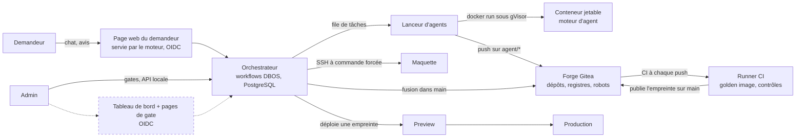

> Traduction destinée aux lecteurs humains. La version anglaise `docs/architecture.md` fait foi.

# Architecture de EupaDev (v2)

Comment l'usine est câblée : quelles pièces existent, comment un outil va de la
demande à la Production, et ce qui empêche un agent autonome de nuire. Ce
document décrit la plateforme, pas un outil généré : les règles d'un outil sont
dans `tool-template/AGENTS.md`. Les décisions de conception et leurs raisons
sont dans `ROADMAP.md` §8 ; cette page résume, elle ne décide pas.

Chaque pièce porte un statut. **Construit et testé** : la pièce tourne sur les
VM du labo et un test réel (`infra/ansible/verify-*.yml`) le prouve. **Conçu,
pas encore construit** : la conception est arrêtée dans `ROADMAP.md` §8 et
aucun code n'existe.

## Les pièces

| Pièce | Ce qu'elle fait | Statut |
|---|---|---|
| Forge Git (Gitea) et organisation | Héberge un dépôt par outil, le template, les dépôts de la plateforme (`engine`, `agent`, `keycloak`, `caddy`, `base-image`, `core`), le registre de conteneurs et le registre npm du socle. Les fichiers protégés (règles des agents, pipelines, `Dockerfile`, `.dockerignore`, `.pnpmfile.*`…) sont refusés aux agents. Installée par Ansible (`infra/`). | Construit et testé (`verify-forge.yml`, `verify-core.yml`) |
| Comptes robots | Cinq comptes, un par rôle : `svc-agent`, `svc-orchestrator`, `svc-ci`, `svc-deployment`, plus `svc-core`, le seul compte qui publie `@eupadev/core`, sous un propriétaire à lui hors de l'organisation des outils (ADR-023, proposé). Chacun n'a que les droits de son rôle (tableau plus bas). | Construit et testé (`verify-forge.yml`, `verify-core.yml`) |
| Runners CI | Une VM dédiée avec deux runners : `ci-standard` exécute les contrôles qui font tourner le code des agents (secrets, tests, analyse, garde-fous) dans la golden image CI, **sans aucun accès à Docker** ; `ci-image` est le seul avec Docker (construction avec le Dockerfile fixe, scan, démarrage contre une base jetable migrée, publication). | Construit et testé (`verify-ci.yml`, `verify-template.yml`) |
| Golden image | Image de base Node.js durcie, variantes `build` et `run`, reconstruite et scannée chaque semaine par la CI de la forge ; chaque image d'outil part d'elle (`FROM`) (`images/base-node/`). Une 3e variante, `ci`, est l'image des jobs de CI (gitleaks, Opengrep, pnpm préinstallés, versions figées). | Construit et testé (`verify-base-image.yml`) |
| Template | Le dépôt copié pour chaque nouvel outil : charte des agents, prompts de rôle, règles par domaine, règles d'analyse, CI et le Dockerfile fixe de la plateforme, `.gitea/image/` (aucun agent n'écrit de Dockerfile ; installation sans aucun script ; `/app` en lecture seule dans l'image ; `tool-template/`). Il dépend de `@eupadev/core` à une version exacte. Son pipeline de contrôle est vert sur une copie propre, rouge sur une faute injectée, et publie sur `main` ; son pipeline de Preview (`preview-check.yml` : performance, accessibilité, contrôles de sécurité dynamiques, suite d'acceptation de l'outil) tourne contre une Preview déployée et enregistre ses résultats contre l'empreinte. | Construit et testé (`verify-template.yml` ; pipeline de Preview : `verify-engine-preview.yml`, vert sur un outil propre, rouge avec le scénario en échec nommé sur une faute injectée) |
| Socle commun des outils (`@eupadev/core`) | Le code commun que chaque outil généré utilise au lieu de l'écrire (ADR-019) : Fastify 5 à configuration fermée, routes tirées du contrat d'API (pas de démarrage sans règle d'accès sur chaque opération), validation Ajv 2020-12 des requêtes et des réponses, erreurs RFC 9457, accès PostgreSQL paramétré, audit en ajout seul, rôles de base séparés, connexion OIDC et sessions en base, protections web (CSRF, limitation de débit), modules front (rendu Trusted Types, formulaires tirés du contrat, routeur, graphique), purge planifiée et kit de tests de sécurité (`core/README.md`). Publié comme paquet npm sur le registre de la forge sous son propre propriétaire, jamais écrasable (ADR-023, proposé). | Construit et testé (`verify-core.yml` : publication, badge en lecture seule, pas d'écrasement ; `verify-deployer-core.yml` : une image au format du socle déployée en Preview et en Production avec ses migrations, ses rôles de base et son client OIDC) ; figé par le template (`tool-template/package.json`) ; tests unitaires, tests contre un vrai PostgreSQL, typage et Squawk dans la CI GitHub |
| Orchestrateur | Workflows durables avec DBOS 5.3 (bibliothèque TypeScript, état dans PostgreSQL) : un workflow par outil, un workflow enfant par tâche d'agent, une file à concurrence globale N. Survit aux redémarrages ; une gate est une attente durable. Tient aussi le registre des outils, fait la recherche de chevauchement avant le cadrage, et expose les mesures par cycle (`cycle_measures` : coût, durées, jetons, tours). Ses adaptateurs externes (forge, déployeur, notifications, moteur d'agent) se choisissent par `EUPADEV_EXTERNAL` ; au labo, les mails partent toujours en SMTP (vers Mailpit), la vraie forge et le vrai déployeur s'activent le temps d'un essai (`orchestrator_real_world`), et l'exécuteur fait tourner un moteur factice sauf si Claude Code ou le faux qui pousse est activé. | Construit et testé (`verify-orchestrator.yml`, `verify-engine.yml`, `verify-engine-mails.yml`, `verify-engine-forge.yml`, `verify-engine-integration.yml`, `verify-engine-ci.yml`, `verify-engine-preview.yml` ; cycle complet demande → maquette → Preview → Gate 2 → Production avec la vraie forge et le vrai déployeur : `verify-engine-deployment.yml`) : image signée déployée par empreinte sur sa VM, API locale par tunnel SSH ; tests unitaires, base, Gherkin et mutations dans la CI GitHub |
| Lanceur d'agents (exécuteur) et conteneurs jetables | Le même code que le moteur, en rôle exécuteur DBOS, sur la VM agents : prend les tâches dans la file, démarre un conteneur jetable par tâche sous gVisor sur un réseau interne, avec pour seules sorties Smokescreen (registre npm public) et le proxy IA, qui ajoute la clé (jamais dans le conteneur). Le dépôt entre sous forme d'archive et le résultat ressort sous forme de bundle : le conteneur n'atteint lui-même ni la forge ni l'orchestrateur. Refuse toute poussée qui touche un chemin interdit ou sort du périmètre d'écriture du rôle (ADR-021). | Construit et testé (`verify-agents.yml`, `verify-executor-claude.yml`) |
| Moteur d'agent interchangeable | Le lanceur appelle un « moteur » derrière un contrat fixe (entrée : dépôt, consigne, règles, plafond de budget ; sortie : code modifié, rapport JSON, coût). Claude Code est le moteur n° 1 : binaire signé figé (ADR-013), mode restreint, consignes tirées de l'image signée du moteur et jamais du dépôt qu'il lit (ADR-018) ; un essai contre un faux serveur IA, dans la CI de l'image des agents, bloque une version qui se laisserait détourner. Un **moteur factice** rejoue des réponses préparées, et un faux **qui pousse** pousse des jeux de fichiers préparés sur la vraie forge (`orchestrator/src/external/pushing-engine.ts`) : toute la chaîne, déploiement compris, se teste sans aucun appel d'IA. | Construit et testé (`verify-image-agent.yml`, `verify-engine-claude.yml` ; un vrai appel payant a réussi ; faux qui pousse : `verify-engine-integration.yml`, `verify-engine-deployment.yml`) |
| Identité | Un seul fournisseur d'identité, Keycloak 26, devant l'API du moteur, la page web du demandeur et les outils générés (la connexion du socle) : realm `eupadev`, administrateur nominatif avec MFA, console d'administration par tunnel SSH seulement. Une personne est le couple stable (émetteur, sujet) de son jeton d'accès, lié à une ligne interne `actors` par une table en ajout seul, avec une fusion d'identités enregistrée par l'admin ; le mail est un attribut de contact. Le moteur vérifie lui-même le jeton (`jose` : JWKS, `typ at+jwt`, émetteur, audience `eupadev-api`, liste d'algorithmes fermée) et lit deux casquettes dans les rôles du client : `requester`, `admin` ; quatre yeux à la Gate 2, appliqué par le code et par la base (ADR-017). | Construit et testé (`verify-keycloak.yml` ; côté moteur : `orchestrator/src/auth.ts`, migrations 0008 et 0010, tests unitaires, base, API et Gherkin, mutations) |
| Page web du demandeur | La page où le demandeur dépose une demande, répond à l'agent de cadrage et donne son avis sur la maquette et la Preview (ADR-024, proposé) : quelques fichiers statiques servis par le processus du moteur lui-même depuis son image signée, derrière Caddy au domaine du chat ; connexion faite par le moteur (session OIDC côté serveur avec Keycloak, cookie `__Host-session`, aucun jeton dans le navigateur) ; le composant de chat est embarqué et figé par l'empreinte de son contenu ; CSP propre ; contrôle strict de `Host`. | Construit et testé (`verify-engine-chat.yml` : HTTPS, CSP, HSTS, mauvais `Host` refusé, vraie connexion et déconnexion depuis la VM CI ; dépôt, réponse et avis par la page couverts par les tests Playwright du moteur, `orchestrator/features/chat.feature`, pas encore par un contrôle au labo) |
| Tableau de bord et pages de gate | Vue en lecture seule sur les tables d'état, plus les pages où les humains approuvent ; connexion par OIDC (Keycloak comme fournisseur). Aujourd'hui l'admin décide d'une gate par l'API locale du moteur (`curl` par tunnel SSH, `orchestrator/src/api.ts`). | Conçu, pas encore construit |
| Coffre des secrets | Aujourd'hui un coffre Ansible chiffré par installation, déchiffré en mémoire sur les VM (`systemd-creds`) ; OpenBao prévu pour le remplacer et porter la clé de signature des images. | Conçu, pas encore construit (en pause jusqu'au deuxième outil réel) |
| Déploiement par empreinte | Preview et Production font tourner une image désignée par son empreinte ; l'empreinte en cours par environnement est enregistrée dans la table `deployments`. Cibles (ADR-022) : les Previews et les maquettes de cadrage sur la VM CI, la production sur une VM outils dédiée, chacune derrière un Caddy générique avec des certificats publics (ADR-015), atteinte par le moteur en SSH à commande forcée sur un compte `deployment` hors du groupe `docker`. Un script de la plateforme sur chaque cible (`deploy`, `stop`, `remove`, `served`, `purge`) ne fait tourner que des images désignées par empreinte et signées avec la clé des outils, dans un modèle Compose fixé par la plateforme ; un outil du socle reçoit sa base, son étape de migration, son client OIDC et sa purge, et sa base de Preview est remise à zéro à chaque nouvelle empreinte, jamais celle de Production. La Production bascule sur la nouvelle empreinte sans interruption et refuse une image en mauvaise santé ; retour arrière = redéployer l'empreinte précédente. La maquette est servie depuis l'archive du cadrage, encadrée et isolée (ADR-009). L'adaptateur `SshDeployer` du moteur (`orchestrator/src/external/ssh-deployer.ts`) est celui en service quand `deployer=ssh` ; le déployeur factice reste pour les tests unitaires. | Construit et testé (`verify-deployer-access.yml`, `verify-deployer.yml`, `verify-deployer-core.yml`, `verify-mockup.yml`, `verify-prod-switch.yml`, `verify-letsencrypt.yml` ; via le moteur : `verify-engine-preview.yml`, `verify-engine-deployment.yml`) ; tests unitaires du script dans la CI GitHub |

Le cadre en pointillé ne tourne pas encore : le tableau de bord et les pages de
gate sont conçus, les gates se décident en attendant par l'API locale du moteur.
Tout le reste tourne au labo : le cycle entier, de la demande à la Production,
a été joué avec la vraie forge, la vraie CI et le vrai déployeur, l'agent étant
un faux scripté qui pousse des fichiers préparés (`verify-engine-deployment.yml`,
sans appel d'IA). Un vrai outil construit de bout en bout par Claude Code n'a
pas encore été joué ; les contrôles payants du labo s'arrêtent à une seule
tâche (`verify-engine-claude.yml`, `verify-executor-claude.yml`).

## Le parcours d'un outil

| Étape | Ce qui se passe | Qui |
|---|---|---|
| 1. Demande | Le demandeur décrit l'outil. L'orchestrateur cherche dans son propre registre (table `tools`, avec le commentaire de l'approbation de Gate 1 de chaque outil) un outil existant couvrant le même besoin ; un chevauchement plausible est remonté au propriétaire produit. | orchestrateur |
| 2. Cadrage | Un agent construit une maquette fonctionnelle avec le demandeur et écrit une spécification courte avec des stories (Given/When/Then). La maquette est faite de fichiers statiques, servis depuis l'archive du cadrage dans un cadre isolé (ADR-009), et le demandeur la juge depuis la page web. Pas encore audité : le périmètre bouge. | agent de cadrage |
| 3. Contrat | Le périmètre validé devient un fichier OpenAPI et des features Gherkin, puis est figé pour le cycle. | agent de contrat |
| 4. Durcissement | L'agent de tests écrit la suite d'acceptation à partir du contrat, sans lire le code ; puis l'agent builder écrit le code (API, données, interface web) contre le contrat et cette suite, qu'il peut lire mais pas modifier (ADR-021). Chacun travaille sur sa branche `agent/<outil>/<cycle>/<rôle>` et son dossier. | agent de tests, puis agent builder |
| 5. Review | Deux relecteurs en lecture seule (sécurité, qualité) signalent les écarts avec fichier et ligne ; seuls les rôles propriétaires sont relancés. | deux agents |
| 6. Fusion | Une fois conforme, l'orchestrateur fusionne (squash) dans `main`. Seul `svc-orchestrator` peut y écrire. | orchestrateur |
| 7. CI | Une seule construction, à partir de la golden image : contrôles, scan, démarrage (lecture seule, base jetable migrée), puis publication de l'image **avec son empreinte**. | CI |
| 8. Gate 1 | Un humain approuve le nom et le domaine de l'outil, une seule fois par outil. Pour un outil du socle, l'admin l'enregistre aussi sur les cibles (`infra/ansible/register-tools.yml` : base, rôles, client OIDC, personas de test) avant la première Preview. | humain |
| 9. Preview | L'empreinte est déployée ; les contrôles de performance, d'accessibilité, de sécurité dynamique et la suite d'acceptation propre à l'outil tournent dessus ; seulement quand tout est vert, le demandeur est prévenu et essaie l'outil. Un contrôle rouge ou une correction demandée renvoie à l'étape 4 (la nouvelle empreinte est recontrôlée avant de solliciter le demandeur). | orchestrateur, CI, demandeur |
| 10. Gate 2 | Un humain approuve **cette empreinte**, affichée dans la demande. | humain |
| 11. Production | La même empreinte est déployée. Rien n'est reconstruit. | orchestrateur |

Toute modification après la Production repasse par le même cycle ; il n'y a pas
de raccourci. `main` plus branches courtes uniquement : pas de branche longue
par environnement, l'état d'un environnement se lit dans la table `deployments`.

## Modèle de confiance

L'agent tourne sans confirmation interactive : rien ne repose sur sa
coopération, tout repose sur ce qu'il peut atteindre.

| Mesure | Effet | Statut |
|---|---|---|
| Conteneur jetable | Un conteneur par tâche, nommé d'après l'identifiant de la tâche (`fa-<tâche>`), supprimé à sa sortie ; runtime gVisor, racine en lecture seule, utilisateur non root, pas de nouveaux privilèges, toutes les capacités retirées, limites de mémoire et de processus, pas de redémarrage automatique. Un arrêt ou une étape rejouée le supprime d'abord (`docker rm -f`), jamais ne le duplique. | Construit et testé (`orchestrator/src/external/claude-engine.ts` ; `verify-agents.yml`, `verify-executor-claude.yml`) |
| Proxy Docker restreint | Le lanceur ne voit jamais le socket Docker. Autorisé : créer, inspecter, lister des conteneurs, lister des images, créer des réseaux. Bloqué : exec, volumes, swarm, secrets, plugins. | Code v1 ; absent de la v2 : l'exécuteur de la VM agents pilote lui-même le socket Docker de la VM (`infra/compose/executor/compose.yml`). La séparation tenue aujourd'hui passe par les VM : le conteneur du pilote ne monte aucun socket Docker, et les conteneurs des agents non plus (`verify-agents.yml`) |
| Jetons par en-tête | Les identifiants Git passent en en-tête HTTP à chaque commande, jamais dans l'URL du remote, jamais écrits dans la configuration du clone. Le conteneur de l'agent ne détient aucun jeton de la forge : le lanceur récupère son travail sous forme de bundle et le pousse lui-même. | Construit et testé (`gitea-forge.ts`, `claude-engine.ts` : `http.extraHeader` ; `verify-engine-claude.yml`) ; Ansible fait de même |
| Sortie réseau en liste blanche | Le conteneur est sur un réseau interne à lui, créé pour la tâche ; il ne sort que par Smokescreen (liste blanche : le registre npm public, `infra/compose/agents/smokescreen/acl.yaml`) et par le proxy IA, qui détient la clé. Ni la forge, ni l'orchestrateur, ni la VM, ni le DNS, ni une autre tâche ne sont joignables. | Construit et testé (`verify-agents.yml`) |
| Fichiers protégés refusés au push | Sur toute branche sauf `exception/**`, Gitea refuse au moment du push toute modification de `.gitea/`, `.opengrep/`, `.claude/`, `agents/`, `AGENTS*.md`, `CLAUDE.md` et des autres fichiers protégés (liste complète : `orchestrator/src/agent-engine/forbidden-paths.ts`). Un agent ne peut pas réécrire ses règles ni le pipeline pour lire les secrets de l'organisation. | Construit et testé |
| Pas de Docker pour les jobs qui exécutent le code des agents | Les tests tournent sur le runner `ci-standard` : ni socket Docker, ni `DOCKER_HOST`, ni client Docker. Seul le job `image` (runner `ci-image`) pilote Docker ; le code des agents n'y est que construit et démarré dans un conteneur isolé, sans le socket. Le fichier de pipeline, qui choisit le runner, est protégé ; toute branche hors `agent/**`, `main` et `exception/**` (réservée aux humains désignés) n'est modifiable que par l'orchestrateur. | Construit et testé |
| Deux badges CI | Un jeton de registre en lecture seule pour télécharger la golden image sur toute branche ; un jeton d'écriture utilisé uniquement par l'étape de publication sur `main`. | Construit et testé |
| Comptes robots par rôle | Voir le tableau ci-dessous. Un compte compromis reste borné à son rôle. | Construit et testé |
| Règles injectées par l'orchestrateur | Les consignes d'un rôle (charte, prompt du rôle, règles par domaine, format du rapport) sont lues dans l'image signée du moteur et passées au moteur comme fichier de prompt système ; rien n'est ramassé dans le clone (ADR-018). Claude Code tourne avec `--bare --restricted` (ni hooks, ni MCP, ni `CLAUDE.md`, les réglages du clone ignorés) et `--permission-mode dontAsk` ; les relecteurs ont un shell réduit à l'ensemble en lecture seule du harnais (ADR-020). | Construit et testé (`orchestrator/src/external/claude-engine.ts` ; `verify-engine-claude.yml`, `verify-executor-claude.yml` ; l'essai de détournement de la CI de l'image des agents, `verify-image-agent.yml`) |
| Diff contrôlé avant fusion | L'orchestrateur refuse une branche dont le diff contre `main` sort du périmètre d'écriture de son rôle (dossiers d'un autre rôle, règles, CI), à la fusion du rôle et de nouveau à l'intégration (`out_of_scope`). | Construit et testé (`inScope` dans `orchestrator/src/external/contracts.ts`, appliqué par `gitea-forge.ts` ; `verify-engine-integration.yml`) |
| Tout ce qui est lu est une donnée | Texte de la demande, fichiers, pages web et sorties de commande ne sont jamais des instructions ; écrit dans la charte, appuyé par les mesures ci-dessus (ADR-018). | Charte |

| Compte | Peut | Ne peut pas |
|---|---|---|
| `svc-agent` | pousser sur `agent/*` | fusionner dans `main`, publier une image, déployer |
| `svc-orchestrator` | créer des dépôts, fusionner dans `main` | publier une image, déployer |
| `svc-ci` | publier une image candidate | déployer, fusionner |
| `svc-deployment` | lire le registre, déployer une empreinte approuvée | publier, fusionner |
| `svc-core` | publier `@eupadev/core` sous son propre propriétaire | quoi que ce soit dans l'organisation des outils (membre d'aucune équipe) |

Protections de branche et jetons sont définis une seule fois, dans
`infra/ansible/group_vars/forge/vars.yml` ; un dépôt d'outil généré depuis le
template les reçoit dès sa création (`verify-forge.yml`).

## Livraison

- **Construire une fois.** L'image est construite à la fusion dans `main` et
  nulle part ailleurs. Une étape de déploiement qui reconstruirait livrerait
  une image que personne n'a validée.
- **Promouvoir par empreinte.** Preview et Production tirent `sha256:…`, jamais
  une étiquette (une étiquette peut être déplacée). Résultats des contrôles et
  approbations sont enregistrés contre l'empreinte. Le registre est celui de la
  forge ; la garantie vient de l'empreinte, pas du registre.
- **Golden state.** La dernière empreinte approuvée et en cours en Production.
  Un incident se traite en la redéployant, jamais en reconstruisant.
- **Retour arrière** = déployer l'empreinte de la release précédente. Les
  migrations de schéma restent donc rétrocompatibles sur une release (ajouter,
  basculer, retirer).
- **Signature.** Chaque image qui tourne en service (moteur, agents, Keycloak,
  Caddy, les outils) est signée par cosign à la construction (une clé pour les
  images de la plateforme, une autre pour les outils) et la signature est
  vérifiée avant qu'elle tourne. **Prévu :** signature de la golden image
  (tirée aujourd'hui par étiquette depuis le registre de la forge elle-même),
  attestation SBOM, clé déplacée dans OpenBao.

## Dimensionnement

La plateforme doit fonctionner correctement à N = 1 agent sur une petite VM ;
le parallèle accélère, il n'est jamais requis. N se règle par variable
d'environnement et se mesure par paliers (1, puis 3, puis d'après la RAM
disponible et la limite de débit de l'API du modèle), avec un plafond de 3
agents simultanés par outil. PostgreSQL est le seul composant d'infrastructure
supplémentaire.

## Où regarder

- Reconstruire le labo, lancer les tests réels : `infra/README.md`.
- Variantes de l'image de base et rythme de reconstruction : `images/base-node/README.md`.
- Décisions, alternatives écartées, questions ouvertes : `ROADMAP.md` §8 et les ADR de `docs/adr/`.
- Qui approuve quoi, budgets, décommissionnement : `docs/fr/governance.md`.
- Installation chez un client (VM, isolation, surveillance, maintenance) : `docs/fr/deployment.md`.
