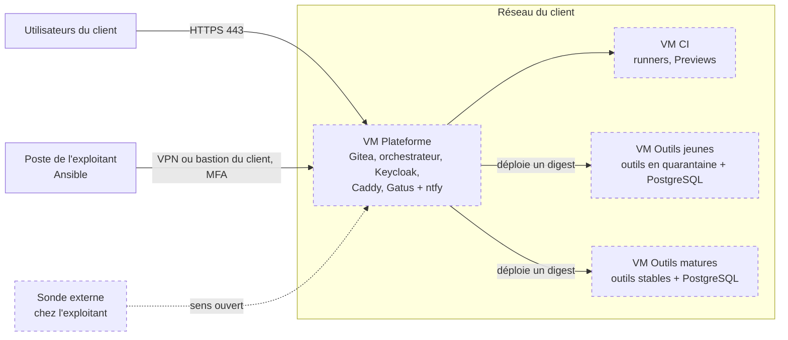

> Traduction destinée aux lecteurs humains. La version anglaise `docs/deployment.md` fait foi.

# Installer EupaDev chez un client

Comment EupaDev tourne dans le réseau d'un client : quelles VM, ce qui
tourne sur chacune, comment les outils sont séparés, et comment l'installation
est surveillée, administrée, mise à jour et sauvegardée. Cette page explique le
modèle d'exploitation ; ce que la DSI du client doit fournir (VM, flux réseau,
comptes, checklist) est dans `docs/fr/client-prerequisites.md`, non repris ici.
Décisions derrière cette page : `ROADMAP.md` §8.15 (« Installation at the
client », décisions 1 à 15).

Chaque élément porte un statut. **En place** : il tourne sur les VM du labo et
un test réel (`infra/ansible/verify-*.yml`) le prouve. **Décidé, pas
construit** : la décision est arrêtée dans `ROADMAP.md` §8.15 et rien ne tourne
encore. **Ouvert** : pas décidé. Aucune installation client n'existe encore :
le labo compte 5 VM (forge, CI, orchestrateur, agents IA, outils), pas la
disposition à 4 VM ci-dessous. La VM outils du labo porte la Prod des outils
générés derrière un Caddy générique (`*.<domaine>`), que le moteur n'atteint
que par un compte restreint `deployment` (ADR-022) ; les Previews restent sur
la VM CI.

## Le modèle « appliance »

EupaDev s'installe comme une **appliance** (option C, décision 1) : la DSI
du client fournit des VM Ubuntu 24.04 vierges sur son propre hyperviseur ;
EupaDev n'accède jamais à l'hyperviseur.

| Sous les VM : la DSI du client | Dans les VM : l'exploitant EupaDev |
|---|---|
| Hyperviseur, stockage, création et redimensionnement des VM | Configuration du système, mises à jour de sécurité, redémarrages |
| Réseau, pare-feu entre zones, DNS, annuaire | EupaDev, les outils générés, leurs bases |
| Sauvegarde des VM entières | Sauvegardes applicatives, surveillance |

L'exploitation est **gérée par l'exploitant** au départ (décision 2). La clé de
l'IA est **au nom du client** (décision 11). Les gates sont validées par un
**référent métier** ; la DSI est prévenue et a un **veto** sur les outils
sensibles ou à profil renforcé (décision 12). Statut : décidé, pas construit.

## Les quatre VM

| VM | Ce qui y tourne |
|---|---|
| Plateforme | Forge Git et registre d'images (Gitea), orchestrateur, identité (Keycloak), reverse proxy (Caddy), surveillance (Gatus, ntfy) |
| CI | Runners CI et Previews (code pas encore validé) |
| Outils jeunes | Les nouveaux outils pendant leur quarantaine, avec leur PostgreSQL |
| Outils matures | Les outils stables, avec leur PostgreSQL |

Environ 14-16 vCPU, 42-46 Go de RAM, 700 Go de disque au total ; ce sont des
estimations, à mesurer lors des premiers vrais passages (décision 3). Les
tailles par VM sont dans `docs/fr/client-prerequisites.md` §1. Un outil sensible
peut ajouter une cinquième VM (plus bas). Mesuré au labo le 2026-11-07, les
cinq VM du labo au repos utilisent environ 4,7 Go de RAM et environ 90 Go de
disque au total : les chiffres ci-dessus sont les tailles données aux VM pour
la charge d'une entreprise, pas ce dont la plateforme a besoin pour démarrer.
Pendant un cycle gratuit complet le 2026-11-10 (agents fictifs, vraie forge,
CI, Preview et contrôles ; mémoire utilisée dans chaque VM, relevée toutes les
30 s), les pics étaient : forge 0,9 Go, CI 1,4 Go (contrôles de la Preview),
moteur 1,4 Go, agents 0,6 Go, outils 0,7 Go, environ 5 Go au total. Les vrais
agents IA ajoutent leurs conteneurs sur la VM agents ; ce pic reste à mesurer.

Les boîtes en pointillés sont décidées, pas construites (le labo a une VM
forge, une VM CI, une VM orchestrateur, une VM agents IA et une VM outils).

## Isolation

| Mesure | Statut |
|---|---|
| Un conteneur par outil, avec son réseau, ses plafonds RAM/CPU, un utilisateur non-root et un système de fichiers en lecture seule | En place au labo (`infra/compose/deployer/tool.compose.yml` ; `verify-deployer.yml`, `verify-prod-switch.yml`) |
| Un PostgreSQL par VM, **une base et un compte par outil**, avec plafond de connexions et durée de requête maximale ; jamais de table partagée (décision 5) | En place au labo pour les outils du socle (une base et trois rôles par outil, `register-tools.yml`, `verify-deployer-core.yml`) ; plafond de connexions et durée de requête : décidé, pas construit |
| Les Previews tournent sur la VM CI avec une base jetable, **jamais à côté de la Production** (décision 6) | En place au labo (`verify-deployer.yml`, `verify-engine-preview.yml`) : la base de la Preview est vidée à chaque nouvelle empreinte |
| Un outil sensible (RH, paie, données personnelles) a **sa propre VM**, décidé à la Gate 1 (décision 6) | Décidé, pas construit |
| **Quarantaine** : un nouvel outil passe sur la VM Outils matures après **4 semaines sans incident** ; la promotion est validée par l'exploitant (décision 4) | Décidé, pas construit |

## Communication entre outils

Les outils se parlent **uniquement par API HTTPS via Caddy**, jamais par la
base de l'autre (décision 7) :

- chaque outil a son propre **compte de service Keycloak** ; le jeton d'un
  utilisateur n'est jamais transmis ;
- la dépendance est déclarée à la Gate 1 et appuyée sur un contrat OpenAPI ;
- ni répartition de charge ni gestionnaire d'API pour l'instant : une instance
  par outil suffit pour des outils internes. Les outils restent sans état pour
  garder cette porte ouverte.

Statut : décidé, pas construit (Keycloak est en place, `verify-keycloak.yml` ;
les appels entre outils, non). Un Caddy central ou un par VM outils :
**ouvert**.

## Surveillance et tableau de bord d'exploitation

| Élément | Statut |
|---|---|
| Page d'état **Gatus** et notifications **ntfy** sur la VM Plateforme ; VictoriaMetrics/Logs plus tard, pas de Grafana (décision 8) | Décidé, pas construit |
| Une **sonde externe** chez l'exploitant (décision 8) ; son sens (elle interroge le client, ou le client la prévient) | Décidé, pas construit ; sens **ouvert** |
| Chaque outil s'inscrit dans Gatus à son déploiement (décision 14) | Décidé, pas construit |
| Chaque outil expose `/health` ; la CI du template vérifie que l'image construite y répond 200 | En place (`verify-template.yml`) |
| `/health` vérifie aussi la base de l'outil | En place (le `/health` du socle, `core/src/http.js`) |
| **Tableau de bord d'exploitation** : « est-ce que ça marche ? » = page d'état Gatus ; « que faut-il faire ? » = onglet Maintenance du tableau de bord EupaDev (redémarrage en attente, golden image, CVE, sauvegarde manquée, outil inutilisé), qui renvoie vers Gatus sans le refaire (décision 14) | Décidé, pas construit |

## Administration à distance et diagnostic

| Élément | Statut |
|---|---|
| Ansible lancé depuis le poste de l'exploitant ; un inventaire et un coffre chiffré par client (décision 9) | En place au labo (l'inventaire du labo et ses coffres) |
| Accès par le **VPN ou le bastion du client**, **nominatif, MFA, journalisé** (NIS2 par contrat, guide ANSSI PA-022) | Décidé, pas construit |
| SSH par clé uniquement, pas de connexion root | En place (`verify-system.yml`) |
| Aucun agent logiciel installé chez le client ; Terraform/OpenTofu facultatif chez lui | Décidé |
| **Diagnostic par Claude** : Claude tourne sur le poste de l'exploitant, lance des recettes Ansible de diagnostic **en lecture seule** avec un compte SSH `diagnostic` sans droits d'administration ; données personnelles masquées ; l'exploitant relit et applique toute correction ; accord dans le contrat de sous-traitance ; pas de Claude du tout chez un client très sensible (décision 10) | Décidé, pas construit |

## Maintenance

Tout ceci est dans le rôle `base`, sur chaque VM, et prouvé par
`verify-system.yml` (détails : `infra/README.md`, « Operations: system base
and maintenance »). **En place** au labo.

- **Mises à jour de sécurité automatiques** chaque jour
  (`unattended-upgrades`, origines « sécurité » seulement), sans redémarrage
  automatique.
- `needrestart` en mode liste : aucun service (Docker compris) n'est
  redémarré tout seul après une mise à jour.
- **Créneau de maintenance de nuit** : quand Ubuntu demande un redémarrage,
  chaque VM redémarre à son heure (labo : de 03:15 à 04:15 UTC, à un quart
  d'heure d'écart), après la sauvegarde et jamais deux VM en même temps.
- **Alerte** si un redémarrage attend depuis plus de 7 jours (le contrôle
  échoue).
- Redémarrage immédiat à la main : `maintenance.yml` ne redémarre que les VM
  qui l'attendent, **une à la fois**, et attend que leurs conteneurs soient
  revenus en bonne santé avant la suivante.

## Sauvegardes

Deux étages (décision 13) : la DSI sauvegarde les VM entières, EupaDev
sauvegarde ses propres données.

| Élément | Statut |
|---|---|
| Sauvegarde applicative chaque nuit à 02:30 UTC par la méthode native de chaque service (`gitea dump` pour la forge, `pg_dump` pour les bases de l'orchestrateur et de Keycloak), 7 gardées (4 sur la forge) | En place |
| Restauration réelle testée automatiquement dans des conteneurs jetables | En place (`verify-backup.yml`) |
| Copie chiffrée hors des VM (restic, vers une cible fournie par le client) | Décidé, pas construit : aujourd'hui les sauvegardes restent **sur la VM** |
| Sauvegarde de la base de chaque outil | En place sur la VM outils : un `pg_dump` par base de Production (`verify-deployer-core.yml`) |

Reconstruire = VM vierges + recettes Ansible + dernière sauvegarde (procédure
dans `infra/README.md`). Détails pour la DSI : `docs/fr/client-prerequisites.md`
§4.

## Ce qui manque avant un vrai client

D'après `ROADMAP.md` §8.15 (bloquants relevés en écrivant les prérequis) :

- **Proxy sortant** : aucune prise en charge dans `infra/` (apt, Docker, CI).
- **Disque de données** : repéré par son nom LXD (`docker_disk_device`), qui
  n'existe pas sur une VM fournie par la DSI.
- **Certificats** : Caddy ne sait pas encore utiliser un certificat fourni par
  le client (aujourd'hui `internal` ou Let's Encrypt par DNS-01, qui n'expose
  rien mais demande un accès API à l'hébergeur DNS ; OVH est l'hébergeur DNS
  du labo, Caddy a des modules DNS pour d'autres hébergeurs, aucun construit
  ni testé ici).
- **Réversibilité** : la remise du coffre de secrets au client en fin de
  contrat reste à prévoir.
- **Questions ouvertes** : un Caddy central ou un par VM outils ; sens de la
  sonde externe.

Prévu aussi pour l'étape client : un test Hyper-V au labo (décision 13). Le
passage du labo à **OpenTofu + Incus** (ADR-010, rejeté) ne concerne pas une
installation client, où la DSI fournit les VM.
