# State machine of a tool's cycle — v1 → v2

Single source of v2: `src/machine/states.ts`. This document sets each
transition of v1 (visual graph, rebuilt from its connections and its
decision nodes — ideas and logic only, nothing copied) against v2.

## 1. Reading v1

The v1 graph was a drawn state machine: ~100 nodes, including 5 admin
gates sharing one sub-workflow with three outcomes (approve / clarify /
refuse), two loops with counters (scoping: same error ×3, 5 attempts,
2 h; hardening: same deviation ×3, 15 rounds, 2 h, $20), a scoping budget
checked before each launch ($10), two waits for the requester by email
(24 h), a dispatch polled every 20 s with failure after 2 h.
Rebuilt: **50 transitions** (the earlier study counted 49; only the
split differs at the margin).

## 2. Transition by transition

Legend of the v2 column: `from --[trigger]--> to` in `states.ts`;
**removed** = deliberately absent from v2; **new** = no v1 equivalent.

### Entry

| # | v1 (rebuilt) | v2 |
|---|---|---|
| V01 | Request with "existing tool to change" filled in → registry read | `request_received --[guard:evolution]--> scoping`: the evolution cycle is created **on** an existing tool (foreign key `cycles.tool_id`), no more free name to check |
| V02 | Request without an existing tool → initial context → overlap search | `request_received --[guard:creation]--> overlap_search` |
| V03 | Tool found in the registry → "change" context, skips overlap and repository creation → scoping budget | `request_received --[guard:evolution]--> scoping` (the budget check is at the entry of `scoping`) |
| — | — | **new (decision A, 2026-10-27, ADR-023)**: before `guard:evolution`, the **platform** moves the tool to the latest published core version, before any agent (operation `core` on the executor's queue: twin of the fetch container, read badge and route to the registry, `pnpm add @eupadev/core@latest --lockfile-only`; then `core_publication`: commit of `package.json` and `pnpm-lock.yaml` into main by the orchestrator account, `[skip ci]`). No transition of its own: already up to date → nothing; registry unreachable or commit refused → the cycle goes on with the current version, message to the requester in the chat, admin told (never a dead end). Scenarios 7 bis to 7 quater |
| V04 | Tool not found → mail to the requester → end "not found" | **removed**: impossible by construction (E1: the tool's identity is a foreign key, a request cannot target a tool that does not exist) |

### Overlap search

| # | v1 | v2 |
|---|---|---|
| V05 | "Plausible" report → overlap gate | `overlap_search --[guard:plausible]--> gate_overlap` |
| V06 | Technical failure of the task → treated as plausible → gate | `overlap_search --[task:failed]--> gate_overlap` |
| V07 | Report without JSON / invalid JSON → **not plausible by default** → scoping | **changed**: `overlap_search --[guard:unreadable_report]--> gate_overlap` (unreadable = "to be checked", scenario 4) |
| V08 | Not plausible → scoping budget | `overlap_search --[guard:not_plausible]--> repo_creation` (the repository creation, implicit in v1, becomes a state) |
| V09 | Overlap gate: approve → scoping budget | `gate_overlap --[gate:approved]--> repo_creation` |
| V10 | Overlap gate: correction → text in the context → scoping budget | `gate_overlap --[gate:correction]--> repo_creation` (text passed on to the first scoping **as data**) |
| V11 | Overlap gate: refuse → end "redundancy confirmed" | `gate_overlap --[gate:refused]--> end_refusal` |
| — | — | **new**: `repo_creation --[task:done]--> scoping` and `--[task:failed]--> gate_scoping_blocked` (decision 3); idempotent creation (scenario 10) |

### Budget and scoping loop

| # | v1 | v2 |
|---|---|---|
| V12 | Cumulative cost ≥ $10 before launch → scoping budget gate | `scoping --[guard:budget_exceeded]--> gate_scoping_budget` (check **once per round**, at the entry of the state, E2, decision 12) |
| V13 | Cost < $10 → scoping launched | implicit: state `scoping` starts the agent if the check passes |
| V14 | Budget gate: approve → scoping | `gate_scoping_budget --[gate:approved]--> scoping`; top-up = approve + `approvals.budget_top_up_usd` (D2, decision 6); "continue" without a top-up immediately triggers the gate again (the budget check is at the entry of `scoping`) |
| V15 | Budget gate: correction → scoping with text | `gate_scoping_budget --[gate:correction]--> scoping` |
| V16 | Budget gate: refuse → end "budget abandonment" | `gate_scoping_budget --[gate:refused]--> end_refusal` |
| V17 | Successful scoping (deployment included in the task) → requester's feedback | `scoping --[task:done]--> mockup_deployment --[task:done]--> waiting_scoping_feedback`: the mock-up deployment is a separate state (W4: the scoping commit's archive is sent to the mock-up host and served as static files, ADR-009; wait for availability + health, scenario 21) |
| V18 | Scoping failed technically → counters evaluated | evaluation inside `scoping` (and `mockup_deployment`) |
| V19 | No escalation → restart with the error → scoping budget | `scoping --[guard:technical_failure]--> scoping` (restart bounded to 4 = 5 attempts in total, error in the context, "same error" counter); `mockup_deployment --[guard:technical_failure]--> scoping` — a mock-up failure counts in the 5 attempts and in "same error ×3" (D17) |
| V20 | Escalation (same error ×3, 5 attempts, 2 h) → scoping blocked gate | `scoping --[guard:escalation]--> gate_scoping_blocked`; likewise from `mockup_deployment` |
| V21 | Scoping blocked gate: approve → counters reset → scoping budget | `gate_scoping_blocked --[gate:approved]--> repo_creation` (idempotent, then `scoping`): target `repo_creation` to also cover the failure of the repository creation (decision 3) |
| V22 | Scoping blocked gate: correction → counters reset + text | `gate_scoping_blocked --[gate:correction]--> repo_creation` |
| V23 | Scoping blocked gate: refuse → end "scoping blocked" | `gate_scoping_blocked --[gate:refused]--> end_refusal` |

### Requester's feedback (scoping)

| # | v1 | v2 |
|---|---|---|
| V24 | Satisfied → hardening entry | `waiting_scoping_feedback --[event:scoping_feedback:satisfied]--> contract` (**new step** Contract between scoping and hardening, §8.2) |
| V25 | Not satisfied → text → scoping budget → scoping | `waiting_scoping_feedback --[event:scoping_feedback:correction]--> scoping` (full chat history, E7) |
| V26 | No answer within 24 h → empty form → treated as "not satisfied" → **an agent restarted without feedback** | **removed** (v1 defect). Replaced by `waiting_scoping_feedback --[timeout_exceeded]--> waiting_scoping_feedback (×3: 24/48/72 h)` then `--[guard:reminders_exhausted]--> scoping_pause` at 96 h (D4, decision 13); no agent restarted |
| — | — | **new**: `waiting_scoping_feedback --[event:requester_abandonment]--> end_abandonment` (scenario 15); abandonment by the requester exists only before the merge (decision 9) |
| — | — | **new**: `scoping_pause --[event:requester_message]--> mockup_deployment` (resumed where it stopped: mock-up restarted, then the free message treated as a correction request, D4, decision 17, D18), `--[event:requester_abandonment]--> end_abandonment`, `--[timeout_exceeded]--> end_abandonment` after 30 days: the tool is **archived**, never deleted (decision 1) |

### Contract (new step in v2)

| # | v1 | v2 |
|---|---|---|
| — | — | **new**: `contract --[task:done]--> hardening_execution`; `--[task:failed]--> gate_contract_blocked` and `--[guard:budget_exceeded]--> gate_contract_blocked` (a gate of its own so that "continue" restarts the contract, decision 4; the contract counts in the hardening envelope, $40 by default, with no threshold of its own, D16); `gate_contract_blocked`: approve/correction → `contract`, refuse → `end_refusal` |

### Hardening loop

| # | v1 | v2 |
|---|---|---|
| V27 | Hardening entry → state → back ∥ front → fan-in → security ∥ quality → fan-in → evaluation | `hardening_execution --[task:done]--> hardening_integration --[task:done]--> hardening_review --[task:done]--> hardening_evaluation`. Code roles: the independent **tests** agent, then the single **builder** (ADR-021); explicit **integration** step (§8.2), explicit fan-in (E4) |
| V28 | 0 deviations (even if a review failed: unreadable report = 0 deviations) → preview push | **changed (fail-closed)**: `hardening_review --[task:failed]--> hardening_evaluation` (non-compliant, counts one iteration); only `hardening_evaluation --[guard:compliant]--> merge` leads to the merge |
| V29 | Deviations, no escalation → next round (reviewers without the previous deviations) | `hardening_evaluation --[guard:non_compliant]--> hardening_execution`: deviations routed to the owning roles, previous reports passed on to all (E8) |
| V30 | Deviations + (stagnation ×3 \| 15 rounds \| 2 h \| $20) → hardening blocked gate | `hardening_evaluation --[guard:escalation]--> gate_hardening_blocked`; cap raised to 25 rounds (safety net, D1), stagnation on `rule` + `file`, then `category` + `file`, then `previous_id`, patience on the number of deviations, Git tree hash per role (E9, D20 — computed in `src/hardening/stagnation.ts`, no new state or trigger), duration = the agents' work (D3); **plus** `hardening_execution --[guard:budget_exceeded]--> gate_hardening_blocked` once before each round, never between two agents of the round (E2, decision 12), and `hardening_execution --[guard:escalation]--> gate_hardening_blocked`: the counters (stagnation, cap, duration) are also checked at the entry of the round, so that a red pipeline, a red CI or an out-of-scope diff that repeats escalates without replaying a round of agents (D15); the red checks of the CI and of the Preview pipeline count as deviations (`rule = <pipeline>:<check>`), stored in `pipeline_results` so that the admin sees which check fails and for how many rounds (decision 11). **ADR-027, first failed round**: at the same entry, after the counters, a round that holds a failure the agents did not produce (red CI or Preview check, task failed without a cap or an invalid report, task blocked) is diagnosed once per situation before the next paid round, with the red checks' log tails as data; `platform_or_impossible` or `unclear_request` → `hardening_execution --[guard:escalation]--> gate_hardening_blocked` at once (the gate reuses the diagnosis); `slow_progress` or no usable verdict → the round starts (paid cycle 9: five rounds paid on a Preview check the platform failed) |
| V31 | Hardening gate: approve → counters reset → next round | `gate_hardening_blocked --[gate:approved]--> hardening_execution` (counters reset, never the cost; top-up possible) |
| V32 | Hardening gate: correction → counters reset + text | `gate_hardening_blocked --[gate:correction]--> hardening_execution`; **plus** `gate_hardening_blocked --[gate:scope_change]--> contract`: a defect of the frozen contract goes back to the contract with the admin's text (like Gate 1). A new scope — every entry into `contract` except the resume after an incident: this button, Gate 1's, the requester's "new capability" — also resets the counters (stagnation, rounds, duration), never the cost: paid cycle 9 started its new contract with the counters of the old scope, already at their limits |
| V33 | Hardening gate: refuse → end "hardening blocked" | `gate_hardening_blocked --[gate:refused]--> end_refusal` |
| — | — | **new**: `hardening_execution --[task:failed]--> hardening_evaluation`, `hardening_integration --[task:failed]--> hardening_evaluation` (a failed code task = non-compliant round; in v1 the merge waited forever). A `blocked` agent is treated as `failed`, its `blocked_reason` is shown to the admin (decision 7) |

### Merge, CI, Gate 1

| # | v1 | v2 |
|---|---|---|
| V34 | Push to the `preview` branch → green pipeline 1 → SBOM comparison | `merge --[task:done]--> waiting_ci --[event:ci_finished:green]--> candidate_image`: no more `preview` branch, squash into `main`, **image built once and identified by its digest** (§8.4). Before the squash, diff checked per role: `merge --[guard:diff_out_of_scope]--> hardening_execution` — an out-of-scope file is a **deviation of the round** (`rule = scope:<file>`, passed on to the roles concerned, counters kept), not a technical block; the hardening guard-rails escalate if it loops (arbitration A, same mechanism as the red pipeline) |
| V35 | Red pipeline 1 → hardening entry | `waiting_ci --[event:ci_finished:red]--> hardening_execution` (failed checks passed on through `pipeline_results`, counters kept, scenario 33) |
| V36 | Preview DNS already granted **and** SBOM unchanged, or change of a tool → deploy Preview (gate skipped) | `candidate_image --[guard:gate1_already_granted]--> preview_deployment`: **with no SBOM condition** (D5: Gate 1 once per tool; the SBOM diff is shown at Gate 2) |
| V37 | Otherwise → Preview DNS gate | `candidate_image --[guard:gate1_required]--> gate_1` |
| V38 | DNS gate: approve → deploy Preview | `gate_1 --[gate:approved]--> preview_deployment` |
| V39 | DNS gate: correction → text → **scoping budget → scoping** | **changed (decision 2)**: two buttons — `gate_1 --[gate:correction]--> hardening_execution` (contract unchanged) and `gate_1 --[gate:scope_change]--> contract`; never back to scoping after the merge |
| V40 | DNS gate: refuse → end "Preview DNS refused" | `gate_1 --[gate:refused]--> end_refusal` |
| — | — | **new**: `merge --[task:failed]-->`, `waiting_ci --[timeout_exceeded]-->`, `preview_deployment --[task:failed]-->`, `preview_pipeline --[timeout_exceeded]--> gate_delivery_blocked` (technical blocks after the merge, not handled in v1; decision 5); silent CI or pipeline = 60 min (decision 14); `gate_delivery_blocked`: approve → `merge` (retry without restarting any agent), correction → `hardening_execution`, refuse → `end_refusal`. `merge --[task:failed]-->` covers only the real technical failure (Git error, forge unavailable). The failure of the **Prod deployment** has its own gate: `prod_deployment --[task:failed]--> gate_prod_blocked`, approve → `prod_deployment` (restart of the Prod deployment only, of the same approved digest, without redoing merge, CI, Preview or Gate 2), correction → `hardening_execution`, refuse → `end_refusal` (D19). Two distinct gates = the machine knows where the block comes from without any side memory |

### Preview, pipeline 2, Gate 2, Prod

| # | v1 | v2 |
|---|---|---|
| V41 | Deploy Preview → state updated (DNS granted, SBOM) → Preview feedback mail (24 h) | **changed (S5, note 2026-10-26 acceptance-on-preview §3.5)**: `preview_deployment --[task:done]--> preview_pipeline` then `preview_pipeline --[event:preview_pipeline_finished:green]--> waiting_preview_feedback`: the Preview checks (perf, accessibility, DAST, acceptance suite) run on the fresh database before the requester receives the link; they never see a version that fails its own acceptance. Memories stored in `approvals` / `tasks`, never on a state that gets deleted |
| V42 | Preview feedback: satisfied → pipeline 2 | **changed (S5)**: `waiting_preview_feedback --[event:preview_feedback:satisfied]--> gate_2`: the digest tried has already passed the pipeline, Gate 2 opens without restarting it; a "bug" produces a new digest, which goes through the pipeline again before any new feedback |
| V43 | Preview feedback: not satisfied → text → hardening entry | **refined (D6, decision 8)**: the **requester** chooses, two buttons: `--[event:preview_feedback:bug]--> hardening_execution`; `--[event:preview_feedback:new_capability]--> contract` |
| V44 | Preview feedback: no answer within 24 h → empty text → hardening | **removed** (v1 defect). `waiting_preview_feedback --[timeout_exceeded]--> waiting_preview_feedback (×3)` then "waiting > 72 h" on the dashboard; no abandonment by the requester after the merge: they go through the admin, who cancels (decision 9) |
| V45 | Pipeline 2 started, **result never checked** → Prod validation gate | **changed (decision 11, then S5)**: `preview_pipeline --[event:preview_pipeline_finished:green]--> waiting_preview_feedback` (link sent to the requester, results shown at Gate 2); `--[event:preview_pipeline_finished:red]--> hardening_execution` (automatic return without disturbing the requester, failed checks in the context, counters kept; if it loops, the hardening guard-rails escalate to `gate_hardening_blocked`). Results recorded **against the digest** in `pipeline_results`, one per check and per round |
| V46 | Prod gate: approve → registry created or updated → "Prod deployed" (no real deployment) | `gate_2 --[gate:approved]--> prod_deployment --[task:done]--> end_success`: approval of a **precise digest** (`approvals.digest` required for `gate_2`), promotion = the same digest in Prod; the `deployments` row (prod) serves as the release, no dedicated table (decision 16) |
| V47 | Prod gate: correction → text → hardening entry | `gate_2 --[gate:correction]--> hardening_execution` (scenario 39) |
| V48 | Prod gate: refuse → end "Prod refused" | `gate_2 --[gate:refused]--> end_refusal` (scenario 40) |

### Sub-workflows and cross-cutting

| # | v1 | v2 |
|---|---|---|
| V49 | Admin gate without an answer → mail sent again, **with no bound** | `gate_* --[timeout_exceeded]--> gate_* (×3)` then "waiting > 72 h" on the dashboard and one reminder a week until the decision (D4, ROADMAP §8.14 A (a): notification only, the traced reminder stays bounded to 3) |
| V50 | Dispatch: task still waiting/running after 2 h → marked failed → sent back to the graph | outside the W1 machine: limits **per task** in W2 (the role's caps, A-R5; unknown cost = cap), `failed` result taken up by the `task:failed` transitions |
| — | No cancellation command (E15: containers stopped by hand) | **new**: `cancellation` from each of the 29 non-terminal states → `end_cancellation`; the cancellation is also seen at the start of the processing of each state, even a transient one (`request_received`, `hardening_evaluation`, `candidate_image`) |
| — | An unexpected error (database, outside service, unexpected message) stopped the run silently | **new (D21)**: gate `gate_incident` (cross-cutting phase). `<state> --[incident]--> gate_incident` from each of the 28 other non-terminal states, after the automatic retries of the steps; the admin sees the exact error; "retry" = `gate_incident --[resume:<state>]--> <state>`, **to the state of origin only** (last `incident` row of the history, checked by the trigger: any other resumption is refused by the database); `gate:refused` → `end_refusal`; bounded reminders and cancellation like any gate. No "correction": an incident is not a matter of content. An open cycle whose workflow is really dead (ERROR, CANCELLED, resumptions exhausted, or waiting at an executor that is gone; seen at start-up or by the scheduled monitoring, A6/B2) also goes through this gate, its W1 resumed from the start under the same id (`DBOS.rewindWorkflow`) thanks to the memory in the database (D22); a code update does not send it there (DBOS patching, ROADMAP §8.14); "retry" really restarts the work (failed task → new attempt, B3); the return through "retry" does not start a new pass: deadlines (pause 30 days, CI 60 min) and reminders already sent count from the first entry into the state (deadline rule, ROADMAP §8.13) |
| — | Ends = nodes "with nothing after"; no cleanup, requester not always notified | **changed**: the 4 ends (`end_success`, `end_abandonment`, `end_refusal`, `end_cancellation`) notify the requester and start the cleanup (containers, iteration branches, scoping subdomain, Preview removed whatever the end; Prod removed and traced if a creation does not succeed after a Prod deployment, B6). **Nothing is ever deleted in the database.** Outside success, a **creation** cycle archives the tool — final: mock-up container and subdomain removed, repository archiving asked of the admin (§8.16 M5), history and costs kept, `tools.archived_at` set by the database, no cycle possible any more; an **evolution** cycle stops alone, the tool in prod goes on (decisions 1 and 9). No dedicated `end_archive` end: archiving is the common effect of the three non-success ends on a creation, and the history (`timeout_exceeded` from `scoping_pause`, `event:requester_abandonment`, `gate:refused`, `cancellation`) already tells the cause |
| — | Decommissioning (steps day 83 → day 104) and weekly summary | outside W1: W5 and W6, later steps (decommissioning fields of the schema: later, decision 18) |

### Hardening anti-loop (ROADMAP D20)

No new transition: every mechanism leads to `guard:escalation` (at the evaluation, and at the
entry of the round, D15) or adds a deviation to the round. The precise reason is named to the admin.

| # | Mechanism | Where | Effect |
|---|---|---|---|
| M1 | `rule` and `category` in closed lists, generated from the template's `.claude/rules/*.md` (`$defs` of `report.schema.json`, template CI test) | W2: report validation | outside the list = invalid report → `task:failed` (already) **and** deviation `report:<role>` on `report`, which counts like the others |
| M2 | identity cascade: fine counter (`rule`, `file`), coarse counter (`category`, `file`) | `hardening_evaluation`, table `deviations` | either one at 3 → escalation "fine fingerprint" / "same category in the file" (the v1 case: SEC-IDOR → SEC-URL → SEC-IDOR) |
| M3 | patience: number of deduplicated deviations per evaluation, with no new minimum for 3 evaluations | same | escalation "no progress" (3, 2, 3, 2, 3; total churn) |
| M4 | Git tree hash of the role's folders after its round (`tasks.tree_hash`) | evaluation | unchanged → deviation `code:unchanged:<role>`; equal to an earlier round → immediate "oscillation" escalation. Judged only for a role that ran with at least one real deviation to address (routed to it by the previous round, `code:unchanged:*` excluded) **and** still targeted by a real deviation of this round: a role relaunched for that deviation alone that changes nothing produces no deviation, so `code:unchanged:<role>` never feeds itself (lab cycle 43); a role that rightly changed nothing while the reviewers found nothing more on its side produces none either, the round is compliant (paid cycle 9) |
| M5 | Opengrep: one deviation per finding, `rule = ci:opengrep:<matchBasedId>`, `file` = the file concerned | `pipeline_results.details` → `deviations` | insensitive to moved lines; routed to the role that owns the file |
| ADR-027 | first failed round: a pipeline deviation (`file = pipeline`), a task failed without a cap or an invalid report, or a task blocked, with no `diagnosis` task since the first round counted (`earlyDiagnosisDue`, `src/hardening/diagnosis.ts`) | round entry, `tasks` + `deviations` + `pipeline_results.details.log_tail` | the read-only diagnosis runs before the next paid round; `platform_or_impossible` / `unclear_request` → escalation at once; otherwise the round starts |
| M6 | budget, rounds cap, duration | unchanged | safety nets |
| M7 | optional `previous_id` from the reviewer | 3rd level of the cascade | inherits the counter of the referenced finding; information for the admin; **never** a reset |

## 3. Diagram of v2

<!-- generated:start -->
_Generated by `scripts/generate-mermaid.ts` from `src/machine/states.ts` — 33 states (14 active, 5 waiting, 10 gates, 4 ends), 181 transitions, 29 of them cancellations._

```mermaid
stateDiagram-v2
  direction TB
  class request_received, overlap_search, repo_creation, scoping, mockup_deployment, contract, hardening_execution, hardening_integration, hardening_review, hardening_evaluation, merge, candidate_image, preview_deployment, prod_deployment kind_active
  class waiting_scoping_feedback, scoping_pause, waiting_ci, preview_pipeline, waiting_preview_feedback kind_waiting
  class gate_overlap, gate_scoping_budget, gate_scoping_blocked, gate_contract_blocked, gate_hardening_blocked, gate_1, gate_2, gate_delivery_blocked, gate_prod_blocked, gate_incident kind_gate
  class end_success, end_abandonment, end_refusal, end_cancellation kind_end
  classDef kind_waiting fill:#fff3bf,stroke:#b08900
  classDef kind_gate fill:#ffd8d8,stroke:#b00020
  classDef kind_end fill:#d3f9d8,stroke:#2b8a3e
  classDef kind_active fill:#e7f0ff,stroke:#1c4f9c
  [*] --> request_received
  state "Entry" as phase_entry {
    request_received
    overlap_search
    gate_overlap
    repo_creation
  }
  state "Scoping" as phase_scoping {
    scoping
    gate_scoping_budget
    gate_scoping_blocked
    mockup_deployment
    waiting_scoping_feedback
    scoping_pause
  }
  state "Contract" as phase_contract {
    contract
    gate_contract_blocked
  }
  state "Hardening" as phase_hardening {
    hardening_execution
    hardening_integration
    hardening_review
    hardening_evaluation
    gate_hardening_blocked
  }
  state "Delivery" as phase_delivery {
    merge
    waiting_ci
    candidate_image
    gate_1
    preview_deployment
    preview_pipeline
    waiting_preview_feedback
    gate_2
    prod_deployment
    gate_delivery_blocked
    gate_prod_blocked
  }
  state "Cross-cutting" as phase_cross_cutting {
    gate_incident
  }
  state "Ends" as phase_end {
    end_success
    end_abandonment
    end_refusal
    end_cancellation
  }
  request_received --> overlap_search : guard:creation
  request_received --> scoping : guard:evolution
  overlap_search --> repo_creation : guard:not_plausible
  overlap_search --> gate_overlap : guard:plausible
  overlap_search --> gate_overlap : guard:unreadable_report
  overlap_search --> gate_overlap : task:failed
  gate_overlap --> repo_creation : gate:approved
  gate_overlap --> repo_creation : gate:correction
  gate_overlap --> end_refusal : gate:refused
  gate_overlap --> gate_overlap : timeout_exceeded (×3)
  repo_creation --> scoping : task:done
  repo_creation --> gate_scoping_blocked : task:failed
  scoping --> gate_scoping_budget : guard:budget_exceeded
  scoping --> mockup_deployment : task:done
  scoping --> scoping : guard:technical_failure (×4)
  scoping --> gate_scoping_blocked : guard:escalation
  gate_scoping_budget --> scoping : gate:approved
  gate_scoping_budget --> scoping : gate:correction
  gate_scoping_budget --> end_refusal : gate:refused
  gate_scoping_budget --> gate_scoping_budget : timeout_exceeded (×3)
  gate_scoping_blocked --> repo_creation : gate:approved
  gate_scoping_blocked --> repo_creation : gate:correction
  gate_scoping_blocked --> end_refusal : gate:refused
  gate_scoping_blocked --> gate_scoping_blocked : timeout_exceeded (×3)
  mockup_deployment --> waiting_scoping_feedback : task:done
  mockup_deployment --> scoping : guard:technical_failure
  mockup_deployment --> gate_scoping_blocked : guard:escalation
  waiting_scoping_feedback --> contract : event:scoping_feedback:satisfied
  waiting_scoping_feedback --> scoping : event:scoping_feedback:correction
  waiting_scoping_feedback --> end_abandonment : event:requester_abandonment
  waiting_scoping_feedback --> waiting_scoping_feedback : timeout_exceeded (×3)
  waiting_scoping_feedback --> scoping_pause : guard:reminders_exhausted
  scoping_pause --> mockup_deployment : event:requester_message
  scoping_pause --> end_abandonment : event:requester_abandonment
  scoping_pause --> end_abandonment : timeout_exceeded
  contract --> hardening_execution : task:done
  contract --> gate_contract_blocked : task:failed
  contract --> gate_contract_blocked : guard:budget_exceeded
  gate_contract_blocked --> contract : gate:approved
  gate_contract_blocked --> contract : gate:correction
  gate_contract_blocked --> end_refusal : gate:refused
  gate_contract_blocked --> gate_contract_blocked : timeout_exceeded (×3)
  hardening_execution --> gate_hardening_blocked : guard:budget_exceeded
  hardening_execution --> gate_hardening_blocked : guard:escalation
  hardening_execution --> hardening_integration : task:done
  hardening_execution --> hardening_evaluation : task:failed
  hardening_integration --> hardening_review : task:done
  hardening_integration --> hardening_evaluation : task:failed
  hardening_review --> hardening_evaluation : task:done
  hardening_review --> hardening_evaluation : task:failed
  hardening_evaluation --> merge : guard:compliant
  hardening_evaluation --> hardening_execution : guard:non_compliant
  hardening_evaluation --> gate_hardening_blocked : guard:escalation
  gate_hardening_blocked --> hardening_execution : gate:approved
  gate_hardening_blocked --> hardening_execution : gate:correction
  gate_hardening_blocked --> end_refusal : gate:refused
  gate_hardening_blocked --> gate_hardening_blocked : timeout_exceeded (×3)
  gate_hardening_blocked --> contract : gate:scope_change
  merge --> waiting_ci : task:done
  merge --> hardening_execution : guard:diff_out_of_scope
  merge --> gate_delivery_blocked : task:failed
  waiting_ci --> candidate_image : event:ci_finished:green
  waiting_ci --> hardening_execution : event:ci_finished:red
  waiting_ci --> gate_delivery_blocked : timeout_exceeded
  candidate_image --> gate_1 : guard:gate1_required
  candidate_image --> preview_deployment : guard:gate1_already_granted
  gate_1 --> preview_deployment : gate:approved
  gate_1 --> hardening_execution : gate:correction
  gate_1 --> end_refusal : gate:refused
  gate_1 --> gate_1 : timeout_exceeded (×3)
  gate_1 --> contract : gate:scope_change
  preview_deployment --> preview_pipeline : task:done
  preview_deployment --> gate_delivery_blocked : task:failed
  preview_pipeline --> waiting_preview_feedback : event:preview_pipeline_finished:green
  preview_pipeline --> hardening_execution : event:preview_pipeline_finished:red
  preview_pipeline --> gate_delivery_blocked : timeout_exceeded
  waiting_preview_feedback --> gate_2 : event:preview_feedback:satisfied
  waiting_preview_feedback --> hardening_execution : event:preview_feedback:bug
  waiting_preview_feedback --> contract : event:preview_feedback:new_capability
  waiting_preview_feedback --> waiting_preview_feedback : timeout_exceeded (×3)
  gate_2 --> prod_deployment : gate:approved
  gate_2 --> hardening_execution : gate:correction
  gate_2 --> end_refusal : gate:refused
  gate_2 --> gate_2 : timeout_exceeded (×3)
  prod_deployment --> end_success : task:done
  prod_deployment --> gate_prod_blocked : task:failed
  gate_delivery_blocked --> merge : gate:approved
  gate_delivery_blocked --> hardening_execution : gate:correction
  gate_delivery_blocked --> end_refusal : gate:refused
  gate_delivery_blocked --> gate_delivery_blocked : timeout_exceeded (×3)
  gate_prod_blocked --> prod_deployment : gate:approved
  gate_prod_blocked --> hardening_execution : gate:correction
  gate_prod_blocked --> end_refusal : gate:refused
  gate_prod_blocked --> gate_prod_blocked : timeout_exceeded (×3)
  gate_incident --> end_refusal : gate:refused
  gate_incident --> gate_incident : timeout_exceeded (×3)
  end_success --> [*]
  end_abandonment --> [*]
  end_refusal --> [*]
  end_cancellation --> [*]
```

Not drawn, to stay readable: `cancellation` from each of the 29 non-final states to `end_cancellation` (E15); `incident` from each of the 28 other non-final states to `gate_incident`, and `resume:<state>` from `gate_incident` to each of them (D21, back to the original state only, checked by the database). The `(×N)` arrows are bounded repeats in place.
<!-- generated:end -->
